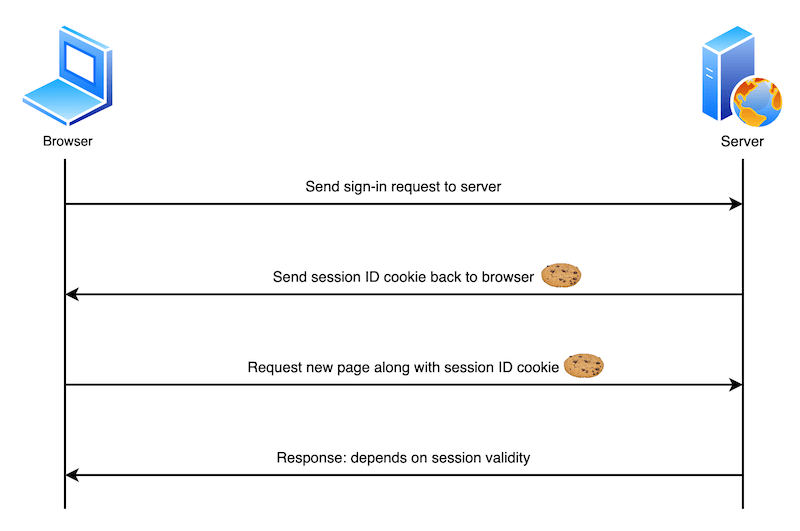
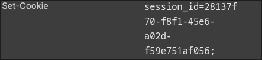
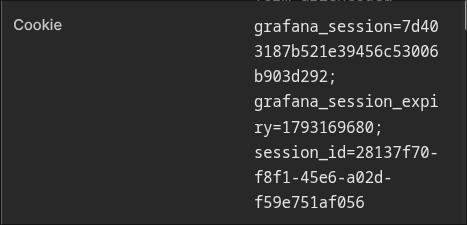

I've been revisiting authentication and authorization, and **cookies and sessions** are a useful place to start. They often work together to let a web application maintain state across requests.

HTTP requests are independent. To connect a new request to an earlier one, a server needs an identifier. A common approach is to give the browser a session ID in a cookie, then use that ID to look up session data on the server.

---

## 🍪 How cookies and sessions work together

A cookie is a small piece of data that the browser stores and sends with matching requests. A session is user-specific state kept by the server, in memory or in an external store. A common design **puts the session ID in a cookie and keeps the actual state on the server**. Cookies and sessions serve different roles in the same flow.

For a login, that flow looks like this:

1. The browser sends credentials to the server.
2. The server verifies them, creates a session, and sends its ID in a cookie.
3. The browser includes that cookie in later requests.
4. The server looks up the session by ID, identifies the user, and responds.



### The headers that carry cookies

A server sets a cookie with the `Set-Cookie` response header. In this example, the browser stores a value named `session_id`:

```http
Set-Cookie: session_id=abc123; Path=/; HttpOnly
```

The browser then adds a `Cookie` header to requests that match the cookie's rules. A semicolon separates multiple cookies:

```http
Cookie: session_id=abc123; theme=dark
```

The server uses the ID to find the session in its own store. The cookie does not contain the server-side session data.

### An Express session example

We can demonstrate the same flow by counting visits instead of implementing login. Save the following code as `app.js`. To keep the example small, it stores sessions in memory; restarting the server clears them.

```javascript
const express = require('express');
const { randomUUID } = require('node:crypto');

const app = express();
const sessions = new Map(); // In-memory store for this example
const cookieName = 'session_id';

// Read session_id from the Cookie header.
function getSessionId(req) {
  const cookie = req.headers.cookie
    ?.split(';')
    .map((part) => part.trim())
    .find((part) => part.startsWith(`${cookieName}=`));
  return cookie?.slice(cookieName.length + 1);
}

app.get('/', (req, res) => {
  const count = sessions.get(getSessionId(req))?.count ?? 0;
  res.send(`<!doctype html>
<html lang="en">
  <head><meta charset="utf-8"><title>Session demo</title></head>
  <body>
    <h1>Session demo</h1>
    <p>Visit count: ${count}</p>
    <form method="post" action="/count"><button>Increase count</button></form>
    <form method="post" action="/reset"><button>Reset</button></form>
  </body>
</html>`);
});

app.post('/count', (req, res) => {
  let sessionId = getSessionId(req);
  let session = sessions.get(sessionId);

  // Issue a new ID if there is no stored session.
  if (!session) {
    sessionId = randomUUID();
    session = { count: 0 };
    sessions.set(sessionId, session);
    res.cookie(cookieName, sessionId);
  }

  session.count += 1;
  res.redirect('/');
});

app.post('/reset', (req, res) => {
  sessions.delete(getSessionId(req));
  res.clearCookie(cookieName);
  res.redirect('/');
});

const port = process.env.PORT || 3000;
app.listen(port, () => {
  console.log(`http://localhost:${port}`);
});
```

Install Express and start the server:

```bash
npm init -y
npm install express
node app.js
```

Open `http://localhost:3000` in a browser and switch to the Network tab in developer tools. Click **Increase count** for the first time. The `/count` response contains a newly issued `session_id` in its `Set-Cookie` header.



Click the button again. The `/count` request now includes that `session_id` in its `Cookie` header, allowing the server to find the same session and increase its count.



Click **Reset**, then increase the count once more. The server issues a new ID because the reset removed both the browser cookie and the server-side session. This example demonstrates state management; it does not implement user authentication or a production session store.

---

## ⏳ Cookie lifetime

The `Expires` and `Max-Age` attributes control how long a browser keeps a cookie.

- **Session cookie:** With neither attribute, it expires when the browser session ends. Browser session restore may preserve it across a restart.
- **Persistent cookie:** It expires at the time set by `Expires` or after the number of seconds set by `Max-Age`. If both are present, `Max-Age` takes precedence.

These attributes control **the cookie stored in the browser**. The server needs a separate expiration policy for its session data.

---

## 🧭 Where cookies are sent

`Domain` and `Path` define which requests receive a cookie. Without `Domain`, the cookie is sent only to the host that set it. With `Domain=example.com`, it can also be sent to subdomains of `example.com`.

With `Path=/docs`, the cookie is sent to `/docs` and paths below `/docs/`. `Path` selects where the browser sends a cookie; it is not a security boundary for access control.

---

## 🔒 Cookie security attributes

### `Secure`

With `Secure`, the browser sends the cookie only over HTTPS. Browsers may make an exception for `localhost` during development, but a production service should use HTTPS.

### `HttpOnly` and XSS

JavaScript cannot read an `HttpOnly` cookie through `document.cookie`. This reduces the risk of an XSS payload stealing a session ID directly. **It does not prevent XSS or stop a malicious script from making authenticated requests.**

XSS occurs when an attacker gets a script to run in a site's context. Common forms include Stored XSS, where malicious input is saved on the server; Reflected XSS, where input appears in a response; and DOM-based XSS, where client-side DOM manipulation creates the vulnerability. Context-aware output escaping, safe DOM APIs, HTML sanitization where needed, and a Content Security Policy help reduce this risk.

### `SameSite` and CSRF

`SameSite` controls whether the browser sends a cookie with requests initiated from another site.

- `Strict`: The cookie is not sent even when a user follows a link from another site.
- `Lax`: The cookie can be sent on a top-level navigation using a safe method, such as following a link, but generally not with a cross-site `POST` form submission.
- `None`: The cookie can be sent with cross-site requests and must also have `Secure`.

CSRF tricks a user's browser into making an **unintended authenticated request**. It relies on the browser attaching cookies automatically. For example, if a bank allowed a transfer through a `GET` request, an attacker could try to trigger one by loading an image:

```html

```

This only works if the browser sends the authentication cookie with that request. With `SameSite=Lax` or `Strict`, a cross-site image request like this does not receive the cookie. More fundamentally, **a `GET` endpoint should not change state**.

Using `POST` for a state change is necessary, but a cross-site form can still be an attack when the cookie is allowed on cross-site requests:

```html
<form action="https://bank.example.com/withdraw" method="POST">
  <input type="hidden" name="account" value="bob" />
  <input type="hidden" name="amount" value="1000000" />
  <input type="hidden" name="for" value="mallory" />
</form>
<script>
  document.querySelector('form').submit();
</script>
```

For state-changing requests, use a **CSRF token that the server validates** and review the session cookie's `SameSite` setting. A form can carry the token in a hidden field, or JavaScript can send it in a request header. `SameSite` alone is not a complete defense in every situation.

XSS runs a script in the site's context; CSRF induces an authenticated request from another site. An XSS vulnerability can also undermine CSRF defenses, so both need attention.

### Applying the attributes to the example

The cookie-setting line in the Express example can be updated as follows. `HttpOnly` prevents scripts from reading the cookie, while `SameSite=Lax` limits when it is sent with cross-site requests.

```javascript
res.cookie(cookieName, sessionId, { httpOnly: true, sameSite: 'lax' });
```

The example runs over local HTTP, so it omits `secure`. For a service using HTTPS, add `secure: true` and configure server-side session expiration and CSRF protection separately.

---

## 📚 References

- [MDN: Using HTTP cookies](https://developer.mozilla.org/en-US/docs/Web/HTTP/Guides/Cookies)
- [MDN: Set-Cookie header](https://developer.mozilla.org/en-US/docs/Web/HTTP/Reference/Headers/Set-Cookie)
- [OWASP: Session Management Cheat Sheet](https://cheatsheetseries.owasp.org/cheatsheets/Session_Management_Cheat_Sheet.html)
- [OWASP: Cross-Site Request Forgery Prevention Cheat Sheet](https://cheatsheetseries.owasp.org/cheatsheets/Cross-Site_Request_Forgery_Prevention_Cheat_Sheet.html)
- [OWASP: Cross Site Scripting Prevention Cheat Sheet](https://cheatsheetseries.owasp.org/cheatsheets/Cross_Site_Scripting_Prevention_Cheat_Sheet.html)
