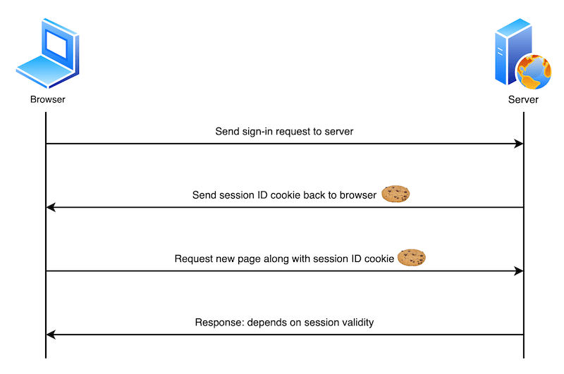
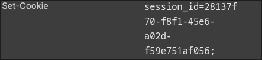
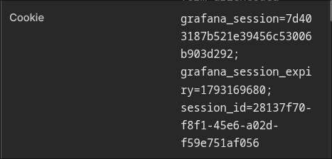

최근 인증과 인가 기술을 다시 정리하고 있다. 그 출발점으로 웹에서 상태를 유지할 때 함께 쓰는 **쿠키와 세션**을 살펴보려 한다.

HTTP 요청은 각각 독립적이다. 서버가 이전 요청을 기억하려면 요청들을 연결할 단서가 필요하다. 흔히 서버는 세션 ID를 발급해 브라우저의 쿠키에 저장하고, 이후 요청에서 받은 ID로 서버 측 세션을 찾는다.

---

## 🍪 쿠키와 세션의 동작 방식

쿠키는 브라우저가 저장하고 조건에 맞는 요청에 실어 보내는 작은 데이터이다. 세션은 서버가 유지하는 사용자별 상태이며, 메모리나 외부 저장소에 둘 수 있다. **쿠키에는 세션 ID를 담고 실제 상태는 서버에 두는 방식**이 흔하다. 핵심은, 둘은 서로 대체하는 개념이 아니라는 것이다.

로그인에 적용하면 흐름은 다음과 같다.

1. 브라우저가 로그인 정보를 서버에 보낸다.
2. 서버가 정보를 검증하고 세션을 만든 뒤, 세션 ID를 쿠키로 발급한다.
3. 브라우저가 다음 요청에 해당 쿠키를 함께 보낸다.
4. 서버가 세션 ID로 세션을 찾아 사용자를 식별하고 응답한다.



### 쿠키를 주고받는 헤더

서버는 응답의 `Set-Cookie` 헤더로 쿠키를 설정한다. 예를 들어 다음 응답을 받으면 브라우저는 `session_id` 값을 저장한다.

```http
Set-Cookie: session_id=abc123; Path=/; HttpOnly
```

이후 브라우저는 쿠키의 전송 조건에 맞는 요청에 `Cookie` 헤더를 붙인다. 여러 쿠키는 세미콜론으로 구분한다.

```http
Cookie: session_id=abc123; theme=dark
```

서버는 이 ID로 자신의 저장소에서 세션을 찾는다. 쿠키 자체가 서버의 세션 데이터를 담는 것은 아니다.

### Express로 세션 흐름 확인하기

로그인 기능 대신 방문 횟수로 같은 흐름을 확인해 보자. 아래 코드를 `app.js`로 저장한다. 실습을 단순하게 하기 위해 세션은 메모리에 저장하며, 서버를 재시작하면 사라진다.

```javascript
const express = require('express');
const { randomUUID } = require('node:crypto');

const app = express();
const sessions = new Map(); // 실습용 메모리 저장소
const cookieName = 'session_id';

// Cookie 헤더에서 session_id 값을 읽는다.
function getSessionId(req) {
  const cookie = req.headers.cookie
    ?.split(';')
    .map((part) => part.trim())
    .find((part) => part.startsWith(`${cookieName}=`));
  return cookie?.slice(cookieName.length + 1);
}

app.get('/', (req, res) => {
  const count = sessions.get(getSessionId(req))?.count ?? 0;
  res.send(`<!doctype html>
<html lang="ko">
  <head><meta charset="utf-8"><title>세션 실습</title></head>
  <body>
    <h1>세션 실습</h1>
    <p>방문 횟수: ${count}</p>
    <form method="post" action="/count"><button>횟수 늘리기</button></form>
    <form method="post" action="/reset"><button>초기화</button></form>
  </body>
</html>`);
});

app.post('/count', (req, res) => {
  let sessionId = getSessionId(req);
  let session = sessions.get(sessionId);

  // 저장된 세션이 없으면 ID를 새로 발급한다.
  if (!session) {
    sessionId = randomUUID();
    session = { count: 0 };
    sessions.set(sessionId, session);
    res.cookie(cookieName, sessionId);
  }

  session.count += 1;
  res.redirect('/');
});

app.post('/reset', (req, res) => {
  sessions.delete(getSessionId(req));
  res.clearCookie(cookieName);
  res.redirect('/');
});

const port = process.env.PORT || 3000;
app.listen(port, () => {
  console.log(`http://localhost:${port}`);
});
```

다음 명령으로 Express를 설치하고 서버를 실행한다.

```bash
npm init -y
npm install express
node app.js
```

브라우저에서 `http://localhost:3000`에 접속하고 개발자 도구의 Network 탭을 연다. **횟수 늘리기**를 처음 누르면 `/count` 응답의 `Set-Cookie` 헤더에서 새 `session_id`를 확인할 수 있다.



다시 누르면 `/count` 요청의 `Cookie` 헤더에 앞서 받은 `session_id`가 들어 있다. 서버가 같은 세션을 찾아 방문 횟수를 이어서 올리는 것이다.



**초기화**를 누른 뒤 다시 횟수를 늘리면 새 ID가 발급된다. 브라우저의 쿠키와 서버의 세션을 함께 지웠기 때문이다. 이 예제는 상태 유지 원리를 보여 주는 실습이며, 사용자 인증이나 운영 환경의 세션 저장소를 구현한 것은 아니다.

---

## ⏳ 쿠키의 유효기간

쿠키의 수명은 `Expires`와 `Max-Age`로 정한다.

- **세션 쿠키:** 두 속성이 없으면 브라우저 세션이 끝날 때 만료된다. 다만 브라우저가 세션을 복원하면 재시작 후에도 남을 수 있다.
- **영속 쿠키:** `Expires`에 지정한 시각이나 `Max-Age`에 지정한 초가 지나면 만료된다. 두 속성을 함께 설정하면 `Max-Age`가 우선한다.

이 수명은 **브라우저에 저장된 쿠키의 수명**이다. 서버에 저장된 세션의 만료 정책은 별도로 관리해야 한다.

---

## 🧭 쿠키의 전송 범위

`Domain`과 `Path`는 브라우저가 쿠키를 보낼 범위를 정한다. `Domain`을 생략하면 쿠키를 설정한 호스트에만 전송된다. `Domain=example.com`을 지정하면 `example.com`과 그 하위 도메인에도 전송될 수 있다.

`Path=/docs`를 지정하면 `/docs`와 `/docs/` 아래 경로에 전송된다. `Path`는 전송 범위를 고르는 속성이지 접근 권한을 분리하는 보안 경계는 아니다.

---

## 🔒 쿠키의 보안 속성

### `Secure`

`Secure`를 설정하면 브라우저는 쿠키를 HTTPS 요청에만 보낸다. 로컬 개발의 `localhost`에는 브라우저별 예외가 있으므로, 실제 서비스에서는 HTTPS를 사용해야 한다.

### `HttpOnly`와 XSS

`HttpOnly` 쿠키는 JavaScript의 `document.cookie`로 읽을 수 없다. XSS로 실행된 스크립트가 세션 ID를 직접 가져가는 위험을 줄이지만, **XSS 자체를 막거나 악성 스크립트의 인증된 요청까지 차단하지는 못한다.**

XSS는 공격자가 웹 페이지의 맥락에서 악성 스크립트를 실행하게 만드는 취약점이다. 입력값이 서버에 저장됐다가 실행되는 Stored XSS, 요청 값이 응답에 반영되는 Reflected XSS, 클라이언트 측 DOM 조작에서 발생하는 DOM-based XSS 등이 있다. 이를 줄이려면 출력 맥락에 맞는 이스케이프, 안전한 DOM API, 필요한 경우 HTML 정화와 Content Security Policy를 함께 적용해야 한다.

### `SameSite`와 CSRF

`SameSite`는 다른 사이트에서 시작된 요청에 쿠키를 보낼지 결정한다.

- `Strict`: 다른 사이트에서 이동해 온 요청에도 쿠키를 보내지 않는다.
- `Lax`: 다른 사이트의 일반 링크를 눌러 이동하는 것처럼 최상위 탐색의 안전한 요청에는 쿠키를 보낼 수 있지만, 일반적인 교차 사이트 `POST` 폼 전송에는 보내지 않는다.
- `None`: 교차 사이트 요청에도 보낸다. 이때 `Secure`가 필요하다.

CSRF는 공격자가 사용자의 브라우저에 **의도하지 않은 인증된 요청**을 보내게 하는 공격이다. 브라우저가 쿠키를 자동으로 붙이는 특성을 악용한다. 예를 들어 은행이 송금 동작을 `GET` 요청으로 허용한다면 다음처럼 이미지 로드를 이용해 요청을 유도할 수 있다.

```html

```

다만 이 방식이 실제로 통하려면 해당 요청에 인증 쿠키가 전송되어야 한다. `SameSite=Lax`나 `Strict`라면 위와 같은 교차 사이트 하위 리소스 요청에는 쿠키가 붙지 않는다. 또한 **상태를 바꾸는 동작을 `GET`으로 제공하지 않는 것**이 기본이다.

상태 변경을 `POST`로 바꿔도, 쿠키가 교차 사이트 요청에 전송되는 설정이라면 공격자는 폼 제출을 유도할 수 있다.

```html
<form action="https://bank.example.com/withdraw" method="POST">
  <input type="hidden" name="account" value="bob" />
  <input type="hidden" name="amount" value="1000000" />
  <input type="hidden" name="for" value="mallory" />
</form>
<script>
  document.querySelector('form').submit();
</script>
```

상태 변경 요청에는 서버가 검증하는 **CSRF 토큰**을 적용하고, 세션 쿠키의 `SameSite` 설정도 함께 검토한다. 토큰은 폼의 숨김 필드나 JavaScript가 설정한 요청 헤더로 전달할 수 있다. `SameSite`만으로 모든 상황의 CSRF 방어를 끝낼 수는 없다.

XSS는 사이트 안에서 스크립트를 실행하는 문제이고, CSRF는 다른 사이트에서 인증된 요청을 유도하는 문제이다. XSS가 있으면 CSRF 방어도 우회될 수 있으므로 둘 다 다뤄야 한다.

### 실습 코드에 속성 적용하기

앞선 예제의 쿠키 발급 부분은 다음처럼 바꿀 수 있다. `HttpOnly`로 스크립트의 쿠키 읽기를 막고, `SameSite=Lax`로 교차 사이트 요청에서 쿠키가 전송되는 범위를 줄인다.

```javascript
res.cookie(cookieName, sessionId, { httpOnly: true, sameSite: 'lax' });
```

예제는 로컬 HTTP로 실행하므로 `secure`는 넣지 않았다. HTTPS를 사용하는 서비스라면 `secure: true`도 설정하고, 세션 만료와 CSRF 토큰 같은 서버 측 정책을 별도로 구성해야 한다.

---

## 📚 References

- [MDN: Using HTTP cookies](https://developer.mozilla.org/en-US/docs/Web/HTTP/Guides/Cookies)
- [MDN: Set-Cookie header](https://developer.mozilla.org/en-US/docs/Web/HTTP/Reference/Headers/Set-Cookie)
- [OWASP: Session Management Cheat Sheet](https://cheatsheetseries.owasp.org/cheatsheets/Session_Management_Cheat_Sheet.html)
- [OWASP: Cross-Site Request Forgery Prevention Cheat Sheet](https://cheatsheetseries.owasp.org/cheatsheets/Cross-Site_Request_Forgery_Prevention_Cheat_Sheet.html)
- [OWASP: Cross Site Scripting Prevention Cheat Sheet](https://cheatsheetseries.owasp.org/cheatsheets/Cross_Site_Scripting_Prevention_Cheat_Sheet.html)
