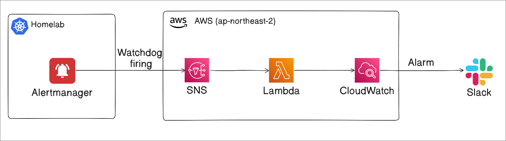
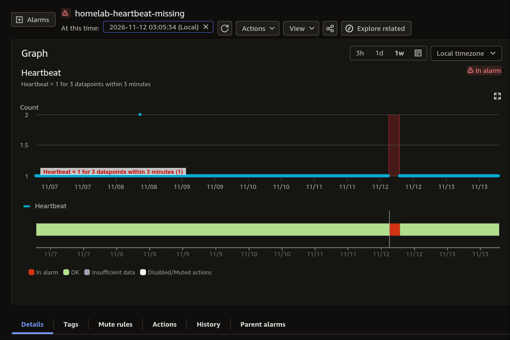
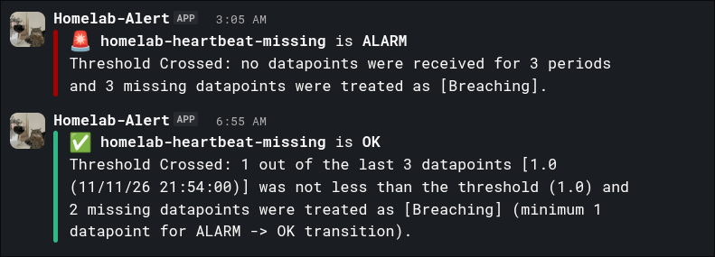

While rebuilding my homelab, I started thinking about how to tell whether the cluster was still alive. Even with a monitoring stack inside the cluster, a home internet outage or a failure of the entire cluster could also cut off its ability to send alerts.

I considered [healthchecks.io](https://healthchecks.io), but I already use AWS for backups and some automation, so I decided to bring the heartbeat stack into AWS as well. Learning how to build it was part of the motivation, too.

---

## 🏗️ Architecture



The idea is to **send a periodic signal while the system is healthy and detect its absence from outside the cluster**.

1. The Watchdog rule in Prometheus generates an alert that is always firing.
2. Alertmanager periodically publishes the Watchdog notification to SNS.
3. SNS invokes a Lambda function, which records a custom metric in CloudWatch.
4. A CloudWatch alarm detects missing metrics and invokes a Lambda function that sends a Slack notification.
5. When metrics arrive again and the alarm returns to `OK`, it sends a recovery notification as well.

This is a Dead Man's Switch: Watchdog provides the heartbeat, and CloudWatch watches for its absence. Instead of storing the last received timestamp in DynamoDB, the stack uses only a custom metric and an alarm to determine its state.

A received heartbeat does not mean every service in the cluster is healthy. It covers the path from Watchdog generation through Alertmanager, the external network, SNS, and metric ingestion.

There are also failures this setup cannot cover.

- AWS failures: an outage in the Seoul region or in the notification path itself could prevent notifications from arriving.
- Individual service failures: if the heartbeat path remains healthy, problems in other workloads still need their own monitoring rules.

The advantages are:

- It builds on my existing AWS environment, reducing the number of additional external services to operate.
- Watchdog's firing state and notification delivery errors can also be checked in the existing monitoring stack.
- The stack itself can be built with IaC.

The tradeoff is a more complex setup than healthchecks.io and a small amount of additional cost.

---

## 💓 A Lambda Function to Record Custom Metrics in CloudWatch

First, create a function that receives SNS messages and records a metric. It checks the source topic and message in the event's `Records`, then records `Heartbeat=1` only when the expected Watchdog message is present.

```python
# lambda_function.py
import os

import boto3


def put_heartbeat_metric():
    client = boto3.client("cloudwatch")
    # Record 1 when a healthy signal arrives.
    client.put_metric_data(
        Namespace=os.environ["HEARTBEAT_NAMESPACE"],
        MetricData=[{"MetricName": "Heartbeat", "Value": 1, "Unit": "Count"}],
    )


def lambda_handler(event, context):
    # Check the SNS event's source topic and message body rather than HTTP headers.
    expected_topic = os.environ["HEARTBEAT_TOPIC_ARN"]
    # Record one healthy signal if any record in this event matches.
    if any(
        record.get("EventSource") == "aws:sns"
        and record.get("Sns", {}).get("TopicArn") == expected_topic
        and record.get("Sns", {}).get("Message") == "Watchdog"
        for record in event.get("Records", [])
    ):
        # Let metric write errors propagate so Lambda can retry the invocation.
        put_heartbeat_metric()

    # SNS does not use this return value as an HTTP response.
    return {"statusCode": 204}
```

The function needs two environment variables.

- `HEARTBEAT_TOPIC_ARN`: the ARN of the SNS topic receiving the heartbeat.
- `HEARTBEAT_NAMESPACE`: the CloudWatch namespace where the metric is recorded. It must match the namespace of the alarm created later.

This function records **the fact that a healthy signal arrived**. Because it uses `any()`, it writes the metric once even if an event contains multiple matching records. [Asynchronous SNS delivery](https://docs.aws.amazon.com/lambda/latest/dg/with-sns.html) can result in duplicate processing, so `Sum` should not be interpreted as an exact count of unique messages.

When no message arrives, the function does not record `0`. That period has no data, and the alarm's `treat_missing_data` setting treats the gap as a failure.

In Terraform, grant the function's execution role `cloudwatch:PutMetricData`. This action cannot be scoped to an individual metric ARN, so use `Resource = "*"` and restrict the writable namespace with a `cloudwatch:namespace` condition.

Here is the Terraform configuration.

```hcl
# Trust policy allowing the Lambda service to assume this execution role.
data "aws_iam_policy_document" "heartbeat_assume_role" {
  statement {
    effect = "Allow"

    principals {
      type        = "Service"
      identifiers = ["lambda.amazonaws.com"]
    }

    actions = ["sts:AssumeRole"]
  }
}

# IAM role used by the heartbeat Lambda to call AWS APIs.
resource "aws_iam_role" "heartbeat" {
  name               = "${var.heartbeat_func_name}-role"
  assume_role_policy = data.aws_iam_policy_document.heartbeat_assume_role.json
}

# Package src so lambda_function.py is at the root of the ZIP archive.
data "archive_file" "heartbeat" {
  type        = "zip"
  source_dir  = "${path.module}/lambda/heartbeat/src"
  output_path = "${path.module}/lambda/heartbeat/function.zip"
}

resource "aws_lambda_function" "heartbeat" {
  filename      = data.archive_file.heartbeat.output_path
  function_name = var.heartbeat_func_name
  role          = aws_iam_role.heartbeat.arn
  handler       = "lambda_function.lambda_handler"
  code_sha256   = data.archive_file.heartbeat.output_base64sha256

  runtime = "python3.14"

  environment {
    variables = {
      HEARTBEAT_NAMESPACE = var.cloudwatch_heartbeat_ns
      HEARTBEAT_TOPIC_ARN = aws_sns_topic.heartbeat_topic.arn
    }
  }
}

# PutMetricData does not support restricting access by metric ARN.
# Use * for Resource and restrict writes with a namespace condition instead.
data "aws_iam_policy_document" "heartbeat_put_metric_data" {
  statement {
    effect = "Allow"

    actions = [
      "cloudwatch:PutMetricData"
    ]

    resources = ["*"]

    condition {
      test     = "StringEquals"
      variable = "cloudwatch:namespace"

      values = [
        var.cloudwatch_heartbeat_ns
      ]
    }
  }
}

# Create an IAM policy from the policy document.
resource "aws_iam_policy" "heartbeat_put_metric_data" {
  name   = "${var.heartbeat_func_name}-put-metric-data"
  path   = "/"
  policy = data.aws_iam_policy_document.heartbeat_put_metric_data.json
}

# Attach the metric write policy to the execution role.
resource "aws_iam_role_policy_attachment" "heartbeat_put_metric_data" {
  role       = aws_iam_role.heartbeat.name
  policy_arn = aws_iam_policy.heartbeat_put_metric_data.arn
}

# Grant basic permissions to write execution logs to CloudWatch Logs.
resource "aws_iam_role_policy_attachment" "heartbeat_cloudwatch_logs" {
  role       = aws_iam_role.heartbeat.name
  policy_arn = "arn:aws:iam::aws:policy/service-role/AWSLambdaBasicExecutionRole"
}

# Retain logs for one day.
resource "aws_cloudwatch_log_group" "heartbeat" {
  name              = "/aws/lambda/${var.heartbeat_func_name}"
  retention_in_days = 1
}
```

---

## 📮 Connecting SNS

I initially implemented this by connecting Lambda to API Gateway. I then chose SNS as the trigger because I wanted to avoid exposing a public endpoint and felt that the SNS approach made the architecture cleaner.

```hcl
# Encrypt with an AWS managed key.
resource "aws_sns_topic" "heartbeat_topic" {
  name              = "homelab-heartbeat"
  kms_master_key_id = "alias/aws/sns"
}

# Deliver messages from this topic to the heartbeat Lambda.
resource "aws_sns_topic_subscription" "user_updates_sqs_target" {
  topic_arn = aws_sns_topic.heartbeat_topic.arn
  protocol  = "lambda"
  endpoint  = aws_lambda_function.heartbeat.arn

  depends_on = [aws_lambda_permission.allow_sns_heartbeat]
}

# Allow SNS to invoke this function only through this topic.
resource "aws_lambda_permission" "allow_sns_heartbeat" {
  statement_id  = "AllowHeartbeatLambdaInvokeFromSNS"
  action        = "lambda:InvokeFunction"
  function_name = aws_lambda_function.heartbeat.function_name
  principal     = "sns.amazonaws.com"

  source_arn = aws_sns_topic.heartbeat_topic.arn
}
```

---

## 🚨 CloudWatch Alarms and Slack Notifications

CloudWatch handles the failure detection.

### A Lambda Function to Send Slack Messages

Save the following code as `lambda/slack_notify/src/lambda_function.py`. It sends a failure message for `ALARM` and a recovery message for `OK`, including the reason for the state change.

```python
# lambda_function.py
import json
import os
from urllib.request import Request, urlopen

import boto3


def lambda_handler(event, context):
    # Event from a direct CloudWatch alarm action invocation.
    if event.get("source") != "aws.cloudwatch" or "alarmData" not in event:
        raise ValueError("Expected a CloudWatch alarm action event")

    # Include the state and reason reported by CloudWatch in the message.
    alarm = event["alarmData"]
    state = alarm["state"]
    name = alarm["alarmName"]
    value = state["value"]
    reason = state.get("reason", "No reason provided")
    # OK: healthy, ALARM: failure.
    icon = ":white_check_mark:" if value == "OK" else ":rotating_light:"
    color = "good" if value == "OK" else "danger"
    message = f"{icon} *{name}* is *{value}*\n{reason}"
    payload = {
        "attachments": [
            {
                "color": color,
                "fallback": f"{name} is {value}: {reason}",
                "text": message,
                "mrkdwn_in": ["text"],
            }
        ]
    }

    secret = boto3.client("secretsmanager").get_secret_value(
        SecretId=os.environ["SLACK_WEBHOOK_SECRET_ARN"]
    )
    webhook_url = secret["SecretString"].strip()
    if not webhook_url.startswith("https://hooks.slack.com/services/"):
        raise ValueError("Slack webhook secret is not an Incoming Webhook URL")

    # Encode the JSON as UTF-8 and POST it to the Slack Incoming Webhook.
    request = Request(
        webhook_url,
        data=json.dumps(payload).encode("utf-8"),
        headers={"Content-Type": "application/json"},
        method="POST",
    )
    with urlopen(request, timeout=5) as response:
        if response.read().strip() != b"ok":
            raise RuntimeError("Slack did not accept the notification")
```

Set `SLACK_WEBHOOK_SECRET_ARN` to the ARN of the Secrets Manager secret containing the Slack Incoming Webhook URL. The secret value must be the URL string itself, rather than a JSON object.

### Creating the Slack Notification Resources

Terraform manages only the secret's metadata. The actual webhook URL is stored separately through the console or another method.

```hcl
# Manage only the secret's metadata in code.
resource "aws_secretsmanager_secret" "slack_webhook" {
  name        = "homelab/slack-notifications-webhook"
  description = "Slack Incoming Webhook for homelab CloudWatch alarms"
}

# IAM role resources for the Slack notification function.
data "aws_iam_policy_document" "slack_notify_assume_role" {
  statement {
    actions = ["sts:AssumeRole"]

    principals {
      type        = "Service"
      identifiers = ["lambda.amazonaws.com"]
    }
  }
}

resource "aws_iam_role" "slack_notify" {
  name               = "homelab-slack-notify-role"
  assume_role_policy = data.aws_iam_policy_document.slack_notify_assume_role.json
}

# Allow the notification function to read only this webhook secret.
data "aws_iam_policy_document" "slack_notify_secret" {
  statement {
    actions   = ["secretsmanager:GetSecretValue"]
    resources = [aws_secretsmanager_secret.slack_webhook.arn]
  }
}

resource "aws_iam_role_policy" "slack_notify_secret" {
  name   = "read-slack-webhook"
  role   = aws_iam_role.slack_notify.id
  policy = data.aws_iam_policy_document.slack_notify_secret.json
}

resource "aws_iam_role_policy_attachment" "slack_notify_logs" {
  role       = aws_iam_role.slack_notify.name
  policy_arn = "arn:aws:iam::aws:policy/service-role/AWSLambdaBasicExecutionRole"
}

# Package the notification function.
data "archive_file" "slack_notify" {
  type        = "zip"
  source_dir  = "${path.module}/lambda/slack_notify/src"
  output_path = "${path.module}/lambda/slack_notify/function.zip"
}

# Set a 10-second timeout, including secret retrieval and HTTP delivery.
resource "aws_lambda_function" "heartbeat_slack_notify" {
  filename      = data.archive_file.slack_notify.output_path
  function_name = "homelab-heartbeat-slack-notify"
  role          = aws_iam_role.slack_notify.arn
  handler       = "lambda_function.lambda_handler"
  code_sha256   = data.archive_file.slack_notify.output_base64sha256
  runtime       = "python3.14"
  timeout       = 10

  environment {
    variables = {
      SLACK_WEBHOOK_SECRET_ARN = aws_secretsmanager_secret.slack_webhook.arn
    }
  }
}

resource "aws_cloudwatch_log_group" "heartbeat_slack_notify" {
  name              = "/aws/lambda/${aws_lambda_function.heartbeat_slack_notify.function_name}"
  retention_in_days = 14
}
```

### Treating Missing Metrics as a Failure

The alarm evaluates the custom metric recorded by Lambda. Its settings mean the following.

| Setting | Meaning |
| --- | --- |
| `statistic = "Sum"`, `period = 60` | Sum the `Heartbeat` values in each 60-second period. |
| `threshold = 1`, `LessThanThreshold` | Treat a period's sum below 1 as breaching the threshold. |
| `evaluation_periods = 3` | Use three data points in the evaluation. |
| `datapoints_to_alarm = 3` | Enter `ALARM` when all three evaluated points are breaching. |
| `treat_missing_data = "breaching"` | Treat missing points as breaching when there is not enough data for evaluation. |

A received heartbeat is recorded as `1`. When heartbeats stop, data is missing. Treating that absence as `breaching` is the key to this setup.

However, **this does not mean a notification arrives exactly three minutes after the last heartbeat**. With its default evaluation behavior, CloudWatch retrieves data from a wider range than the three configured periods. If enough real data points are available, it can use earlier points in the evaluation. The missing-data setting is applied only when needed, so period boundaries and the time it takes for metrics to become available also affect detection time. See [CloudWatch's missing-data evaluation rules](https://docs.aws.amazon.com/AmazonCloudWatch/latest/monitoring/alarms-and-missing-data.html) for details.

```hcl
# Apply a 3-of-3 rule to 60-second metrics and treat missing data as breaching.
resource "aws_cloudwatch_metric_alarm" "heartbeat_missing" {
  alarm_name        = "homelab-heartbeat-missing"
  alarm_description = "Alertmanager Watchdog heartbeat has stopped reaching CloudWatch"
  namespace         = var.cloudwatch_heartbeat_ns
  metric_name       = "Heartbeat"
  # Match the namespace, name, and unit used by the receiving Lambda.
  statistic = "Sum"
  unit      = "Count"
  # Each point is a 60-second sum; enter ALARM when all three evaluated points breach.
  period              = 60
  evaluation_periods  = 3
  datapoints_to_alarm = 3
  threshold           = 1
  comparison_operator = "LessThanThreshold"
  # A missing heartbeat leaves a gap rather than a zero, so treat gaps as breaching.
  treat_missing_data = "breaching"

  # Invoke when the state changes.
  alarm_actions = [aws_lambda_function.heartbeat_slack_notify.arn]
  ok_actions    = [aws_lambda_function.heartbeat_slack_notify.arn]
}

# Allow the service principal dedicated to alarm actions to invoke the function.
resource "aws_lambda_permission" "heartbeat_alarm_invoke" {
  statement_id  = "AllowHeartbeatAlarmInvoke"
  action        = "lambda:InvokeFunction"
  function_name = aws_lambda_function.heartbeat_slack_notify.function_name
  principal     = "lambda.alarms.cloudwatch.amazonaws.com"
  source_arn    = aws_cloudwatch_metric_alarm.heartbeat_missing.arn
}
```

CloudWatch runs `alarm_actions` and `ok_actions` when the state changes to `ALARM` and `OK`, respectively.

---

## ⏱️ Sending Watchdog Notifications from kube-prometheus-stack

The Watchdog rule is designed to remain in the firing state in Prometheus. Configuring Alertmanager to send it repeatedly to SNS turns it into a periodic heartbeat.

The token and volume configuration in the Helm values below is for AWS OIDC Federation. See [OIDC Federation Between Kubernetes and AWS]() for the full setup. Replace `AWS_ROLE_ARN` with the ARN of your own Alertmanager role.

The role needs `sns:Publish` permission for the destination topic. If the topic is encrypted with KMS as in the earlier example, the publishing role also needs `kms:GenerateDataKey*` and `kms:Decrypt` permissions for that key. Check key access as described in the [SNS encryption permissions documentation](https://docs.aws.amazon.com/sns/latest/dg/sns-key-management.html).

```yaml
alertmanager:
  alertmanagerSpec:
    # Mount a ServiceAccount token with STS as its audience into the container.
    volumes:
      - name: aws-token
        projected:
          sources:
            - serviceAccountToken:
                path: aws
                audience: sts.amazonaws.com
                expirationSeconds: 3600
    volumeMounts:
      - name: aws-token
        mountPath: /var/run/secrets/tokens
        readOnly: true
    containers:
      - name: alertmanager
        env:
          - name: AWS_ROLE_ARN
            value: arn:aws:iam::647502392199:role/homelab-alertmanager
          - name: AWS_WEB_IDENTITY_TOKEN_FILE
            value: /var/run/secrets/tokens/aws
          - name: AWS_REGION
            value: ap-northeast-2

    # If the AlertmanagerConfig CR shares Alertmanager's namespace, do not filter alerts by namespace.
    # This allows notifications to match simply on alertname=Watchdog.
    alertmanagerConfigMatcherStrategy:
      type: OnNamespaceExceptForAlertmanagerNamespace

  # Clear the default child route that sends Watchdog to the null receiver.
  config:
    route:
      routes: []
```

Next, create an `AlertmanagerConfig` CR that sends only alerts with `alertname=Watchdog` to the SNS receiver. Replace `<topicARN>` with the ARN of the topic created earlier.

```yaml
apiVersion: monitoring.coreos.com/v1alpha1
kind: AlertmanagerConfig
metadata:
  name: watchdog-heartbeat
  namespace: observability
spec:
  route:
    # Send to the heartbeat receiver defined below.
    receiver: heartbeat
    # Group Watchdog alerts by alertname.
    groupBy:
      - alertname
    # Do not add an initial wait to group the first notification.
    groupWait: 0s
    # Interval for checking group changes and repeat notifications after the first send.
    groupInterval: 1m
    # Resend every minute.
    # Delivery delays and retries mean arrival at exact one-minute intervals is not guaranteed.
    repeatInterval: 1m
    # Select only Watchdog so other alerts are not counted as heartbeats.
    matchers:
      - name: alertname
        value: Watchdog
        matchType: "="
  receivers:
    - name: heartbeat
      snsConfigs:
        - topicARN: <topicARN>
          sendResolved: false
          # Must match the string checked by the receiving Lambda.
          message: Watchdog
          sigv4:
            region: ap-northeast-2
```

---

## ✅ Checking It in Practice

A problem with my home router once cut off my internet connection. Heartbeat metrics stopped arriving, and the CloudWatch alarm entered the failure state. The missing data was treated as a threshold breach.



I could also see the state-change notification in Slack.



---

## 💸 Cost

[Secrets Manager pricing](https://aws.amazon.com/secrets-manager/pricing/) is $0.40 per secret per month, with API requests billed separately. This setup reads the secret when sending a Slack message, so those requests are infrequent.

To reduce that cost, another option is to put the webhook URL in a Lambda environment variable. If Terraform passes the value into the environment variable, however, it will be included in `tfstate`, so the state file needs to be managed carefully.

The total also includes CloudWatch custom metrics and alarms, SNS, Lambda, and log storage. Most of these components have very low usage in this setup relative to their monthly free allowances.

---

## 📚 References

- [Homelab repository](https://github.com/fudoge/homelab)
- [healthchecks.io](https://healthchecks.io)
- [Terraform AWS Provider](https://registry.terraform.io/providers/hashicorp/aws)
- [Boto3 CloudWatch API](https://docs.aws.amazon.com/boto3/latest/reference/services/cloudwatch.html)
- [kube-prometheus-stack Helm chart](https://artifacthub.io/packages/helm/prometheus-community/kube-prometheus-stack)
- [Watchdog runbook](https://runbooks.prometheus-operator.dev/runbooks/general/watchdog/)
- [Prometheus Operator: Alerting](https://prometheus-operator.dev/docs/developer/alerting/)
- [Prometheus Operator API reference](https://prometheus-operator.dev/docs/api-reference/api/)
- [Alertmanager configuration](https://prometheus.io/docs/alerting/latest/configuration/)
- [Using Lambda with SNS](https://docs.aws.amazon.com/lambda/latest/dg/with-sns.html)
- [CloudWatch alarm missing-data handling](https://docs.aws.amazon.com/AmazonCloudWatch/latest/monitoring/alarms-and-missing-data.html)
- [Invoking Lambda from a CloudWatch alarm](https://docs.aws.amazon.com/AmazonCloudWatch/latest/monitoring/alarms-and-actions-Lambda.html)
- [SNS encryption keys and permissions](https://docs.aws.amazon.com/sns/latest/dg/sns-key-management.html)
- [AWS Secrets Manager pricing](https://aws.amazon.com/secrets-manager/pricing/)
