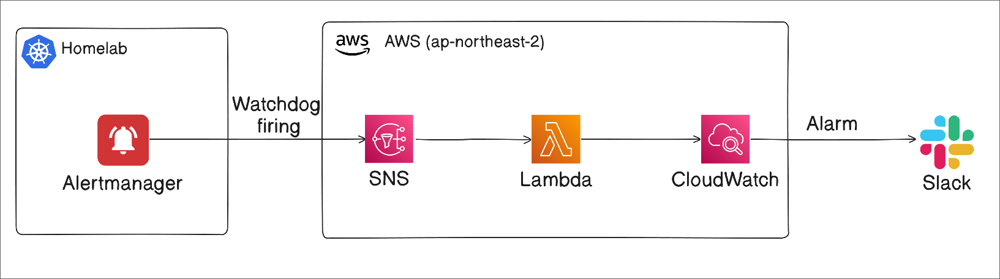
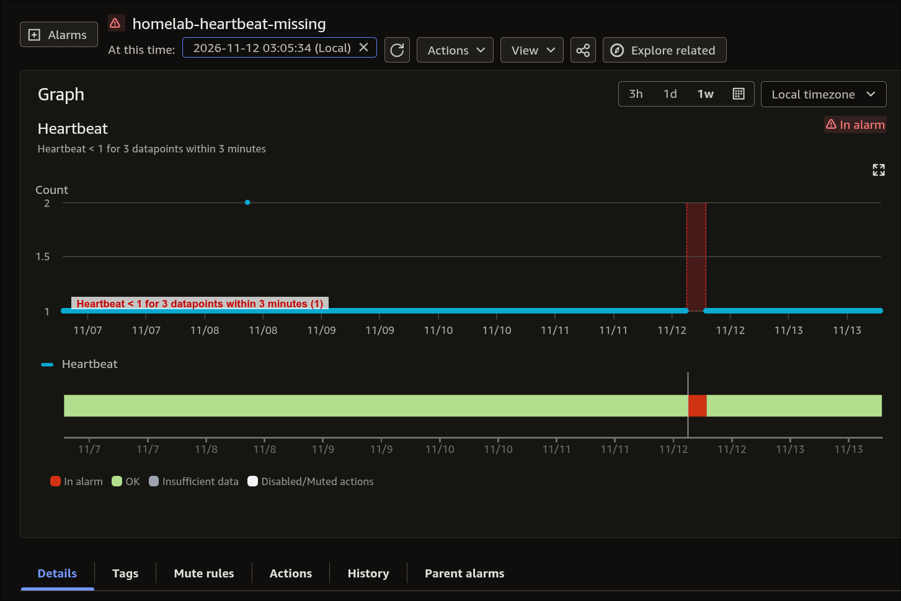
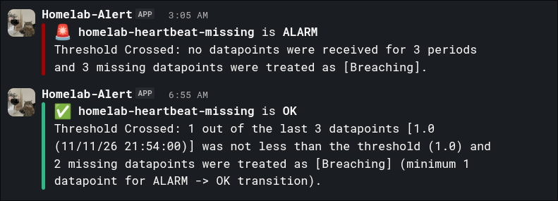

홈랩을 새로 파는 와중에, 클러스터가 살아 있는지 어떻게 확인할지 고민했다. 클러스터 내부에 모니터링 스택이 있어도, 집의 인터넷 연결이나 클러스터 전체가 멈추면 그 스택에서 보내는 장애 알림도 함께 끊길 수 있기 때문이다.

[healthchecks.io](https://healthchecks.io)를 이용할까도 했지만, 이미 백업과 일부 자동화에 AWS를 사용하고 있어 헬스체크 스택도 AWS로 통합해 보기로 했다. 학습 목적도 일부 있다.

---

## 🏗️ 주요 아키텍처



핵심 아이디어는 **정상일 때 주기적으로 신호를 보내고, 외부에서 그 신호가 끊기는 것을 감지하는 것**이다.

1. Prometheus의 Watchdog 규칙이 항상 firing 상태인 알림을 생성한다.
2. Alertmanager가 Watchdog 알림을 주기적으로 SNS에 발행한다.
3. SNS가 Lambda 함수를 호출하고, Lambda가 CloudWatch에 커스텀 메트릭을 기록한다.
4. CloudWatch Alarm이 메트릭 누락을 감지하면 Slack 알림용 Lambda를 호출한다.
5. 메트릭이 다시 들어와 Alarm이 `OK`로 전환되면 복구 알림도 보낸다.

Watchdog을 heartbeat로 사용하고, CloudWatch가 이 신호의 부재를 감시하는 Dead Man's Switch 구성이다. DynamoDB에 마지막 수신 시각을 따로 저장하지 않고, 커스텀 메트릭과 Alarm만으로 상태를 판단하는 구조이다.

다만, 이 신호가 도착한다고 해서 클러스터의 모든 서비스가 정상이라는 뜻은 아니다. 확인하는 범위는 Watchdog 생성부터 Alertmanager, 외부 네트워크, SNS, 메트릭 기록까지의 경로이다.

이 구성으로 잡지 못하는 문제도 있다.

- AWS의 장애: 서울 리전이나 알림 경로 자체에 장애가 생기면 알림이 오지 않을 수 있다.
- 개별 서비스의 장애: heartbeat 경로가 살아 있다면 다른 워크로드의 문제는 기존 모니터링 규칙으로 따로 감지해야 한다.

장점은 다음과 같다.

- 기존 AWS 환경을 활용해 추가로 운영할 외부 서비스를 줄일 수 있다.
- Watchdog의 firing 상태와 전송 오류를 기존 모니터링 스택에서도 확인할 수 있다.
- 이 스택 자체도 IaC로 구축할 수 있다.

반면, healthchecks.io에 비해 구성이 복잡하고 약간의 비용이 생기는 것도 감수해야 한다.

---

## 💓 CloudWatch에 커스텀 메트릭을 기록하는 Lambda 함수

먼저 SNS 메시지를 받아 메트릭을 기록하는 함수를 만든다. SNS가 넘기는 이벤트의 `Records`에서 발신 토픽과 메시지를 확인하고, 기대한 Watchdog 메시지가 있을 때만 `Heartbeat=1`을 기록한다.

```python
# lambda_function.py
import os

import boto3


def put_heartbeat_metric():
    client = boto3.client("cloudwatch")
    # 정상 신호가 도착했을 때 1을 기록.
    client.put_metric_data(
        Namespace=os.environ["HEARTBEAT_NAMESPACE"],
        MetricData=[{"MetricName": "Heartbeat", "Value": 1, "Unit": "Count"}],
    )


def lambda_handler(event, context):
    # HTTP 헤더 대신 SNS 이벤트의 발신 토픽과 메시지 본문을 확인한다.
    expected_topic = os.environ["HEARTBEAT_TOPIC_ARN"]
    # 한 이벤트에서 일치하는 레코드를 하나라도 찾으면 정상 신호를 한 번 기록한다.
    if any(
        record.get("EventSource") == "aws:sns"
        and record.get("Sns", {}).get("TopicArn") == expected_topic
        and record.get("Sns", {}).get("Message") == "Watchdog"
        for record in event.get("Records", [])
    ):
        # 메트릭 기록에 실패 시, exception을 전달하여 Lambda가 재시도하도록 한다.
        put_heartbeat_metric()

    # 실제 SNS는 아래와 같은 HTTP응답에는 무관하다.
    return {"statusCode": 204}
```

환경 변수는 다음 두 가지이다.

- `HEARTBEAT_TOPIC_ARN`: heartbeat를 받는 SNS 토픽의 ARN
- `HEARTBEAT_NAMESPACE`: 메트릭을 기록할 CloudWatch namespace. 뒤에서 만드는 Alarm의 namespace와 같아야 한다.

이 함수는 **정상 신호가 도착했다는 사실**을 기록한다. `any()`를 사용하므로 한 이벤트 안에 조건에 맞는 레코드가 여러 개 있어도 메트릭은 한 번만 기록한다. [SNS의 비동기 전달](https://docs.aws.amazon.com/lambda/latest/dg/with-sns.html)에서는 중복 처리가 생길 수 있으므로, `Sum`이 정확한 고유 메시지 수를 의미하지 않는다고 이해하면 된다.

메시지가 오지 않더라도 `0`을 기록하지 않는데, 해당 구간의 데이터가 비게 되고, 뒤에서 `treat_missing_data`로 이를 장애로 취급한다.

Terraform에서는 함수의 실행 역할에 `cloudwatch:PutMetricData` 권한을 부여한다. 이 작업은 개별 메트릭 ARN으로 제한할 수 없으므로 `Resource = "*"`를 사용하고, 대신 `cloudwatch:namespace` 조건으로 기록 가능한 namespace를 제한해야 한다.

아래는 Terraform 예시이다.

```hcl
# Lambda 서비스가 이 실행 역할을 맡을 수 있게 하는 trust policy
data "aws_iam_policy_document" "heartbeat_assume_role" {
  statement {
    effect = "Allow"

    principals {
      type        = "Service"
      identifiers = ["lambda.amazonaws.com"]
    }

    actions = ["sts:AssumeRole"]
  }
}

# heartbeat lambda가 AWS API를 호출할 때 사용할 IAM Role
resource "aws_iam_role" "heartbeat" {
  name               = "${var.heartbeat_func_name}-role"
  assume_role_policy = data.aws_iam_policy_document.heartbeat_assume_role.json
}

# src 안의 lambda_function.py가 ZIP 루트에 위치하도록 패키징
data "archive_file" "heartbeat" {
  type        = "zip"
  source_dir  = "${path.module}/lambda/heartbeat/src"
  output_path = "${path.module}/lambda/heartbeat/function.zip"
}

resource "aws_lambda_function" "heartbeat" {
  filename      = data.archive_file.heartbeat.output_path
  function_name = var.heartbeat_func_name
  role          = aws_iam_role.heartbeat.arn
  handler       = "lambda_function.lambda_handler"
  code_sha256   = data.archive_file.heartbeat.output_base64sha256

  runtime = "python3.14"

  environment {
    variables = {
      HEARTBEAT_NAMESPACE = var.cloudwatch_heartbeat_ns
      HEARTBEAT_TOPIC_ARN = aws_sns_topic.heartbeat_topic.arn
    }
  }
}

# PutMetricData는 메트릭 ARN 단위 제한을 지원하지 않으므로,
# Resource는 *로 두되 namespace 조건으로 쓰기 범위를 제한.
data "aws_iam_policy_document" "heartbeat_put_metric_data" {
  statement {
    effect = "Allow"

    actions = [
      "cloudwatch:PutMetricData"
    ]

    resources = ["*"]

    condition {
      test     = "StringEquals"
      variable = "cloudwatch:namespace"

      values = [
        var.cloudwatch_heartbeat_ns
      ]
    }
  }
}

# 정책 문서를 실제 IAM policy로 생성
resource "aws_iam_policy" "heartbeat_put_metric_data" {
  name   = "${var.heartbeat_func_name}-put-metric-data"
  path   = "/"
  policy = data.aws_iam_policy_document.heartbeat_put_metric_data.json
}

# 생성한 메트릭 기록 정책을 실행 역할에 연결
resource "aws_iam_role_policy_attachment" "heartbeat_put_metric_data" {
  role       = aws_iam_role.heartbeat.name
  policy_arn = aws_iam_policy.heartbeat_put_metric_data.arn
}

# 실행 로그를 CloudWatch Logs에 기록할 수 있도록 기본 권한을 부여
resource "aws_iam_role_policy_attachment" "heartbeat_cloudwatch_logs" {
  role       = aws_iam_role.heartbeat.name
  policy_arn = "arn:aws:iam::aws:policy/service-role/AWSLambdaBasicExecutionRole"
}

# 로그 보관 기간을 1일로 제한
resource "aws_cloudwatch_log_group" "heartbeat" {
  name              = "/aws/lambda/${var.heartbeat_func_name}"
  retention_in_days = 1
}
```

---

## 📮 SNS 연결

처음에는 API Gateway에 Lambda를 붙이는 방식으로 구현했다. 그러나 공개 엔드포인트를 노출하기 싫은 것도 있고, SNS로 연결하는 것이 더 깔끔한 구조라고 생각해서 SNS로 트리거하는 방식을 선택했다.

```hcl
# AWS managed key로 암호화한다.
resource "aws_sns_topic" "heartbeat_topic" {
  name              = "homelab-heartbeat"
  kms_master_key_id = "alias/aws/sns"
}

# 이 토픽의 메시지를 heartbeat Lambda로 전달
resource "aws_sns_topic_subscription" "user_updates_sqs_target" {
  topic_arn = aws_sns_topic.heartbeat_topic.arn
  protocol  = "lambda"
  endpoint  = aws_lambda_function.heartbeat.arn

  depends_on = [aws_lambda_permission.allow_sns_heartbeat]
}

# SNS 서비스가 이 토픽을 통해서만 함수를 호출하도록 제한
resource "aws_lambda_permission" "allow_sns_heartbeat" {
  statement_id  = "AllowHeartbeatLambdaInvokeFromSNS"
  action        = "lambda:InvokeFunction"
  function_name = aws_lambda_function.heartbeat.function_name
  principal     = "sns.amazonaws.com"

  source_arn = aws_sns_topic.heartbeat_topic.arn
}
```

---

## 🚨 CloudWatch Alarm과 Slack 알림

장애 판단은 CloudWatch Alarm에서 진행된다.

### Slack 메시지를 보내는 Lambda 함수

아래 코드를 `lambda/slack_notify/src/lambda_function.py`에 저장한다. `ALARM`이면 장애 메시지를, `OK`이면 복구 메시지를 보내며, 상태 변경 사유도 함께 표시한다.

```python
# lambda_function.py
import json
import os
from urllib.request import Request, urlopen

import boto3


def lambda_handler(event, context):
    # Alarm action의 직접 호출 이벤트
    if event.get("source") != "aws.cloudwatch" or "alarmData" not in event:
        raise ValueError("Expected a CloudWatch alarm action event")

    # CloudWatch가 판단한 상태와 사유를 그대로 메시지에 담기
    alarm = event["alarmData"]
    state = alarm["state"]
    name = alarm["alarmName"]
    value = state["value"]
    reason = state.get("reason", "No reason provided")
    # OK: 정상, ALARM: 장애
    icon = ":white_check_mark:" if value == "OK" else ":rotating_light:"
    color = "good" if value == "OK" else "danger"
    message = f"{icon} *{name}* is *{value}*\n{reason}"
    payload = {
        "attachments": [
            {
                "color": color,
                "fallback": f"{name} is {value}: {reason}",
                "text": message,
                "mrkdwn_in": ["text"],
            }
        ]
    }

    secret = boto3.client("secretsmanager").get_secret_value(
        SecretId=os.environ["SLACK_WEBHOOK_SECRET_ARN"]
    )
    webhook_url = secret["SecretString"].strip()
    if not webhook_url.startswith("https://hooks.slack.com/services/"):
        raise ValueError("Slack webhook secret is not an Incoming Webhook URL")

    # JSON을 UTF-8로 인코딩해 Slack Incoming Webhook으로 POST
    request = Request(
        webhook_url,
        data=json.dumps(payload).encode("utf-8"),
        headers={"Content-Type": "application/json"},
        method="POST",
    )
    with urlopen(request, timeout=5) as response:
        if response.read().strip() != b"ok":
            raise RuntimeError("Slack did not accept the notification")
```

환경 변수 `SLACK_WEBHOOK_SECRET_ARN`에는 Slack Incoming Webhook URL을 저장한 Secrets Manager 시크릿의 ARN을 넣는다. 시크릿 값은 JSON 객체가 아니라 URL 문자열 자체여야 한다.

### Slack 알림용 리소스 생성

Terraform에서는 시크릿의 메타데이터만 만들고, 실제 Webhook URL은 콘솔 등에서 별도로 저장하도록 하였다.

```hcl
# 시크릿 메타데이터만 코드로 관리
resource "aws_secretsmanager_secret" "slack_webhook" {
  name        = "homelab/slack-notifications-webhook"
  description = "Slack Incoming Webhook for homelab CloudWatch alarms"
}

# Slack 알림용 함수를 위한 IAM Role 관련 리소스들
data "aws_iam_policy_document" "slack_notify_assume_role" {
  statement {
    actions = ["sts:AssumeRole"]

    principals {
      type        = "Service"
      identifiers = ["lambda.amazonaws.com"]
    }
  }
}

resource "aws_iam_role" "slack_notify" {
  name               = "homelab-slack-notify-role"
  assume_role_policy = data.aws_iam_policy_document.slack_notify_assume_role.json
}

# 알림 함수는 이 Webhook 시크릿 하나만 읽을 수 있다.
data "aws_iam_policy_document" "slack_notify_secret" {
  statement {
    actions   = ["secretsmanager:GetSecretValue"]
    resources = [aws_secretsmanager_secret.slack_webhook.arn]
  }
}

resource "aws_iam_role_policy" "slack_notify_secret" {
  name   = "read-slack-webhook"
  role   = aws_iam_role.slack_notify.id
  policy = data.aws_iam_policy_document.slack_notify_secret.json
}

resource "aws_iam_role_policy_attachment" "slack_notify_logs" {
  role       = aws_iam_role.slack_notify.name
  policy_arn = "arn:aws:iam::aws:policy/service-role/AWSLambdaBasicExecutionRole"
}

# 알림용 함수
data "archive_file" "slack_notify" {
  type        = "zip"
  source_dir  = "${path.module}/lambda/slack_notify/src"
  output_path = "${path.module}/lambda/slack_notify/function.zip"
}

# URL 조회와 HTTP 전송 시간을 포함해 함수 실행 한도는 10초로 설정
resource "aws_lambda_function" "heartbeat_slack_notify" {
  filename      = data.archive_file.slack_notify.output_path
  function_name = "homelab-heartbeat-slack-notify"
  role          = aws_iam_role.slack_notify.arn
  handler       = "lambda_function.lambda_handler"
  code_sha256   = data.archive_file.slack_notify.output_base64sha256
  runtime       = "python3.14"
  timeout       = 10

  environment {
    variables = {
      SLACK_WEBHOOK_SECRET_ARN = aws_secretsmanager_secret.slack_webhook.arn
    }
  }
}

resource "aws_cloudwatch_log_group" "heartbeat_slack_notify" {
  name              = "/aws/lambda/${aws_lambda_function.heartbeat_slack_notify.function_name}"
  retention_in_days = 14
}
```

### 메트릭 누락을 장애로 판단하기

Alarm은 Lambda가 기록한 커스텀 메트릭을 평가한다. 설정의 의미는 다음과 같다.

| 설정 | 의미 |
| --- | --- |
| `statistic = "Sum"`, `period = 60` | 60초 구간마다 `Heartbeat` 값의 합계를 구한다. |
| `threshold = 1`, `LessThanThreshold` | 구간 합계가 1보다 작으면 임계값 위반으로 판단한다. |
| `evaluation_periods = 3` | 평가에 사용할 데이터 포인트 수는 3개이다. |
| `datapoints_to_alarm = 3` | 평가한 3개가 모두 위반일 때 `ALARM`으로 전환한다. |
| `treat_missing_data = "breaching"` | 평가에 필요한 데이터가 부족하면 누락된 포인트를 위반으로 취급한다. |

정상일 때는 수신한 heartbeat가 `1`로 기록된다. 수신이 멈추면 데이터가 누락된다. 이 누락을 `breaching`으로 처리하는 것이 핵심이다.

다만 **마지막 heartbeat를 받은 시점부터 정확히 3분 뒤에 알림이 오는 것은 아니다**. 기본 평가 방식에서 CloudWatch는 지정한 3개 구간보다 넓은 범위의 데이터를 조회하고, 실제 데이터가 충분하면 이전 포인트를 평가에 사용할 수 있다. 필요한 경우에만 누락 데이터 처리 설정을 적용하므로, 구간 경계와 메트릭 반영 시점도 감지 시간에 영향을 준다. 자세한 규칙은 [CloudWatch의 누락 데이터 평가 문서](https://docs.aws.amazon.com/AmazonCloudWatch/latest/monitoring/alarms-and-missing-data.html)를 참고하면 된다.

```hcl
# 60초 단위 메트릭에 3-of-3 조건을 적용, 누락은 임계값 위반으로 취급한다.
resource "aws_cloudwatch_metric_alarm" "heartbeat_missing" {
  alarm_name        = "homelab-heartbeat-missing"
  alarm_description = "Alertmanager Watchdog heartbeat has stopped reaching CloudWatch"
  namespace         = var.cloudwatch_heartbeat_ns
  metric_name       = "Heartbeat"
  # namespace, 이름, 단위를 수신 Lambda가 기록한 메트릭과 맞추기
  statistic = "Sum"
  unit      = "Count"
  # 각 포인트는 60초 합계이며, 평가한 3개가 모두 위반일 때 ALARM
  period              = 60
  evaluation_periods  = 3
  datapoints_to_alarm = 3
  threshold           = 1
  comparison_operator = "LessThanThreshold"
  # heartbeat가 끊길 시, 0 대신 누락이 생기므로 누락을 위반으로 취급한다.
  treat_missing_data = "breaching"

  # 상태가 바뀔 때 호출됨
  alarm_actions = [aws_lambda_function.heartbeat_slack_notify.arn]
  ok_actions    = [aws_lambda_function.heartbeat_slack_notify.arn]
}

# Alarm action 전용 서비스 주체에 호출을 허용한다.
resource "aws_lambda_permission" "heartbeat_alarm_invoke" {
  statement_id  = "AllowHeartbeatAlarmInvoke"
  action        = "lambda:InvokeFunction"
  function_name = aws_lambda_function.heartbeat_slack_notify.function_name
  principal     = "lambda.alarms.cloudwatch.amazonaws.com"
  source_arn    = aws_cloudwatch_metric_alarm.heartbeat_missing.arn
}
```

CloudWatch는 `ALARM`과 `OK`로 상태가 바뀔 때 각각 `alarm_actions`와 `ok_actions`를 실행한다.

---

## ⏱️ kube-prometheus-stack에서 Watchdog 알림 보내기

Watchdog 규칙은 Prometheus에서 항상 firing 상태를 유지하도록 만든 알림이다. Alertmanager가 이를 SNS로 반복 전송하도록 설정하면 주기적인 heartbeat로 사용할 수 있다.

아래 Helm values의 토큰과 볼륨 설정은 AWS OIDC Federation을 위한 것이다. 자세한 구성은 [Kubernetes와 AWS의 OIDC Federation]() 글을 참고하면 된다. `AWS_ROLE_ARN`은 자신의 Alertmanager 역할 ARN으로 바꿔야 한다.

이 역할에는 대상 토픽에 대한 `sns:Publish` 권한이 필요하다. 앞의 예시처럼 SNS 토픽을 KMS로 암호화했다면, 발행 역할에 해당 키의 `kms:GenerateDataKey*`와 `kms:Decrypt` 권한도 필요하다. [SNS 암호화 권한 문서](https://docs.aws.amazon.com/sns/latest/dg/sns-key-management.html)에 따라 키 접근 권한도 함께 확인한다.

```yaml
alertmanager:
  alertmanagerSpec:
    # STS를 audience로 하는 ServiceAccount 토큰을 컨테이너에 마운트한다.
    volumes:
      - name: aws-token
        projected:
          sources:
            - serviceAccountToken:
                path: aws
                audience: sts.amazonaws.com
                expirationSeconds: 3600
    volumeMounts:
      - name: aws-token
        mountPath: /var/run/secrets/tokens
        readOnly: true
    containers:
      - name: alertmanager
        env:
          - name: AWS_ROLE_ARN
            value: arn:aws:iam::647502392199:role/homelab-alertmanager
          - name: AWS_WEB_IDENTITY_TOKEN_FILE
            value: /var/run/secrets/tokens/aws
          - name: AWS_REGION
            value: ap-northeast-2

    # AlertmanagerConfig CR의 namespace가 Alertmanager와 같으면, Alert 자체의 namespace는 필터하지 않는다.
    # 즉, 단순하게 alertname=Watchdog만으로 알림을 보낼 수 있다.
    alertmanagerConfigMatcherStrategy:
      type: OnNamespaceExceptForAlertmanagerNamespace

  # Watchdog을 null receiver로 보내던 기본 하위 route를 비운다.
  config:
    route:
      routes: []
```

이후 `AlertmanagerConfig` CR을 만들어 `alertname=Watchdog`인 알림만 SNS receiver로 보낸다. `<topicARN>`에는 앞에서 만든 토픽 ARN을 넣는다.

```yaml
apiVersion: monitoring.coreos.com/v1alpha1
kind: AlertmanagerConfig
metadata:
  name: watchdog-heartbeat
  namespace: observability
spec:
  route:
    # 아래 receivers에 정의한 heartbeat로 전달
    receiver: heartbeat
    # Watchdog 알림을 alertname 기준으로 묶기
    groupBy:
      - alertname
    # 첫 알림을 묶기 위한 추가 대기 시간 없음
    groupWait: 0s
    # 첫 전송 이후 그룹 변경과 반복 전송 여부를 확인하는 간격
    groupInterval: 1m
    # 1분 간격으로 다시 전송
    # 전송 지연과 재시도로 인해 정확히 매 분 도착을 보장하지는 않음
    repeatInterval: 1m
    # 다른 알림을 heartbeat로 세지 않도록 Watchdog만 선택
    matchers:
      - name: alertname
        value: Watchdog
        matchType: "="
  receivers:
    - name: heartbeat
      snsConfigs:
        - topicARN: <topicARN>
          sendResolved: false
          # 수신 Lambda가 매칭하는 문자열과 같아야 함
          message: Watchdog
          sigv4:
            region: ap-northeast-2
```

---

## ✅ 동작 확인

실제로 집에서 공유기에 문제가 생겨 인터넷 연결이 끊긴 적이 있었다. 이때 heartbeat 메트릭 수신도 중단되어 CloudWatch Alarm이 장애 상태로 전환되었다. 데이터 누락으로 인해 임계값 위반으로 결과가 나왔다.



Slack에서도 상태 변경 알림을 확인할 수 있었다.



---

## 💸 비용

[Secrets Manager 요금](https://aws.amazon.com/secrets-manager/pricing/)은 시크릿 하나당 월 $0.40이고, API호출 비용은 별개이지만, Slack 메시지를 보낼 때 쓰이므로 사실상 매우 희소하다고 볼 수 있다.

이 지출도 줄이고 싶다면 Webhook URL을 Lambda 환경 변수로 넣는 방법도 있다. 다만 Terraform 변수로 전달해 환경 변수에 넣으면 값이 `tfstate`에 포함되므로 상태 파일을 잘 관리할 필요가 있다.

전체 비용에는 Secrets Manager뿐 아니라 CloudWatch 커스텀 메트릭과 Alarm, SNS, Lambda, 로그 저장 등이 있으나, 대부분은 월 무료한도 안에서도 매우 여유로운 사용량이다.

---

## 📚 References

- [홈랩 repository](https://github.com/fudoge/homelab)
- [healthchecks.io](https://healthchecks.io)
- [Terraform AWS Provider](https://registry.terraform.io/providers/hashicorp/aws)
- [Boto3 CloudWatch API](https://docs.aws.amazon.com/boto3/latest/reference/services/cloudwatch.html)
- [kube-prometheus-stack Helm chart](https://artifacthub.io/packages/helm/prometheus-community/kube-prometheus-stack)
- [Watchdog runbook](https://runbooks.prometheus-operator.dev/runbooks/general/watchdog/)
- [Prometheus Operator: Alerting](https://prometheus-operator.dev/docs/developer/alerting/)
- [Prometheus Operator API reference](https://prometheus-operator.dev/docs/api-reference/api/)
- [Alertmanager configuration](https://prometheus.io/docs/alerting/latest/configuration/)
- [Lambda와 SNS 연동](https://docs.aws.amazon.com/lambda/latest/dg/with-sns.html)
- [CloudWatch Alarm의 누락 데이터 처리](https://docs.aws.amazon.com/AmazonCloudWatch/latest/monitoring/alarms-and-missing-data.html)
- [CloudWatch Alarm에서 Lambda 호출](https://docs.aws.amazon.com/AmazonCloudWatch/latest/monitoring/alarms-and-actions-Lambda.html)
- [SNS 암호화 키와 권한](https://docs.aws.amazon.com/sns/latest/dg/sns-key-management.html)
- [AWS Secrets Manager 요금](https://aws.amazon.com/secrets-manager/pricing/)
