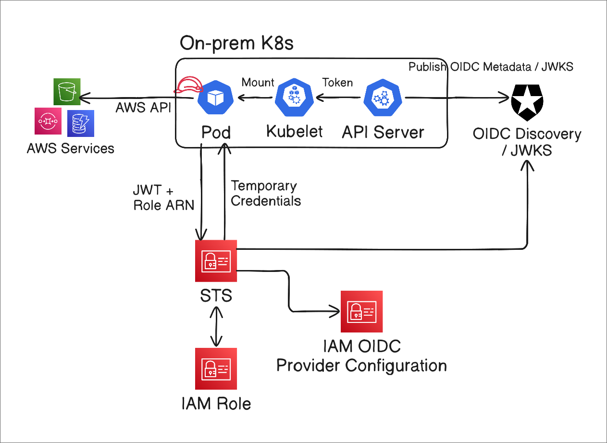

---

## 📝 Overview

Pods running in an on-premises Kubernetes cluster need AWS credentials to access AWS services. **Assuming an IAM role to obtain temporary credentials** reduces the burden of distributing and managing long-term credentials such as access keys.

Common approaches include:

| Approach | How it works | When to use it |
| --- | --- | --- |
| **OIDC Federation** | Exchanges a Kubernetes ServiceAccount JWT for temporary IAM role credentials | General on-premises Kubernetes environments |
| IAM Roles Anywhere | Uses X.509 certificates to obtain temporary AWS credentials | Environments where publishing OIDC information externally is difficult, or where an internal PKI is available |
| EKS Anywhere + IRSA | Integrates ServiceAccounts with IAM in EKS Anywhere | Environments running EKS Anywhere |

This post uses OIDC Federation. We will configure AWS to validate tokens issued by Kubernetes, then use those tokens to assume an IAM role from a Pod.

---

## 🏗️ Architecture

The overall architecture looks like this:



The flow is as follows:

1. Publish the API server's OIDC discovery document and JWKS containing its public keys at HTTPS endpoints that AWS can reach. These can be served directly by the API server or through separate public endpoints.
2. When a Pod is created, the kubelet requests a ServiceAccount token through the API server's TokenRequest API and mounts it into the Pod.
3. The AWS SDK in the Pod sends the ServiceAccount token and the target role ARN to AWS STS through `AssumeRoleWithWebIdentity`.
4. STS validates the token using the information registered in the IAM OIDC provider, checks the role's trust policy conditions, and returns temporary credentials.
5. The Pod uses those credentials to call AWS APIs allowed by the IAM role.

Here, **only the OIDC discovery document and JWKS are published through Cloudflare R2**, keeping the Kubernetes API server itself private.

---

## 🔑 Exposing OIDC Discovery and JWKS

### Configuring the API server

kube-apiserver supports ServiceAccount issuer discovery. This lets Kubernetes act as the token issuer, or IdP, while an external system such as AWS acts as the relying party (RP) that validates the tokens.

Assuming ServiceAccount token issuance and signing keys are already configured, set the public issuer and JWKS URLs with these flags:

- `--service-account-issuer`: the issuer URL included in the token's `iss` claim
- `--service-account-jwks-uri`: the public JWKS URL included in the discovery document's `jwks_uri` field

For example, if the public address is `https://oidc.chaewoon.work`, use the following settings. The remaining examples use this address as well; replace it with your own domain.

```text
--service-account-issuer=https://oidc.chaewoon.work
--service-account-jwks-uri=https://oidc.chaewoon.work/openid/v1/jwks
```

Once configured, the API server serves the OIDC discovery document at `/.well-known/openid-configuration` and the JWKS at `/openid/v1/jwks`. These documents are not fully OIDC compliant; they provide the information needed to validate Kubernetes ServiceAccount tokens.

Kubernetes clusters that use RBAC include a default ClusterRole named `system:service-account-issuer-discovery`. Its default ClusterRoleBinding assigns it to `system:serviceaccounts`, the group that all ServiceAccounts belong to. Pods can therefore use their mounted ServiceAccount tokens to query the API server's discovery endpoints.

You can also bind this role to `system:authenticated` or `system:unauthenticated` as needed. In this setup, however, the documents are published separately through R2, so there is no need to grant anonymous access to the API server for external discovery.

The RP fetches the discovery document, then retrieves the public keys from the JWKS URL specified by `jwks_uri` to verify the token's signature. Both the issuer and JWKS URLs that AWS queries must be accessible over HTTPS.

After applying the API server settings, inspect both documents with `kubectl`:

```bash
kubectl get --raw /.well-known/openid-configuration | jq .
{
  "issuer": "https://oidc.chaewoon.work",
  "jwks_uri": "https://oidc.chaewoon.work/openid/v1/jwks",
  "response_types_supported": [
    "id_token"
  ],
  "subject_types_supported": [
    "public"
  ],
  "id_token_signing_alg_values_supported": [
    "RS256"
  ]
}

kubectl get --raw /openid/v1/jwks | jq .
{
  "keys": [
    {
      "use": "sig",
      "kty": "RSA",
      "kid": "LYHz2yAYPGR3GeSMUwfmyJZLmDoVdUvYX73F_yXbgq8",
      "alg": "RS256",
      "n": "vn3i4EUXFTzC9lb22bvkG_1BUW48aUajHqevSGT2lnNRTkmG2w9M70kJIhkW5PbdOYgS11aQwhfqOn2ZrRkcVeOb3wcmFKqGZ4Aosb8WIty5sfoXclmQY7D7TLG3bt7oW916hFUOUT1WQ-g412QgAAZL09527mDJmawfUVdfyQp_Bb5MTO_yWaldld0aXqMIUws5afz9AJjpxdjV8MxHLJjPGiTA-btoTfguYkral6duaoyfBLAhpOIP5RVQKZnpPji5Nd7kDB7HQvPH8CyMMcwoporrYhmzAj2n-8Jaw-FVIWURtwoCi1I56qHBIjAZz-elQbayWT9tiTQzWyPWSw",
      "e": "AQAB"
    }
  ]
}
```

Save each document to a file for upload to R2:

```bash
# Save the OIDC configuration
kubectl get --raw /.well-known/openid-configuration | jq . > openid-configuration.json

# Save the JWKS
kubectl get --raw /openid/v1/jwks | jq . > jwks.json
```

### Publishing through Cloudflare R2

The API server usually runs on a private network. We will keep it that way and use Cloudflare R2 with a custom domain to expose only the documents AWS needs for validation.

Of the available options, I found R2 with a custom domain simple to set up and convenient to manage for my homelab. I used `oidc.chaewoon.work` as the public address. If you do not have a domain, you can also experiment with a Cloudflare-provided `r2.dev` address. S3 with CloudFront OAC is another option if you prefer to manage the setup within AWS.

You can create an R2 bucket and connect a custom domain in the console, or use the Terraform example below. Configure the Cloudflare provider with an API token that has permission to manage these resources.

```hcl
# Use a separate provider alias for the Cloudflare API token used to manage R2.
provider "cloudflare" {
  alias     = "r2"
  api_token = var.cloudflare_r2_api_token
}

resource "cloudflare_r2_bucket" "oidc" {
  provider      = cloudflare.r2
  name          = "home-oidc"
  account_id    = var.account_id
  storage_class = "Standard"
}

resource "cloudflare_r2_custom_domain" "oidc_custom_domain" {
  provider    = cloudflare.r2
  account_id  = var.account_id
  bucket_name = cloudflare_r2_bucket.oidc.name
  domain      = "oidc.chaewoon.work"
  enabled     = true
  zone_id     = var.zone_id
  min_tls     = "1.3"
}
```

Upload the saved discovery document and JWKS using object keys that match their URL paths. You can use the console or the Wrangler CLI.

The commands below set a five-minute cache lifetime because these documents may change. Choose a cache policy that fits your key rotation schedule and operational needs.

```bash
$ wrangler r2 object put home-oidc/.well-known/openid-configuration \
  --file openid-configuration.json \
  --content-type application/json \
  --content-disposition inline \
  --cache-control "public, max-age=300" \
  --remote

 ⛅️ wrangler 4.151.1
────────────────────
Resource location: remote

Creating object ".well-known/openid-configuration" in bucket "home-oidc".
Upload complete.

$ wrangler r2 object put home-oidc/openid/v1/jwks \
  --file jwks.json \
  --content-type application/json \
  --content-disposition inline \
  --cache-control "public, max-age=300" \
  --remote

 ⛅️ wrangler 4.151.1 (update available 4.156.1)
───────────────────────────────────────────────
Resource location: remote

Creating object "openid/v1/jwks" in bucket "home-oidc".
Upload complete.
```

The uploaded documents should be accessible without authentication at these two addresses:

- [OIDC discovery document](https://oidc.chaewoon.work/.well-known/openid-configuration)
- [JWKS](https://oidc.chaewoon.work/openid/v1/jwks)

> NOTE
>
> **Documents uploaded to R2 do not automatically stay in sync with the API server.** When rotating ServiceAccount signing keys, update the public JWKS as well. Keep the old public keys available while existing tokens still need them for validation, and account for the time it takes cached documents to reflect the new keys.

---

## ☁️ Creating an AWS OIDC Provider

Next, register an OIDC provider in AWS IAM. You can use the console, but this example uses Terraform.

The `url` must match both the ServiceAccount token's `iss` claim and the discovery document's `issuer`. This example sets `sts.amazonaws.com` as an allowed audience in `client_id_list`.

```hcl
locals {
  oidc_url = "https://oidc.chaewoon.work"
}

resource "aws_iam_openid_connect_provider" "oidc" {
  url = local.oidc_url
  client_id_list = [
    "sts.amazonaws.com"
  ]
}
```

> NOTE
>
> EKS IRSA (IAM Roles for Service Accounts) also uses ServiceAccount tokens and OIDC Federation to obtain temporary IAM role credentials. This post implements IRSA's core authentication flow directly on an on-premises Kubernetes cluster.
>
> The `aud` claim identifies the token's intended recipient; it does not have to be `sts.amazonaws.com`. This value is also used in the [EKS IRSA example](https://docs.aws.amazon.com/eks/latest/userguide/associate-service-account-role.html), so we use it here as well. The audience is an identifier; this setting does not determine which endpoint receives the STS request.
>
> In a setup like this, where you explicitly request and configure ServiceAccount tokens, you can use a different value such as `onprem-aws`. If you do, use the same value in all three places:
>
> - The audience registered in the IAM OIDC provider's `client_id_list`
> - The IAM role trust policy's `:aud` condition (the `audience` variable in the module below)
> - The Pod's projected token configuration, `serviceAccountToken.audience`
>
> For example, setting all three to `onprem-aws` puts that value in the token's `aud` claim. Explicitly request an audience for AWS federation to distinguish the token's intended use, rather than reusing the default token for Kubernetes API access. See the [AWS IAM OIDC provider documentation](https://docs.aws.amazon.com/IAM/latest/UserGuide/id_roles_providers_create_oidc.html) for details.

---

## 🧪 Testing: Creating an IAM Role and Connecting a Pod

With the OIDC provider registered, we can create an IAM role and assume it from a Pod.

### Creating an IAM role

Allow `sts:AssumeRoleWithWebIdentity` in the IAM role's trust policy. Use both `aud` and `sub` conditions to restrict access to a ServiceAccount with a specific namespace and name.

The following Terraform example packages this configuration as a module:

```hcl
data "aws_iam_policy_document" "assume_role" {
  statement {
    effect  = "Allow"
    # Action used to assume a role with a Web Identity token
    actions = ["sts:AssumeRoleWithWebIdentity"]

    # Trusted IAM OIDC provider
    principals {
      type        = "Federated"
      identifiers = [var.oidc_provider_arn]
    }

    # Validate aud: defaults to sts.amazonaws.com
    condition {
      test     = "StringEquals"
      variable = "${trimprefix(var.oidc_issuer_url, "https://")}:aud"
      values   = [var.audience]
    }

    # Validate sub: restrict to the specified namespace and ServiceAccount name
    condition {
      test     = "StringEquals"
      variable = "${trimprefix(var.oidc_issuer_url, "https://")}:sub"
      values   = ["system:serviceaccount:${var.service_account_namespace}:${var.service_account_name}"]
    }
  }
}

resource "aws_iam_role" "this" {
  name               = var.role_name
  assume_role_policy = data.aws_iam_policy_document.assume_role.json
}

resource "aws_iam_role_policy_attachment" "this" {
  for_each = var.managed_policy_arns

  role       = aws_iam_role.this.name
  policy_arn = each.value
}

resource "aws_iam_role_policy" "this" {
  for_each = var.inline_policies

  name   = each.key
  role   = aws_iam_role.this.name
  policy = each.value
}

variable "role_name" {
  description = "Name of the IAM role assumed by the service account."
  type        = string
}

variable "oidc_provider_arn" {
  description = "ARN of the IAM OIDC provider."
  type        = string
}

variable "oidc_issuer_url" {
  description = "HTTPS issuer URL of the IAM OIDC provider."
  type        = string

  validation {
    condition     = startswith(var.oidc_issuer_url, "https://")
    error_message = "oidc_issuer_url must start with https://."
  }
}

variable "service_account_namespace" {
  description = "Kubernetes namespace of the service account."
  type        = string
}

variable "service_account_name" {
  description = "Kubernetes service account name."
  type        = string
}

variable "audience" {
  description = "OIDC audience allowed to assume the role."
  type        = string
  default     = "sts.amazonaws.com"
}

variable "managed_policy_arns" {
  description = "ARNs of existing IAM managed policies to attach to the role."
  type        = set(string)
  default     = []
}

variable "inline_policies" {
  description = "Map of inline IAM policy names to JSON policy documents."
  type        = map(string)
  default     = {}
}
```

Here, the goal is only to check the caller's identity with `GetCallerIdentity`, so no permissions policy is attached to the role. This API requires no permissions to call. To access other AWS services, attach a policy that allows the required actions.

```hcl
module "test" {
  source = "../../modules/aws_oidc_iam"

  role_name                 = "onprem-test"
  oidc_provider_arn         = aws_iam_openid_connect_provider.oidc.arn
  oidc_issuer_url           = local.oidc_url
  service_account_namespace = "default"
  service_account_name      = "test-sa"
  managed_policy_arns       = []
}
```

### Creating the Pod and ServiceAccount

Create a ServiceAccount named `test-sa` in the `default` namespace to match the trust policy, then assign it to the Pod.

Set `AWS_ROLE_ARN` to the ARN of the role created above, and `AWS_WEB_IDENTITY_TOKEN_FILE` to the projected token's mounted path. The AWS CLI uses these settings to obtain temporary credentials from STS.

Save the following as `test.yaml`. Replace `{account_id}` and `{role-name}` in the role ARN with your actual values.

```yaml
# Must match the namespace and ServiceAccount name in the trust policy.
apiVersion: v1
kind: ServiceAccount
metadata:
  name: test-sa
  namespace: default
---
apiVersion: v1
kind: Pod
metadata:
  labels:
    run: aws-test
  name: aws-test
  namespace: default
spec:
  # Reference the ServiceAccount
  serviceAccountName: test-sa
  automountServiceAccountToken: false
  containers:
    - image: amazon/aws-cli
      name: aws-test
      command:
        - sleep
        - infinity
      env:
        # Set the ARN of the role created by Terraform above
        - name: AWS_ROLE_ARN
          value: arn:aws:iam::{account_id}:role/{role-name}
        - name: AWS_WEB_IDENTITY_TOKEN_FILE
          value: /var/run/secrets/tokens/aws
        - name: AWS_DEFAULT_REGION
          value: ap-northeast-2
      volumeMounts:
        - name: aws-token
          mountPath: /var/run/secrets/tokens
          readOnly: true
  volumes:
    # Mount a projected token
    - name: aws-token
      projected:
        sources:
          - serviceAccountToken:
              path: aws
              audience: sts.amazonaws.com
              expirationSeconds: 3600
```

Setting `automountServiceAccountToken: false` disables automatic mounting of the default token for Kubernetes API access. Instead, we explicitly mount a projected token requested with `audience: sts.amazonaws.com`. The kubelet refreshes this token before it expires.

Create the resources:

```bash
kubectl apply -n default -f test.yaml
```

Check whether the Pod can obtain AWS credentials:

```bash
kubectl exec -n default aws-test -- aws sts get-caller-identity
```

The output looks like this. Verify that the actual response's `Arn` identifies a session for the role created earlier.

```json
{
    "UserId": "...",
    "Account": "...",
    "Arn": "..."
}
```

### Inspecting the ServiceAccount token

Now inspect the token mounted in the Pod:

```bash
kubectl exec -n default aws-test -- cat /var/run/secrets/tokens/aws
```

Decoding the JWT header and payload reveals information like the following.

Header:

```json
{
  "alg": "RS256",
  "kid": "LYHz2yAYPGR3GeSMUwfmyJZLmDoVdUvYX73F_yXbgq8"
}
```

Payload:

```json
{
  "aud": [
    "sts.amazonaws.com"
  ],
  "exp": 1794318601,
  "iat": 1794315001,
  "iss": "https://oidc.chaewoon.work",
  "jti": "30dc8a58-75ae-46a5-adee-96d61d054b47",
  "kubernetes.io": {
    "namespace": "default",
    "node": {
      "name": "home-cp-1",
      "uid": "5f97e722-3952-425e-a269-069fe9ec2140"
    },
    "pod": {
      "name": "aws-test",
      "uid": "3d41b756-6f77-4a30-8e94-29588af9f45e"
    },
    "serviceaccount": {
      "name": "test-sa",
      "uid": "e707897a-a4fe-42de-bb63-b1bd9042f5e1"
    }
  },
  "nbf": 1794315001,
  "sub": "system:serviceaccount:default:test-sa"
}
```

The key fields to check are:

- `iss`: matches the issuer URL registered in the IAM OIDC provider.
- `aud`: contains `sts.amazonaws.com`, the audience requested for the projected token.
- `sub`: matches `system:serviceaccount:default:test-sa`, the subject allowed by the trust policy.
- `kid` in the header: identifies the key in the public JWKS used to verify the signature.

With this setup, Pods can exchange ServiceAccount tokens for temporary AWS credentials without storing long-term access keys. For actual services, assign roles and permissions according to each ServiceAccount's needs, and keep the public JWKS up to date when rotating signing keys.

---

## 📚 References

- [AWS IAM — OIDC federation](https://docs.aws.amazon.com/IAM/latest/UserGuide/id_roles_providers_oidc.html)
- [AWS IAM Roles Anywhere — Introduction](https://docs.aws.amazon.com/rolesanywhere/latest/userguide/introduction.html)
- [EKS Anywhere — IAM Roles for Service Accounts](https://anywhere.eks.amazonaws.com/docs/getting-started/optional/irsa/)
- [Kubernetes — Configure Service Accounts for Pods](https://kubernetes.io/docs/tasks/configure-pod-container/configure-service-account/)
- [Amazon EKS — Use IRSA with the AWS SDK (Web Identity credential handling)](https://docs.aws.amazon.com/eks/latest/userguide/iam-roles-for-service-accounts-minimum-sdk.html)
- [AWS STS — AssumeRoleWithWebIdentity](https://docs.aws.amazon.com/STS/latest/APIReference/API_AssumeRoleWithWebIdentity.html)
- [Cloudflare R2 — Public buckets](https://developers.cloudflare.com/r2/buckets/public-buckets/)
- [Cloudflare — Create API token](https://developers.cloudflare.com/fundamentals/api/get-started/create-token/)
- [Cloudflare R2 — Authentication (S3 API credentials)](https://developers.cloudflare.com/r2/api/tokens/)
- [Cloudflare Wrangler — R2 object put](https://developers.cloudflare.com/workers/wrangler/commands/r2/#r2-object-put)
- [AWS IAM — Create an OIDC identity provider](https://docs.aws.amazon.com/IAM/latest/UserGuide/id_roles_providers_create_oidc.html)
- [Amazon EKS — Assign IAM roles to Kubernetes service accounts (trust policy and audience examples)](https://docs.aws.amazon.com/eks/latest/userguide/associate-service-account-role.html)
- [AWS STS — GetCallerIdentity](https://docs.aws.amazon.com/STS/latest/APIReference/API_GetCallerIdentity.html)
- [Homelab configuration — fudoge/homelab](https://github.com/fudoge/homelab)
