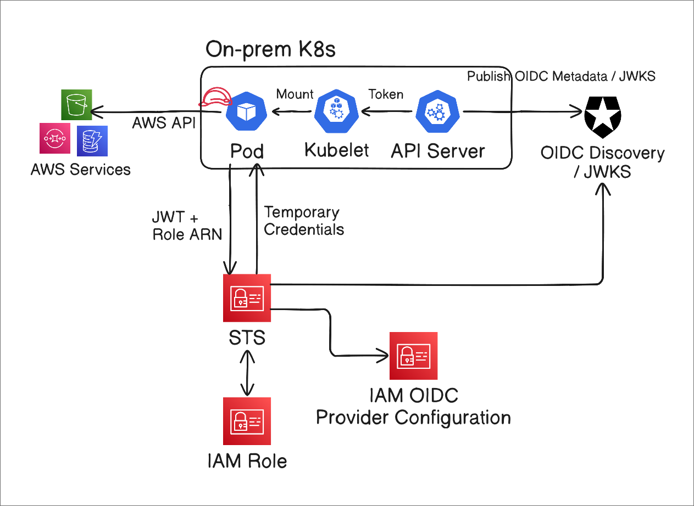

---

## 📝 개요

온프레미스 Kubernetes의 Pod에서 AWS 서비스를 사용하려면 AWS 자격 증명이 필요하다. 이때 Access Key와 같은 장기 자격 증명을 저장하기보다, **IAM Role을 Assume하여 임시 자격 증명을 발급받는 방식**을 사용하면 장기 키를 직접 배포하고 관리하는 부담을 줄일 수 있다.

대표적인 연동 방식은 다음과 같다.

| 방식 | 특징 | 활용 상황 |
| --- | --- | --- |
| **OIDC Federation** | Kubernetes ServiceAccount JWT로 IAM Role의 임시 자격 증명 획득 | 일반적인 온프레미스 Kubernetes |
| IAM Roles Anywhere | X.509 인증서로 임시 AWS 자격 증명 획득 | 외부에 OIDC 정보를 공개하기 어렵거나 사내 PKI를 활용하는 환경 |
| EKS Anywhere + IRSA | EKS Anywhere에서 ServiceAccount 기반 IAM 연동 | EKS Anywhere를 사용하는 환경 |

이 글에서는 OIDC Federation을 이용한다. Kubernetes가 발급한 ServiceAccount Token을 AWS가 검증할 수 있도록 구성하고, Pod에서 해당 토큰으로 IAM Role을 Assume하는 과정을 살펴본다.

---

## 🏗️ 아키텍처

전체 아키텍처는 다음과 같다.



동작 순서는 다음과 같다.

1. Kubernetes API Server에서 제공하는 OIDC Discovery 문서와 공개 키가 담긴 JWKS를 AWS에서 접근할 수 있는 HTTPS 엔드포인트에 공개한다. API Server에서 직접 제공하거나 별도의 공개 엔드포인트를 구성할 수 있다.
2. Pod가 생성되면 kubelet이 API Server의 TokenRequest API로 ServiceAccount Token을 요청하고, 발급받은 토큰을 Pod에 마운트한다.
3. Pod의 AWS SDK는 ServiceAccount Token과 Assume할 Role ARN을 AWS STS의 `AssumeRoleWithWebIdentity` API에 전달한다.
4. STS는 IAM OIDC Provider에 등록된 정보를 바탕으로 토큰을 검증하고, IAM Role의 trust policy 조건을 확인한 뒤 임시 자격 증명을 반환한다.
5. Pod는 발급받은 자격 증명으로 IAM Role에 허용된 AWS API를 호출한다.

여기서는 API Server 전체를 인터넷에 공개하는 대신, **OIDC Discovery 문서와 JWKS만 Cloudflare R2에 공개**한다.

---

## 🔑 OIDC Discovery와 JWKS 노출

### API Server에서 설정하기

kube-apiserver는 ServiceAccount issuer discovery를 지원한다. Kubernetes가 토큰 발급자인 IdP 역할을 하고, AWS와 같은 외부 시스템이 토큰을 검증하는 RP(Relying Party) 역할을 할 수 있게 하는 기능이다.

ServiceAccount Token 발급과 서명 키 설정이 이미 구성되어 있다는 전제에서, 공개할 issuer와 JWKS 주소를 다음 flag로 지정한다.

- `--service-account-issuer`: 토큰의 `iss` claim에 들어갈 issuer URL
- `--service-account-jwks-uri`: Discovery 문서의 `jwks_uri`에 들어갈 공개 JWKS URL

예를 들어 공개 주소가 `https://oidc.chaewoon.work`라면 다음과 같이 설정한다. 이후 예제에서도 이 주소를 사용하므로, 실제 구성에서는 자신이 사용할 도메인으로 바꾸면 된다.

```text
--service-account-issuer=https://oidc.chaewoon.work
--service-account-jwks-uri=https://oidc.chaewoon.work/openid/v1/jwks
```

설정을 적용하면 API Server는 `/.well-known/openid-configuration` 경로로 OIDC Discovery 문서를, `/openid/v1/jwks` 경로로 JWKS를 제공한다. 이 문서들은 완전한 OIDC 호환이 아님을 알아두자. Kubernetes ServiceAccount Token 검증에 필요한 정보를 제공한다.

RBAC을 사용하는 Kubernetes에는 기본적으로 `system:service-account-issuer-discovery` ClusterRole이 있다. 기본 ClusterRoleBinding은 이 Role을 모든 ServiceAccount가 속한 `system:serviceaccounts` 그룹에 연결한다. 따라서 Pod는 마운트된 ServiceAccount Token으로 API Server의 Discovery 엔드포인트를 조회할 수 있다.

필요에 따라 이 Role을 `system:authenticated`나 `system:unauthenticated` 그룹에도 바인딩할 수 있다. 다만 여기서는 R2에 문서를 별도로 공개하므로, 외부 조회를 위해 API Server의 익명 접근 권한을 추가할 필요는 없다.

RP는 Discovery 문서를 조회한 뒤 `jwks_uri`가 가리키는 JWKS에서 공개 키를 얻어 토큰의 서명을 검증한다. AWS가 조회할 issuer와 JWKS 주소는 모두 HTTPS로 접근할 수 있어야 한다.

API Server에 설정을 적용한 뒤, `kubectl`로 두 문서를 확인한다.

```bash
kubectl get --raw /.well-known/openid-configuration | jq .
{
  "issuer": "https://oidc.chaewoon.work",
  "jwks_uri": "https://oidc.chaewoon.work/openid/v1/jwks",
  "response_types_supported": [
    "id_token"
  ],
  "subject_types_supported": [
    "public"
  ],
  "id_token_signing_alg_values_supported": [
    "RS256"
  ]
}

kubectl get --raw /openid/v1/jwks | jq .
{
  "keys": [
    {
      "use": "sig",
      "kty": "RSA",
      "kid": "LYHz2yAYPGR3GeSMUwfmyJZLmDoVdUvYX73F_yXbgq8",
      "alg": "RS256",
      "n": "vn3i4EUXFTzC9lb22bvkG_1BUW48aUajHqevSGT2lnNRTkmG2w9M70kJIhkW5PbdOYgS11aQwhfqOn2ZrRkcVeOb3wcmFKqGZ4Aosb8WIty5sfoXclmQY7D7TLG3bt7oW916hFUOUT1WQ-g412QgAAZL09527mDJmawfUVdfyQp_Bb5MTO_yWaldld0aXqMIUws5afz9AJjpxdjV8MxHLJjPGiTA-btoTfguYkral6duaoyfBLAhpOIP5RVQKZnpPji5Nd7kDB7HQvPH8CyMMcwoporrYhmzAj2n-8Jaw-FVIWURtwoCi1I56qHBIjAZz-elQbayWT9tiTQzWyPWSw",
      "e": "AQAB"
    }
  ]
}
```

이제 R2에 업로드할 수 있도록 각 문서를 파일로 저장한다.

```bash
# OIDC Configuration 저장
kubectl get --raw /.well-known/openid-configuration | jq . > openid-configuration.json

# JWKS 저장
kubectl get --raw /openid/v1/jwks | jq . > jwks.json
```

### Cloudflare R2에 노출하기

API Server는 보통 private 네트워크에 있다. 이 상태를 유지하면서 AWS가 검증에 필요한 문서만 조회할 수 있도록 Cloudflare R2와 Custom Domain을 이용한다.

여러 방법 중에서 내 홈랩에는 R2와 Custom Domain 구성이 간단하고 관리하기 편하다고 생각했다. 나는 `oidc.chaewoon.work`를 공개 주소로 사용했다. 도메인이 없다면 Cloudflare가 제공하는 `r2.dev` 주소로 실험할 수도 있다. AWS 안에서 구성을 관리하고 싶다면 S3와 CloudFront OAC를 이용하는 방법도 있다.

콘솔에서 R2 버킷과 Custom Domain을 연결하거나, 아래 Terraform 코드를 참고할 수 있다. Cloudflare provider에는 해당 리소스를 관리할 권한이 있는 API Token을 사용한다.

```hcl
# R2 관리에 사용할 Cloudflare API Token을 별도 provider alias로 구분한다.
provider "cloudflare" {
  alias     = "r2"
  api_token = var.cloudflare_r2_api_token
}

resource "cloudflare_r2_bucket" "oidc" {
  provider      = cloudflare.r2
  name          = "home-oidc"
  account_id    = var.account_id
  storage_class = "Standard"
}

resource "cloudflare_r2_custom_domain" "oidc_custom_domain" {
  provider    = cloudflare.r2
  account_id  = var.account_id
  bucket_name = cloudflare_r2_bucket.oidc.name
  domain      = "oidc.chaewoon.work"
  enabled     = true
  zone_id     = var.zone_id
  min_tls     = "1.3"
}
```

앞에서 저장한 Discovery 문서와 JWKS를 URL 경로에 맞는 object key로 업로드한다. 콘솔이나 Wrangler CLI를 이용할 수 있다.

아래 명령은 문서가 갱신될 수 있다는 점을 고려해 캐시 유효 시간을 5분으로 설정한 예시다. 실제 캐시 정책은 키 교체 주기와 운영 방식에 맞춰 정한다.

```bash
$ wrangler r2 object put home-oidc/.well-known/openid-configuration \
  --file openid-configuration.json \
  --content-type application/json \
  --content-disposition inline \
  --cache-control "public, max-age=300" \
  --remote

 ⛅️ wrangler 4.151.1
────────────────────
Resource location: remote

Creating object ".well-known/openid-configuration" in bucket "home-oidc".
Upload complete.

$ wrangler r2 object put home-oidc/openid/v1/jwks \
  --file jwks.json \
  --content-type application/json \
  --content-disposition inline \
  --cache-control "public, max-age=300" \
  --remote

 ⛅️ wrangler 4.151.1 (update available 4.156.1)
───────────────────────────────────────────────
Resource location: remote

Creating object "openid/v1/jwks" in bucket "home-oidc".
Upload complete.
```

업로드한 문서는 다음 두 주소에서 인증 없이 조회할 수 있어야 한다.

- [OIDC Discovery 문서](https://oidc.chaewoon.work/.well-known/openid-configuration)
- [JWKS](https://oidc.chaewoon.work/openid/v1/jwks)

> NOTE
>
> **R2에 올린 문서는 API Server와 자동으로 동기화되지 않는다.** ServiceAccount 서명 키를 교체하면 공개 JWKS도 갱신해야 한다. 기존 토큰이 유효한 동안에는 검증에 필요한 기존 공개 키도 유지하고, 캐시된 문서에 새 키가 반영되는 시점도 고려해야 한다.

---

## ☁️ AWS OIDC Provider 생성

이제 AWS IAM에 OIDC Provider를 등록한다. 콘솔에서도 생성할 수 있지만, 여기서는 Terraform을 사용한다.

`url`은 ServiceAccount Token의 `iss` 및 Discovery 문서의 `issuer`와 일치해야 한다. 이 예제에서는 허용할 audience인 `client_id_list`에 `sts.amazonaws.com`을 지정한다.

```hcl
locals {
  oidc_url = "https://oidc.chaewoon.work"
}

resource "aws_iam_openid_connect_provider" "oidc" {
  url = local.oidc_url
  client_id_list = [
    "sts.amazonaws.com"
  ]
}
```

> NOTE
>
> EKS의 IRSA(IAM Roles for Service Accounts)도 ServiceAccount Token과 OIDC Federation을 이용해 IAM Role의 임시 자격 증명을 얻는 방식이다. 이 글에서는 IRSA의 핵심 인증 flow를 온프레미스 Kubernetes에서 직접 구성한다.
>
> `aud`는 토큰의 의도된 수신 대상을 나타내며, 반드시 `sts.amazonaws.com`이어야 하는 것은 아니다. 이 값은 [EKS IRSA 예제](https://docs.aws.amazon.com/eks/latest/userguide/associate-service-account-role.html)에서도 사용하는 값이므로 여기서도 같은 값을 선택했다. audience는 식별자이며, 이 설정 자체가 STS 요청을 보낼 엔드포인트를 결정하는 것은 아니다.
>
> 이 글처럼 ServiceAccount Token을 직접 발급하고 연동하는 구성에서는 `onprem-aws` 같은 별도 값을 사용할 수도 있다. 이 경우 아래 세 곳의 설정을 같은 값으로 맞춰야 한다.
>
> - IAM OIDC Provider의 `client_id_list`에 등록할 audience
> - IAM Role trust policy의 `:aud` 조건 값(아래 모듈의 `audience` 변수)
> - Pod의 projected token에서 요청할 `serviceAccountToken.audience`
>
> 예를 들어 세 곳을 모두 `onprem-aws`로 설정하면 토큰의 `aud`에도 이 값이 들어간다. Kubernetes API 접근용 기본 토큰을 그대로 재사용하기보다, AWS 연동용 audience를 명시해 토큰의 사용 대상을 구분하는 것이 좋다. 자세한 내용은 [AWS IAM의 OIDC Provider 문서](https://docs.aws.amazon.com/IAM/latest/UserGuide/id_roles_providers_create_oidc.html)를 참고하자.

---

## 🧪 테스트: IAM Role 생성과 Pod 연결

OIDC Provider 등록을 마쳤으니 IAM Role을 만들고, Pod에서 해당 Role을 Assume해보자.

### IAM Role 생성

IAM Role의 trust policy에는 `sts:AssumeRoleWithWebIdentity`를 허용한다. 또한 `aud`와 `sub` 조건을 함께 지정해, 이 Role을 Assume할 수 있는 ServiceAccount를 특정 namespace와 이름으로 제한한다.

아래는 이를 모듈로 구성한 Terraform 예시다.

```hcl
data "aws_iam_policy_document" "assume_role" {
  statement {
    effect  = "Allow"
    # Web Identity 토큰으로 Role을 Assume할 때 사용하는 action
    actions = ["sts:AssumeRoleWithWebIdentity"]

    # 신뢰할 IAM OIDC Provider
    principals {
      type        = "Federated"
      identifiers = [var.oidc_provider_arn]
    }

    # aud 검증: 기본값은 sts.amazonaws.com
    condition {
      test     = "StringEquals"
      variable = "${trimprefix(var.oidc_issuer_url, "https://")}:aud"
      values   = [var.audience]
    }

    # sub 검증: 지정한 namespace와 ServiceAccount 이름으로 제한
    condition {
      test     = "StringEquals"
      variable = "${trimprefix(var.oidc_issuer_url, "https://")}:sub"
      values   = ["system:serviceaccount:${var.service_account_namespace}:${var.service_account_name}"]
    }
  }
}

resource "aws_iam_role" "this" {
  name               = var.role_name
  assume_role_policy = data.aws_iam_policy_document.assume_role.json
}

resource "aws_iam_role_policy_attachment" "this" {
  for_each = var.managed_policy_arns

  role       = aws_iam_role.this.name
  policy_arn = each.value
}

resource "aws_iam_role_policy" "this" {
  for_each = var.inline_policies

  name   = each.key
  role   = aws_iam_role.this.name
  policy = each.value
}

variable "role_name" {
  description = "Name of the IAM role assumed by the service account."
  type        = string
}

variable "oidc_provider_arn" {
  description = "ARN of the IAM OIDC provider."
  type        = string
}

variable "oidc_issuer_url" {
  description = "HTTPS issuer URL of the IAM OIDC provider."
  type        = string

  validation {
    condition     = startswith(var.oidc_issuer_url, "https://")
    error_message = "oidc_issuer_url must start with https://."
  }
}

variable "service_account_namespace" {
  description = "Kubernetes namespace of the service account."
  type        = string
}

variable "service_account_name" {
  description = "Kubernetes service account name."
  type        = string
}

variable "audience" {
  description = "OIDC audience allowed to assume the role."
  type        = string
  default     = "sts.amazonaws.com"
}

variable "managed_policy_arns" {
  description = "ARNs of existing IAM managed policies to attach to the role."
  type        = set(string)
  default     = []
}

variable "inline_policies" {
  description = "Map of inline IAM policy names to JSON policy documents."
  type        = map(string)
  default     = {}
}
```

여기서는 `GetCallerIdentity`로 신원 확인까지만 진행하는 것이 목적이라 Role에 별도의 권한 policy를 연결하지 않았다. 이 API는 호출에 별도 권한이 필요하지 않다. 실제 AWS 서비스를 사용하려면 필요한 작업에 맞는 권한 policy를 추가해야 한다.

```hcl
module "test" {
  source = "../../modules/aws_oidc_iam"

  role_name                 = "onprem-test"
  oidc_provider_arn         = aws_iam_openid_connect_provider.oidc.arn
  oidc_issuer_url           = local.oidc_url
  service_account_namespace = "default"
  service_account_name      = "test-sa"
  managed_policy_arns       = []
}
```

### Pod와 ServiceAccount 생성

trust policy에 지정한 `default` namespace와 `test-sa` 이름에 맞춰 ServiceAccount를 만들고, Pod에 연결한다.

`AWS_ROLE_ARN`에는 앞에서 만든 Role ARN을, `AWS_WEB_IDENTITY_TOKEN_FILE`에는 projected token의 마운트 경로를 지정한다. AWS CLI는 이 설정을 이용해 STS에서 임시 자격 증명을 얻는다.

아래 내용을 `test.yaml`로 저장한다. Role ARN의 `{account_id}`와 `{role-name}`은 실제 값으로 바꾸면 된다.

```yaml
# trust policy의 namespace 및 ServiceAccount 이름과 일치해야 한다.
apiVersion: v1
kind: ServiceAccount
metadata:
  name: test-sa
  namespace: default
---
apiVersion: v1
kind: Pod
metadata:
  labels:
    run: aws-test
  name: aws-test
  namespace: default
spec:
  # ServiceAccount 참조
  serviceAccountName: test-sa
  automountServiceAccountToken: false
  containers:
    - image: amazon/aws-cli
      name: aws-test
      command:
        - sleep
        - infinity
      env:
        # 위 테라폼 코드로 생성된 Role ARN 넣기
        - name: AWS_ROLE_ARN
          value: arn:aws:iam::{account_id}:role/{role-name}
        - name: AWS_WEB_IDENTITY_TOKEN_FILE
          value: /var/run/secrets/tokens/aws
        - name: AWS_DEFAULT_REGION
          value: ap-northeast-2
      volumeMounts:
        - name: aws-token
          mountPath: /var/run/secrets/tokens
          readOnly: true
  volumes:
    # projected token으로 마운트
    - name: aws-token
      projected:
        sources:
          - serviceAccountToken:
              path: aws
              audience: sts.amazonaws.com
              expirationSeconds: 3600
```

`automountServiceAccountToken: false`로 기본 API 접근용 토큰의 자동 마운트를 껐다. 여기서는 `audience: sts.amazonaws.com`으로 요청한 토큰을 projected volume으로 명시적으로 마운트한다. kubelet은 이 토큰이 만료되기 전에 갱신한다.

이제 리소스를 생성한다.

```bash
kubectl apply -n default -f test.yaml
```

Pod에서 AWS 자격 증명을 정상적으로 발급받았는지 확인한다.

```bash
kubectl exec -n default aws-test -- aws sts get-caller-identity
```

다음과 같은 출력이 나온다. 실제 응답의 `Arn`이 앞에서 만든 Role의 세션인지 확인해주면 된다.

```json
{
    "UserId": "...",
    "Account": "...",
    "Arn": "..."
}
```

### ServiceAccount Token 확인

이번에는 Pod에 마운트된 토큰의 내용을 살펴보자.

```bash
kubectl exec -n default aws-test -- cat /var/run/secrets/tokens/aws
```

JWT의 header와 payload를 디코딩하면 다음과 같은 내용을 볼 수 있다.

Header:

```json
{
  "alg": "RS256",
  "kid": "LYHz2yAYPGR3GeSMUwfmyJZLmDoVdUvYX73F_yXbgq8"
}
```

Payload:

```json
{
  "aud": [
    "sts.amazonaws.com"
  ],
  "exp": 1794318601,
  "iat": 1794315001,
  "iss": "https://oidc.chaewoon.work",
  "jti": "30dc8a58-75ae-46a5-adee-96d61d054b47",
  "kubernetes.io": {
    "namespace": "default",
    "node": {
      "name": "home-cp-1",
      "uid": "5f97e722-3952-425e-a269-069fe9ec2140"
    },
    "pod": {
      "name": "aws-test",
      "uid": "3d41b756-6f77-4a30-8e94-29588af9f45e"
    },
    "serviceaccount": {
      "name": "test-sa",
      "uid": "e707897a-a4fe-42de-bb63-b1bd9042f5e1"
    }
  },
  "nbf": 1794315001,
  "sub": "system:serviceaccount:default:test-sa"
}
```

토큰에서 확인할 핵심 항목은 다음과 같다.

- `iss`: IAM OIDC Provider에 등록한 issuer URL과 일치한다.
- `aud`: projected token에서 요청한 `sts.amazonaws.com`이 들어 있다.
- `sub`: trust policy에서 허용한 `system:serviceaccount:default:test-sa`와 일치한다.
- Header의 `kid`: 공개 JWKS에서 서명 검증에 사용할 키를 식별한다.

이렇게 구성하면 Pod에 장기 Access Key를 저장하지 않고도 ServiceAccount Token을 통해 AWS 임시 자격 증명을 얻을 수 있다. 실제 서비스에 적용할 때는 ServiceAccount별로 필요한 Role과 권한을 나누고, 서명 키 교체 시 공개 JWKS 갱신도 함께 관리하면 된다.

---

## 📚 References

- [AWS IAM — OIDC federation](https://docs.aws.amazon.com/IAM/latest/UserGuide/id_roles_providers_oidc.html)
- [AWS IAM Roles Anywhere — Introduction](https://docs.aws.amazon.com/rolesanywhere/latest/userguide/introduction.html)
- [EKS Anywhere — IAM Roles for Service Accounts](https://anywhere.eks.amazonaws.com/docs/getting-started/optional/irsa/)
- [Kubernetes — Configure Service Accounts for Pods](https://kubernetes.io/docs/tasks/configure-pod-container/configure-service-account/)
- [Amazon EKS — Use IRSA with the AWS SDK (Web Identity 자격 증명 처리 참고)](https://docs.aws.amazon.com/eks/latest/userguide/iam-roles-for-service-accounts-minimum-sdk.html)
- [AWS STS — AssumeRoleWithWebIdentity](https://docs.aws.amazon.com/STS/latest/APIReference/API_AssumeRoleWithWebIdentity.html)
- [Cloudflare R2 — Public buckets](https://developers.cloudflare.com/r2/buckets/public-buckets/)
- [Cloudflare — Create API token](https://developers.cloudflare.com/fundamentals/api/get-started/create-token/)
- [Cloudflare R2 — Authentication (S3 API credentials)](https://developers.cloudflare.com/r2/api/tokens/)
- [Cloudflare Wrangler — R2 object put](https://developers.cloudflare.com/workers/wrangler/commands/r2/#r2-object-put)
- [AWS IAM — Create an OIDC identity provider](https://docs.aws.amazon.com/IAM/latest/UserGuide/id_roles_providers_create_oidc.html)
- [Amazon EKS — Assign IAM roles to Kubernetes service accounts (trust policy와 audience 예시)](https://docs.aws.amazon.com/eks/latest/userguide/associate-service-account-role.html)
- [AWS STS — GetCallerIdentity](https://docs.aws.amazon.com/STS/latest/APIReference/API_GetCallerIdentity.html)
- [실제 홈랩 구성 — fudoge/homelab](https://github.com/fudoge/homelab)
