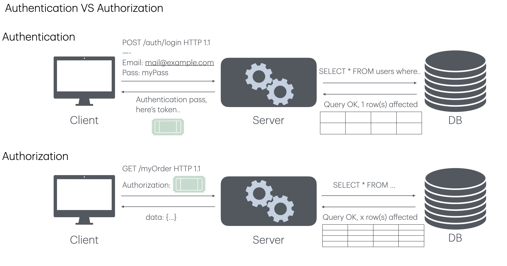
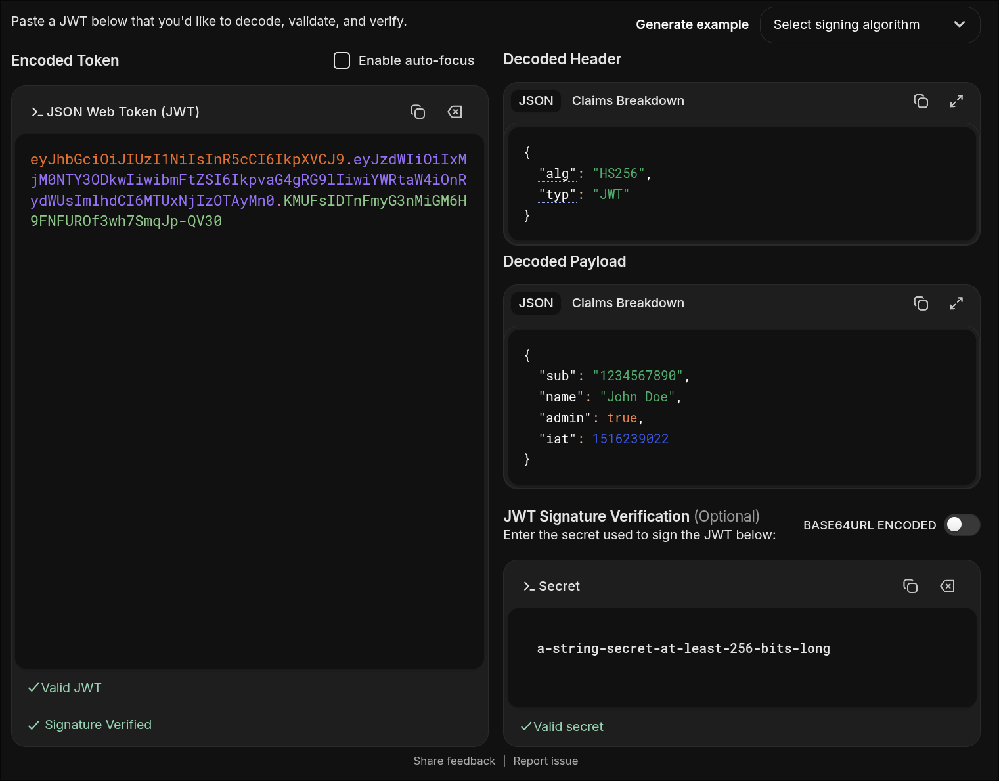
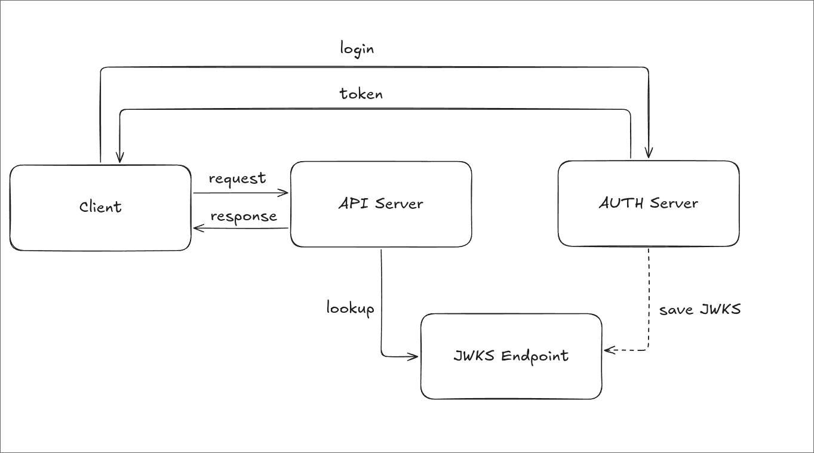

How can an API trust a JWT it receives after a user logs in? It helps to separate **JWT**, which carries claims, **JWS**, which defines a signed representation, and **JWK/JWKS**, which describe the keys used to verify it.

---

## 🔐 Authentication vs Authorization

**Authentication** establishes who a user is. **Authorization** decides whether that user may access a particular resource.



A service may issue a JWT after authenticating a user at login. The API then validates the token and uses its claims together with its own policy to authorize a request. **A valid signature does not, by itself, grant access.**

---

## ✍️ What Is JWS?

JSON Web Signature (JWS) is a standard way to represent content protected by a digital signature or message authentication code (MAC). A JWS has three components:

- **JOSE Header:** Holds parameters such as the signing algorithm (`alg`) and key identifier (`kid`). In JSON Serialization, a header can be split into a signed *Protected Header* and an unsigned *Unprotected Header*.
- **Payload:** The data to protect.
- **Signature:** The digital signature or MAC calculated over the Protected Header and Payload.

### Compact Serialization

The compact form joins three parts with dots (`.`). Its entire JOSE Header is protected.

```text
BASE64URL(UTF8(Protected Header)).BASE64URL(Payload).BASE64URL(Signature)
```

The signing input is the **ASCII byte sequence** formed by joining the first two parts with a dot. The result of applying the selected algorithm to that input is Base64URL-encoded as the third part.

```text
signingInput = BASE64URL(UTF8(Protected Header)) + "." + BASE64URL(Payload)
signature = Sign(key, ASCII(signingInput))
```

### JSON Serialization

The JSON form can use `protected`, `header`, `payload`, and `signature`. The `header` member is not covered by the signature, so it matters whether a parameter used during verification is protected. This is the structure of Flattened JWS JSON Serialization, which holds one signature. The uppercase strings stand in for actual encoded values.

```json
{
  "payload": "BASE64URL(Payload)",
  "protected": "BASE64URL(UTF8(Protected Header))",
  "header": { "kid": "key-1" },
  "signature": "BASE64URL(Signature)"
}
```

General JWS JSON Serialization supports multiple signatures through a `signatures` array. Each signature can have its own Protected and Unprotected Headers.

```json
{
  "payload": "BASE64URL(Payload)",
  "signatures": [
    {
      "protected": "BASE64URL(UTF8(Header1))",
      "header": { "kid": "key-1" },
      "signature": "BASE64URL(Signature1)"
    },
    {
      "protected": "BASE64URL(UTF8(Header2))",
      "header": { "kid": "key-2" },
      "signature": "BASE64URL(Signature2)"
    }
  ]
}
```

### Verifying a JWS

To verify the compact form, parse its three parts, read the Protected Header, and verify the original signing input with an **algorithm and key allowed by a trusted policy**. Do not trust the token's `alg` value on its own or let the token choose an arbitrary verification key.

For the JSON form, reconstruct the signing input for each signature from its Protected Header and the Payload. The application decides how many signatures must be valid. After verifying a signature, it must still validate any claims required for the token's intended use.

---

## 🎟️ JWT (JSON Web Token)

A JSON Web Token (JWT) represents information about a subject as **claims**. It can be signed as a JWS or encrypted as a JWE. The familiar `xxxx.yyyy.zzzz` form is a **signed JWT in JWS Compact Serialization**.

A signed JWT lets a recipient check the integrity of its contents and whether the signer held the signing key. **Signing is not encryption**: its header and payload should not be treated as secrets.

### Header, Payload, Signature

A signed JWT has three parts:

1. **Header:** Parameters such as `alg` and, optionally, `typ`.
2. **Payload:** Claims about a user or the token itself.
3. **Signature:** A signature or MAC over the encoded Header and Payload.

For example, the Header could be:

```json
{
  "alg": "HS256",
  "typ": "JWT"
}
```

With HS256, the signing input is `BASE64URL(header) + "." + BASE64URL(payload)`, and HMAC-SHA-256 is calculated using a shared secret. Public-key algorithms such as RS256 use different keys for signing and verification.



### Registered Claims

RFC 7519 defines commonly used claim names, but it does not require every JWT to contain them all. A service's token policy determines which claims it must check.

| Claim | Meaning | What to check |
| --- | --- | --- |
| `iss` | Issuer | Was the token issued by a trusted party? |
| `sub` | Subject | Does it identify the expected user or subject? |
| `aud` | Audience | Was the token issued for this API? |
| `exp` | Expiration time | Has the token expired? |
| `nbf` | Not-before time | Is the token valid yet? |
| `iat` | Issued-at time | Does the issue time satisfy the policy? |
| `jti` | JWT ID | Is it needed for replay prevention or revocation? |

`exp`, `nbf`, and `iat` use `NumericDate`: seconds since the Unix epoch. `aud` can be a single string or an array of strings.

### Public Claims and Private Claims

**Public claims** use names meant for broader interoperability beyond the registered claims. To avoid collisions, use a name registered with IANA or a collision-resistant name such as a URI. OpenID Connect ID Tokens use additional claims such as `name`, `email`, and `picture`. `nonce` and `at_hash` also belong to OpenID Connect contexts; they are not required in every JWT.

**Private claims** are agreed upon by the issuer and recipient. An internal `department` claim, for example, could be private to an application. Choose names carefully to avoid collisions with other systems.

### Login and API Access with JWTs

After a successful login, a server may issue a JWT as an access token. The client commonly sends it to a protected API like this:

```http
Authorization: Bearer <token>
```

`Bearer` is an OAuth 2.0 token usage scheme: **whoever possesses the token can use it**. If it leaks, someone else may use it until it expires. The API verifies the signature, issuer, audience, and expiration, then checks the permissions needed for the request.

Using JWTs does not automatically make an entire service stateless. Token revocation, session management, and refresh tokens may require server-side state. A refresh token is used to obtain a new access token after the old one expires and usually has a longer lifetime.

### Claim Design Example

This **example payload** shows application-specific claims. `role`, `scope`, and `session_id` are not registered JWT claims; their meaning must be agreed upon by the issuer and recipient.

```json
{
  "iss": "https://auth.example.com",
  "sub": "user-123",
  "aud": "orders-api",
  "role": "admin",
  "scope": "orders:read orders:write",
  "session_id": "session-456"
}
```

`role` can support Role-Based Access Control (RBAC), `scope` can specify allowed API operations, and `session_id` can link the token to a session. A server must check that the claims authorize **the particular operation being requested**, rather than merely checking that the strings exist. Avoid putting personal information or unnecessarily large amounts of data in a token.

### JWT Security Best Practices

- **Transport:** Use HTTPS to protect tokens in transit.
- **Lifetime:** Choose an access-token lifetime that fits the service's risk and user experience. Manage refresh tokens with leakage and replay in mind.
- **Storage:** Tokens in browser `localStorage` may be exposed by XSS. An `HttpOnly` cookie blocks JavaScript access, but cookie-based authentication also needs appropriate `Secure` and `SameSite` settings and CSRF protection.
- **Validation:** Allowlist `alg` values and check the claims the service requires, such as `iss`, `aud`, and `exp`.
- **Revocation:** If immediate invalidation is required, design a server-side revocation list using `jti` or a session ID, or use another suitable mechanism.

---

## 🗝️ JWK and JWKS

The key-sharing model determines how a JWT signature or MAC is created and verified.

- **Symmetric key (for example, HS256)**
  - The issuer and API share the same secret to create and verify a MAC.
  - Because the API also knows the secret, it can issue new tokens.
- **Asymmetric key (for example, RS256)**
  - The issuer signs with a private key, and the API verifies with a public key.
  - The API cannot sign a token with the public key alone.

An asymmetric key is especially useful when several services need to verify signed JWTs in an OAuth 2.0 or OpenID Connect (OIDC) integration. The issuer keeps the private key and provides only the public key to those services. Adding a verifier does not require sharing a signing secret with it.

How can the issuer distribute and rotate that public key? JWK represents a key in JSON, while JWKS publishes a set of keys. In OIDC, the Discovery document can advertise the key set's location through `jwks_uri`.



### What Are JWK and JWKS?

A **JWK (JSON Web Key)** represents a cryptographic key as JSON. It can represent secret keys as well as public keys, so a public JWKS endpoint must expose only information intended to be public. A **JWKS (JSON Web Key Set)** is a JSON object whose `keys` array contains JWKs.

The following P-256 public-key example comes from RFC 7517. `x` and `y` are Base64URL-encoded coordinates of a point on the elliptic curve.

```jsonc
// source: https://www.rfc-editor.org/rfc/rfc7517
{
  "kty": "EC",
  "crv": "P-256",
  "x": "f83OJ3D2xF1Bg8vub9tLe1gHMzV76e8Tus9uPHvRVEU",
  "y": "x_FEzRu9m36HLN_tue659LNpXW6pCyStikYjKIWI5a0",
  "kid": "Public key used in JWS spec Appendix A.3 example"
}
```

The main fields are:

- `kty`: Key type. This field is required.
- `use`, `key_ops`: Intended use and allowed operations.
- `alg`: Algorithm intended for the key.
- `kid`: Key identifier, which can be matched with the JWT Header's `kid`.
- `x5u`, `x5c`, `x5t`, `x5t#S256`: Fields related to X.509 certificate URLs, chains, and thumbprints.

A JWKS has the following shape. A service can publish multiple public JWKs in `keys`, including during a key rotation.

```jsonc
// source: https://www.rfc-editor.org/rfc/rfc7517
{
  "keys": [
    {
      "kty": "EC",
      "crv": "P-256",
      "x": "f83OJ3D2xF1Bg8vub9tLe1gHMzV76e8Tus9uPHvRVEU",
      "y": "x_FEzRu9m36HLN_tue659LNpXW6pCyStikYjKIWI5a0",
      "kid": "key-1"
    }
  ]
}
```

### Verifying a JWT with JWKS

1. The issuer creates a key pair and signs a JWT with its private key.
2. The issuer publishes the public key in a JWKS. The API has a configured JWKS URI for the trusted issuer or obtains it through OIDC Discovery.
3. The API finds the public key matching the JWT's `kid`. It also checks that the algorithm and key type are allowed.
4. The API verifies the signature and validates required claims such as `iss`, `aud`, and `exp`.
5. Finally, it checks whether the request is authorized before handling the API call.

**Signature verification and authorization are separate steps.** JWKS distributes public keys; the API's policy determines which tokens and permissions it accepts.

---

## 📚 References

- [RFC 7515: JSON Web Signature (JWS)](https://www.rfc-editor.org/rfc/rfc7515)
- [RFC 7517: JSON Web Key (JWK)](https://www.rfc-editor.org/rfc/rfc7517)
- [RFC 7519: JSON Web Token (JWT)](https://www.rfc-editor.org/rfc/rfc7519)
- [RFC 6750: OAuth 2.0 Bearer Token Usage](https://www.rfc-editor.org/rfc/rfc6750)
- [RFC 8725: JSON Web Token Best Current Practices](https://www.rfc-editor.org/rfc/rfc8725)
- [OpenID Connect Discovery 1.0](https://openid.net/specs/openid-connect-discovery-1_0.html)
- [JWT Claims Explained — jwtdecode.io](https://jwtdecode.io/jwt-claims)
- [Introduction to JSON Web Tokens — jwt.io](https://www.jwt.io/introduction#what-is-json-web-token)
- [Navigating RS256 and JWKS — Auth0](https://auth0.com/blog/navigating-rs256-and-jwks/)
