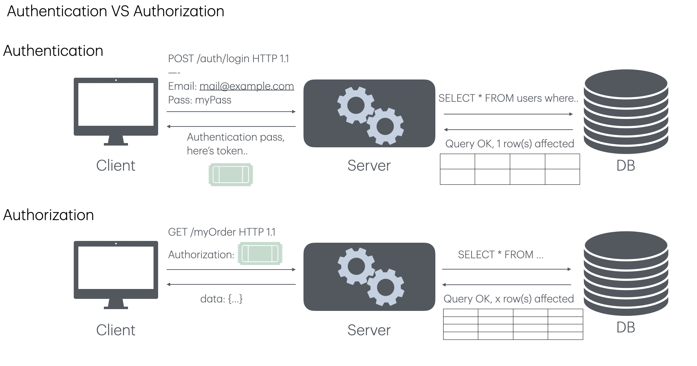
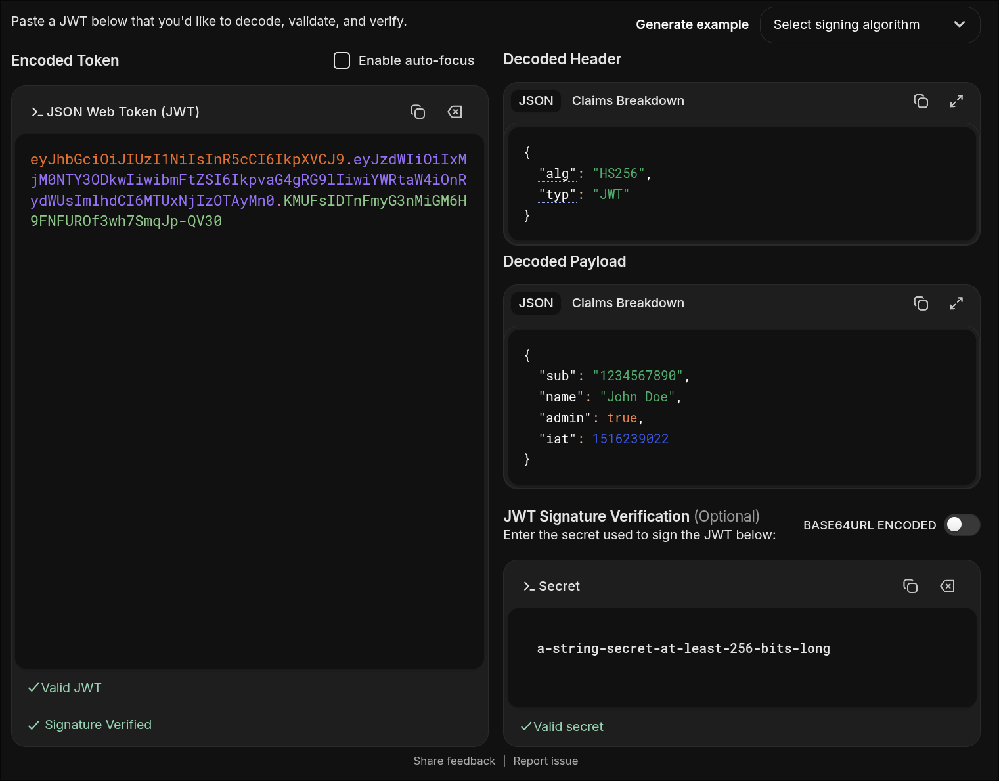
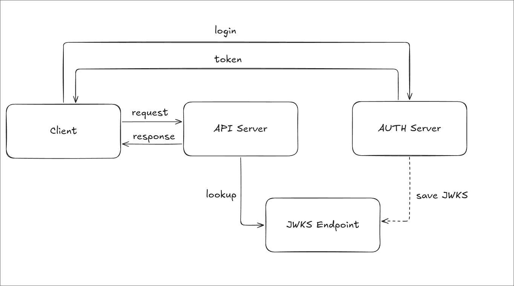

로그인 후 전달받은 JWT를 API 서버는 어떻게 신뢰할까? 이 과정을 이해하려면 토큰에 담긴 정보인 **JWT**, 서명 형식인 **JWS**, 검증 키를 표현하는 <strong>JWK/JWKS</strong>를 구분해야 한다. 

---

## 🔐 Authentication vs Authorization

<strong>인증(Authentication)</strong>은 사용자가 누구인지 확인하는 과정이다. <strong>인가(Authorization)</strong>는 확인된 사용자에게 특정 리소스에 접근할 권한이 있는지 판단하는 과정이다.



로그인으로 사용자를 인증한 뒤 JWT를 발급할 수 있다. 이후 API 서버는 토큰을 검증하고, 토큰에 담긴 정보와 서비스 정책을 바탕으로 요청을 인가한다. **서명이 유효하다는 사실과 접근 권한이 있다는 것은 엄밀히 다르다.**

---

## ✍️ JWS란?

JWS(JSON Web Signature)는 디지털 서명이나 메시지 인증 코드(MAC)로 보호한 내용을 표현하는 표준이다. JWS에는 다음 요소가 있다.

- **JOSE Header:** 서명 알고리즘(`alg`), 키 식별자(`kid`) 같은 매개변수를 담는다. JSON 직렬화에서는 서명으로 보호하는 *Protected Header*와 보호하지 않는 *Unprotected Header*를 나눌 수 있다.
- **Payload:** 보호할 데이터이다.
- **Signature:** Protected Header와 Payload를 대상으로 계산한 서명 또는 MAC이다.

### Compact Serialization

Compact 형식은 세 부분을 점(`.`)으로 연결한다. 이 형식의 JOSE Header 전체가 Protected Header이다.

```text
BASE64URL(UTF8(Protected Header)).BASE64URL(Payload).BASE64URL(Signature)
```

서명 입력은 첫 두 부분을 점으로 연결한 <strong>ASCII 바이트열</strong>이다. 서명 알고리즘으로 이 입력을 처리한 결과를 Base64URL로 인코딩해 세 번째 부분에 넣는다.

```text
signingInput = BASE64URL(UTF8(Protected Header)) + "." + BASE64URL(Payload)
signature = Sign(key, ASCII(signingInput))
```

### JSON Serialization

JSON 형식은 `protected`, `header`, `payload`, `signature` 멤버를 사용할 수 있다. `header`는 서명으로 보호되지 않으므로, 검증에 영향을 주는 값을 다룰 때는 보호 여부를 확인해야 한다. 아래는 서명 하나를 담는 Flattened 형식의 구조를 보여주는 예시이다. 대문자 표기는 실제 인코딩 값이 들어갈 자리이다.

```json
{
  "payload": "BASE64URL(Payload)",
  "protected": "BASE64URL(UTF8(Protected Header))",
  "header": { "kid": "key-1" },
  "signature": "BASE64URL(Signature)"
}
```

여러 서명을 담는 General 형식은 `signatures` 배열을 사용한다. 각 서명은 자체 Protected Header와 Unprotected Header를 가질 수 있다.

```json
{
  "payload": "BASE64URL(Payload)",
  "signatures": [
    {
      "protected": "BASE64URL(UTF8(Header1))",
      "header": { "kid": "key-1" },
      "signature": "BASE64URL(Signature1)"
    },
    {
      "protected": "BASE64URL(UTF8(Header2))",
      "header": { "kid": "key-2" },
      "signature": "BASE64URL(Signature2)"
    }
  ]
}
```

### JWS 검증

Compact 형식을 검증할 때는 세 부분을 파싱하고 Protected Header를 읽은 다음, <strong>신뢰하는 정책에서 허용한 알고리즘과 키</strong>로 원래의 서명 입력을 검증한다. `alg` 헤더에 적힌 값을 그대로 신뢰하거나, 검증 키를 토큰이 임의로 지정하도록 두어서는 안 된다.

JSON 형식에서는 서명마다 해당 Protected Header와 Payload로 서명 입력을 재구성한다. 여러 서명 중 몇 개가 유효해야 하는지는 애플리케이션 정책에 따라 결정한다. 서명 확인 뒤에는 토큰의 용도에 맞는 클레임도 별도로 검증해야 한다.

---

## 🎟️ JWT (JSON Web Token)

JWT(JSON Web Token)는 주체에 관한 정보를 <strong>클레임(Claim)</strong>으로 표현하는 형식이다. JWT는 JWS로 서명하거나 JWE로 암호화할 수 있다. 흔히 보는 `xxxx.yyyy.zzzz` 형태는 <strong>JWS Compact Serialization으로 표현한 서명된 JWT</strong>이다.

서명된 JWT는 내용의 무결성과 서명 키의 소유 여부를 검증하는 데 쓰인다. **서명은 암호화가 아니므로**, 토큰의 헤더와 페이로드를 비밀 정보처럼 취급해서는 안 된다.

### Header, Payload, Signature

서명된 JWT의 세 부분은 다음과 같다.

1. **Header(헤더):** `alg` 같은 서명 매개변수와 선택적인 `typ`을 담는다.
2. **Payload(페이로드):** 사용자나 토큰에 관한 Claim을 담는다.
3. **Signature(서명):** 인코딩된 Header와 Payload에 대한 서명 또는 MAC을 담는다.

예를 들어 헤더는 다음과 같다.

```json
{
  "alg": "HS256",
  "typ": "JWT"
}
```

HS256을 사용할 때 서명 입력은 `BASE64URL(header) + "." + BASE64URL(payload)`이고, 공유 비밀 키로 HMAC-SHA-256을 계산한다. 공개 키 방식인 RS256 등은 서명과 검증에 서로 다른 키를 사용한다.



### Registered Claims

RFC 7519는 자주 쓰는 클레임 이름을 정의하지만, 모든 JWT에 사용을 의무화하지는 않는다. 실제로 무엇을 필수로 검사할지는 서비스의 토큰 정책에 달려 있다.

| 클레임 | 의미 | 검증 시 확인할 점 |
| --- | --- | --- |
| `iss` | 토큰 발급자 | 신뢰하는 발급자인가 |
| `sub` | 토큰의 주체 | 요청에서 식별할 사용자나 대상인가 |
| `aud` | 토큰의 수신 대상 | 이 API를 대상으로 발급했는가 |
| `exp` | 만료 시각 | 현재 시각이 만료 전인가 |
| `nbf` | 유효 시작 시각 | 사용 가능한 시각이 되었는가 |
| `iat` | 발급 시각 | 발급 시각이 정책에 맞는가 |
| `jti` | 토큰의 고유 ID | 재사용 방지나 폐기 관리에 필요한가 |

`exp`, `nbf`, `iat`는 Unix epoch를 기준으로 초 단위로 표현하는 `NumericDate` 값이다. `aud`는 문자열 하나 또는 문자열 배열일 수 있다.

### Public Claims와 Private Claims

<strong>공개 클레임</strong>은 등록된 클레임 외에 널리 공유할 수 있도록 정의한 이름이다. 이름 충돌을 피하려면 IANA에 등록된 이름을 사용하거나, URI처럼 충돌 가능성이 낮은 이름을 사용한다. OpenID Connect의 ID Token에서 쓰는 `name`, `email`, `picture` 등은 이런 추가 클레임의 예다. `nonce`와 `at_hash`도 OpenID Connect 맥락의 클레임이며, 모든 JWT에 필요한 값은 아니다.

<strong>비공개 클레임</strong>은 발급자와 수신자가 합의해 사용하는 이름이다. 예를 들어 내부 서비스의 `department`가 이에 해당할 수 있다. 다른 시스템의 클레임과 이름이 겹치지 않도록 주의해야 한다.

### JWT를 이용한 로그인과 API 접근 흐름

로그인에 성공하면 서버가 액세스 토큰으로 JWT를 발급할 수 있다. 클라이언트는 보호된 API에 요청할 때 보통 다음과 같이 전달한다.

```http
Authorization: Bearer <token>
```

`Bearer`는 <strong>토큰을 가진 사람이 사용할 수 있다</strong>는 뜻의 OAuth 2.0 전달 방식이다. 따라서 토큰이 유출되면 유효 기간 동안 제삼자가 사용할 수 있다. API 서버는 서명, 발급자, 수신 대상, 만료 시각을 검증한 뒤 필요한 권한을 확인한다.

JWT를 쓴다고 서비스 전체가 자동으로 stateless(무상태)로 동작하는 것은 아니다. Token Revocation(토큰 폐기), 세션 관리, Refresh Token 운영에는 서버 측 상태가 필요할 수 있다. Refresh Token은 Access Token이 만료된 뒤 새 토큰을 받는 데 사용하며, 보통 더 긴 유효 기간을 둔다.

### Claim 설계 예시

다음은 애플리케이션에서 사용할 수 있는 <strong>예시 페이로드</strong>다. `role`, `scope`, `session_id`는 표준 JWT 등록 클레임이 아니라 발급자와 수신자가 의미를 합의해야 하는 값이다.

```json
{
  "iss": "https://auth.example.com",
  "sub": "user-123",
  "aud": "orders-api",
  "role": "admin",
  "scope": "orders:read orders:write",
  "session_id": "session-456"
}
```

`role`은 Role-Based Access Control(RBAC, 역할 기반 접근 제어), `scope`는 허용된 API 작업, `session_id`는 세션 연결에 활용할 수 있다. 서버는 클레임 문자열의 존재만 확인하는 데서 그치지 않고, **해당 작업에 필요한 권한인지** 판단해야 한다. 토큰에 개인 정보나 불필요하게 큰 데이터를 담지 않는 편이 좋다.

### JWT Security Best Practices

- **전송:** HTTPS를 사용해 전송 중 토큰 노출을 막는다.
- **수명:** 액세스 토큰의 유효 기간을 서비스의 위험과 사용자 경험에 맞게 정한다. 리프레시 토큰도 유출과 재사용에 대비해 관리한다.
- **저장:** 브라우저의 `localStorage`에 둔 토큰은 XSS로 노출될 수 있다. `HttpOnly` 쿠키를 쓰면 JavaScript 접근을 막을 수 있지만, 쿠키로 인증할 때는 `Secure`, `SameSite`와 CSRF 방어도 함께 고려해야 한다.
- **검증:** `alg`를 허용 목록으로 제한하고, `iss`, `aud`, `exp` 등 서비스에 필요한 클레임을 확인한다.
- **폐기:** 즉시 무효화가 필요하다면 `jti`나 세션 ID를 이용한 서버 측 폐기 목록 등의 방법을 설계한다.

---

## 🗝️ JWK와 JWKS

JWT의 서명 또는 MAC을 생성하고 검증하는 방식은 키를 어떻게 공유하는지에 따라 나뉜다.

- **대칭 키 방식(예: HS256)**
  - 발급 서버와 API 서버가 같은 비밀 키를 사용해 MAC을 생성하고 검증한다.
  - API 서버도 비밀 키를 알기 때문에 토큰을 새로 발급할 수 있다.
- **비대칭 키 방식(예: RS256)**
  - 발급 서버가 개인 키로 서명하고, API 서버는 공개 키로 검증한다.
  - API 서버는 공개 키만으로 토큰에 서명할 수 없다.

OAuth 2.0이나 OpenID Connect(OIDC) 연동에서 서명된 JWT를 여러 서비스가 검증해야 한다면, 비대칭 키 방식이 특히 유용하다. 발급 서버는 개인 키를 보관하고 각 서비스에는 공개 키만 제공하면 된다. 검증 서비스를 추가할 때마다 비밀 키를 공유하지 않아도 된다.

그렇다면 공개 키를 여러 서비스에 어떻게 전달하고 교체할까? 공개 키를 JSON으로 표현하는 JWK와 여러 키를 묶어 제공하는 JWKS가 이 역할을 한다. OIDC에서는 Discovery 문서의 `jwks_uri`로 공개 키 목록의 위치를 알릴 수 있다.



### JWK, JWKS란?

<strong>JWK(JSON Web Key)</strong>는 암호화 키를 JSON으로 표현하는 형식이다. 공개 키뿐 아니라 비밀 키도 표현할 수 있으므로, 공개 JWKS 엔드포인트에는 공개 가능한 키 정보만 제공해야 한다. <strong>JWKS(JSON Web Key Set)</strong>는 JWK를 `keys` 배열에 담은 JSON 객체이다.

다음은 RFC 7517에 나온 P-256 공개 키 예시다. `x`와 `y`는 타원곡선 점의 좌표를 Base64URL로 인코딩한 값이다.

```jsonc
// source: https://www.rfc-editor.org/rfc/rfc7517
{
  "kty": "EC",
  "crv": "P-256",
  "x": "f83OJ3D2xF1Bg8vub9tLe1gHMzV76e8Tus9uPHvRVEU",
  "y": "x_FEzRu9m36HLN_tue659LNpXW6pCyStikYjKIWI5a0",
  "kid": "Public key used in JWS spec Appendix A.3 example"
}
```

주요 필드는 다음과 같다.

- `kty`: 키 유형. 필수 필드다.
- `use`, `key_ops`: 키의 용도와 허용된 연산이다.
- `alg`: 이 키와 함께 사용하려는 알고리즘이다.
- `kid`: 키 식별자다. 토큰 헤더의 `kid`와 연결해 키를 찾을 때 쓴다.
- `x5u`, `x5c`, `x5t`, `x5t#S256`: X.509 인증서 URL, 체인, 인증서 지문과 관련된 필드다.

JWKS는 다음과 같은 형태다. 실제 서비스에서는 `keys`에 하나 이상의 공개 JWK를 넣고, 키를 교체하는 동안 여러 키를 함께 제공할 수 있다.

```jsonc
// source: https://www.rfc-editor.org/rfc/rfc7517
{
  "keys": [
    {
      "kty": "EC",
      "crv": "P-256",
      "x": "f83OJ3D2xF1Bg8vub9tLe1gHMzV76e8Tus9uPHvRVEU",
      "y": "x_FEzRu9m36HLN_tue659LNpXW6pCyStikYjKIWI5a0",
      "kid": "key-1"
    }
  ]
}
```

### JWKS를 이용한 JWT 검증 

1. 발급 서버가 키 쌍을 만들고 개인 키로 JWT에 서명한다.
2. 발급 서버가 공개 키를 JWKS로 제공한다. API 서버는 신뢰하는 발급자의 JWKS URI를 설정하거나 OIDC Discovery를 통해 얻는다.
3. API 서버가 JWT의 `kid`에 맞는 공개 키를 찾는다. 키가 맞더라도 허용한 알고리즘과 키 유형인지 확인한다.
4. API 서버가 서명을 검증하고 `iss`, `aud`, `exp` 등 필요한 클레임을 검사한다.
5. 마지막으로 요청한 작업에 필요한 권한을 확인한 뒤 API를 처리한다.

핵심은 <strong>서명 검증과 인가가 서로 다른 단계</strong>라는 점이다. JWKS는 공개 키를 배포하는 수단이고, 어떤 토큰과 권한을 받아들일지는 API 서버의 정책이 결정한다.

---

## 📚 References

- [RFC 7515: JSON Web Signature (JWS)](https://www.rfc-editor.org/rfc/rfc7515)
- [RFC 7517: JSON Web Key (JWK)](https://www.rfc-editor.org/rfc/rfc7517)
- [RFC 7519: JSON Web Token (JWT)](https://www.rfc-editor.org/rfc/rfc7519)
- [RFC 6750: OAuth 2.0 Bearer Token Usage](https://www.rfc-editor.org/rfc/rfc6750)
- [RFC 8725: JSON Web Token Best Current Practices](https://www.rfc-editor.org/rfc/rfc8725)
- [OpenID Connect Discovery 1.0](https://openid.net/specs/openid-connect-discovery-1_0.html)
- [JWT Claims Explained — jwtdecode.io](https://jwtdecode.io/jwt-claims)
- [Introduction to JSON Web Tokens — jwt.io](https://www.jwt.io/introduction#what-is-json-web-token)
- [Navigating RS256 and JWKS — Auth0](https://auth0.com/blog/navigating-rs256-and-jwks/)
