---

## 🔑 What Is OAuth 2.0?

OAuth 2.0 is an **authorization framework that lets users delegate limited access to an application without sharing their credentials**.

What can go wrong when a third-party application uses a user's username and password to access another service?

- The third-party application must collect and store the user's credentials.
- It depends on the authentication methods supported by the original service, and introduces more places where the password could be exposed.
- It may gain access to everything the user can access, rather than just the resources it needs.
- Revoking access for a single application is difficult. Changing the password also affects other applications using the same credentials.
- If the third-party application is compromised, both the password and the data it protects are at risk.

For example, a user can allow a printing service to read photos from a photo-sharing service. Instead of receiving the user's password, the printing service accesses the photos using an Access Token.

OAuth 2.0 is designed for delegating access. Authentication—establishing who the user is—requires an additional layer such as OpenID Connect (OIDC).

---

## 🏗️ OAuth 2.0 Architecture

### Roles

OAuth 2.0 defines four roles.

- Resource Owner: An entity that can authorize access to protected resources, usually the end user.
- Resource Server: The server that hosts protected resources and validates Access Tokens before processing requests.
- Client: An application that accesses protected resources with the Resource Owner's permission.
- Authorization Server: The server that authenticates the Resource Owner, confirms authorization, and issues Access Tokens.

The Authorization Server and Resource Server can be part of the same system or separate systems.

### Protocol Flow

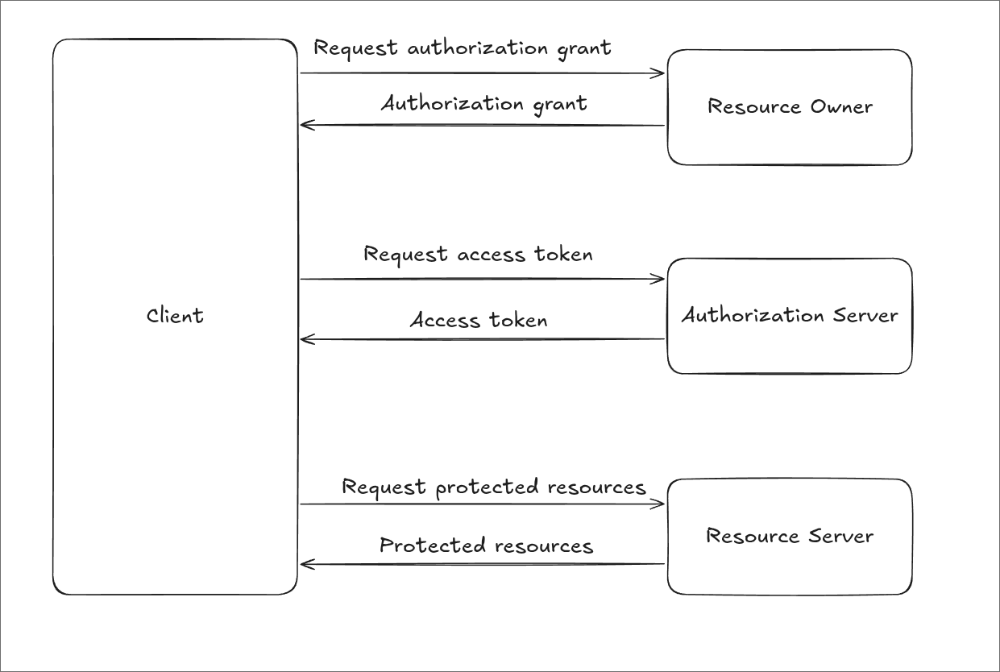

The overall flow is as follows.

1. The Client requests authorization from the Resource Owner, either directly or through the Authorization Server.
2. The Client receives an Authorization Grant representing that authorization.
3. The Client uses the Grant to request an Access Token from the Authorization Server.
4. The Authorization Server validates the Grant, authenticates the Client when required, and issues an Access Token.
5. The Client uses the Access Token to request protected resources from the Resource Server.
6. The Resource Server validates the token and the permissions required for the request, then returns a response.

### Grant Types

An Authorization Grant is a credential the Client uses to obtain an Access Token. [RFC 6749](https://datatracker.ietf.org/doc/html/rfc6749) defines the following four grant types. Not all of them are recommended today.

#### Authorization Code

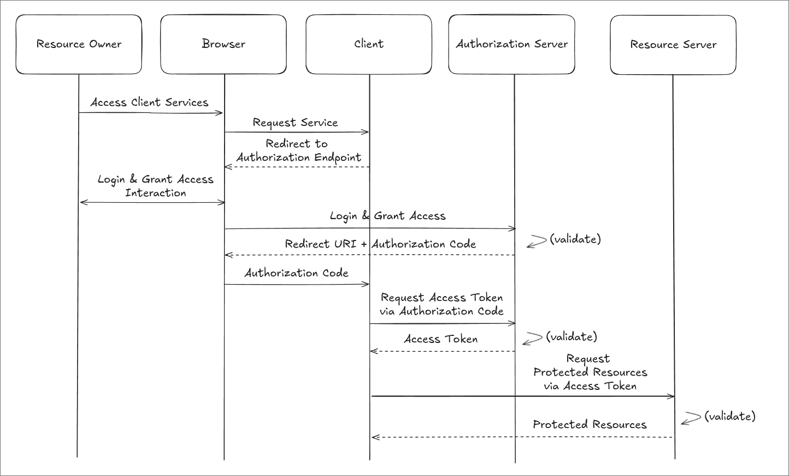

1. The Client redirects the user's browser to the Authorization Server's Authorization Endpoint.
2. The user signs in at the Authorization Server and approves access.
3. The Authorization Server delivers an Authorization Code to the Client's registered callback URI.
4. The Client exchanges the Authorization Code for an Access Token at the Token Endpoint.

This delegates access without exposing the user's username and password to the Client. It is widely used by web applications, mobile apps, and SPAs. We will look at how it works with PKCE below.

#### Implicit

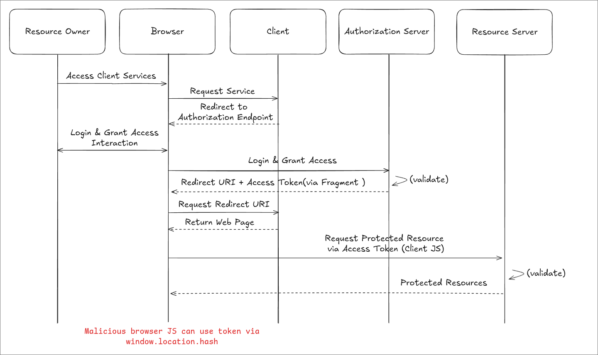

1. The Resource Owner signs in at the Authorization Server and approves access.
2. The Authorization Server returns an Access Token in the URL fragment of a redirect response.
3. The Client running in the browser reads the token and makes requests to the Resource Server.

Because this can expose tokens in the browser and redirect path, [RFC 9700](https://www.rfc-editor.org/rfc/rfc9700.html#section-2.1.2) advises against using this flow (SHOULD NOT). Use Authorization Code with PKCE instead.

#### Resource Owner Password Credentials

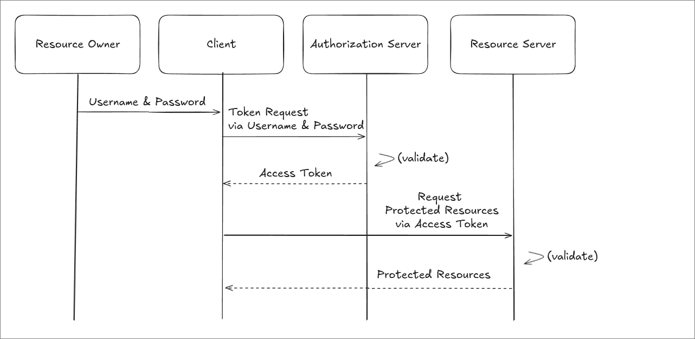

The Client receives the user's username and password directly and uses them to obtain an Access Token.
[RFC 9700](https://www.rfc-editor.org/rfc/rfc9700.html#section-2.4) prohibits this grant (MUST NOT).

#### Client Credentials

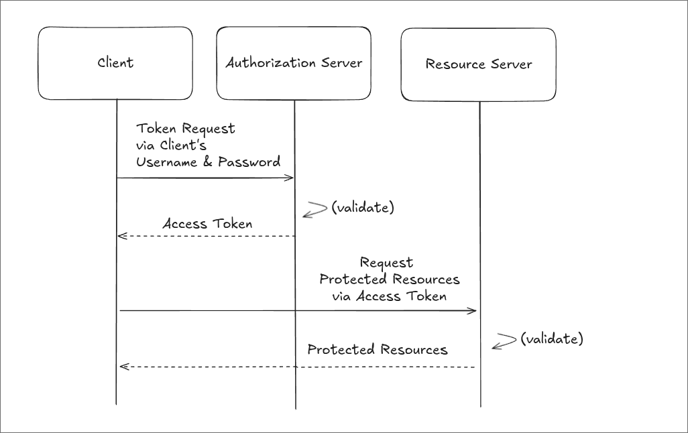

The Client obtains an Access Token using its own credentials. This is used for scenarios such as Machine-to-Machine communication, where the Client acts with its own permissions rather than delegated user permissions.

### PKCE

PKCE (Proof Key for Code Exchange) is a mechanism that **prevents an attacker from exchanging a stolen Authorization Code for an Access Token** in the Authorization Code Flow. It is pronounced “pixy.” It complements the Authorization Code Flow rather than defining a separate grant type.

Public Clients such as mobile apps and SPAs cannot safely keep a `client_secret`. As the diagram below illustrates, a flow that allows a code alone to be exchanged for a token is vulnerable if an attacker intercepts that code.

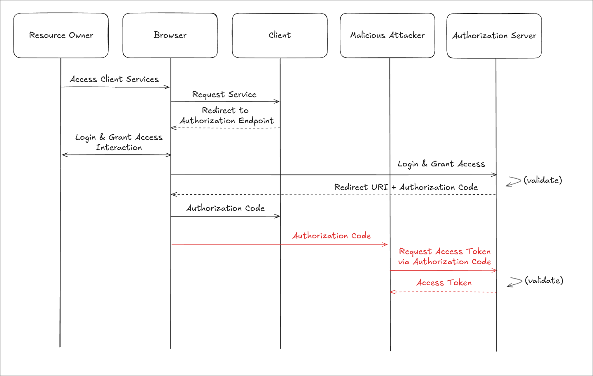

PKCE binds the Authorization Request and Token Request to the same authorization attempt. The Client generates a new secret called a `code_verifier` for each request and first sends a transformed version called a `code_challenge`. When exchanging the code later, it presents the original `code_verifier`.

The flow is as follows.

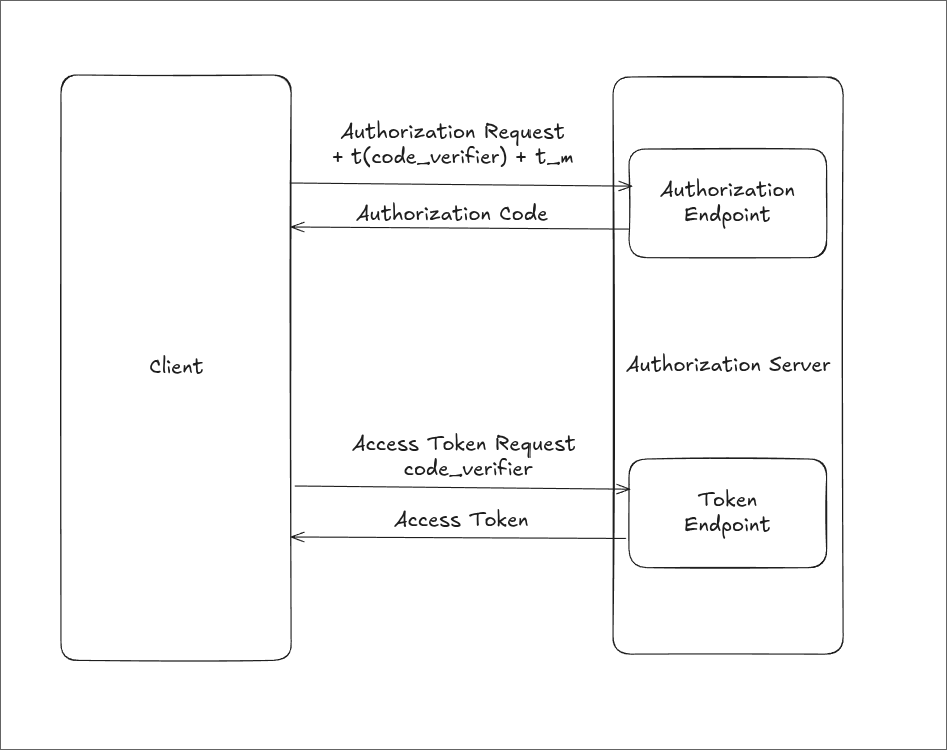

1. The Client generates a `code_verifier` and stores it with the associated authorization attempt.
    - It must be 43–128 characters long and generated using a cryptographically secure random number generator.
    - Allowed characters are uppercase and lowercase letters, digits, `-`, `.`, `_`, and `~`.
2. The Client derives a `code_challenge` and includes it in the Authorization Request.
    - `S256`: `code_challenge = BASE64URL(SHA256(ASCII(code_verifier)))`
    - Base64url encoding omits trailing `=` padding.
    - The request also includes `code_challenge_method=S256`.
    - The original specification also defines `plain`, which is the default when the method is omitted. However, a Client that supports `S256` must use it.
3. The Authorization Server associates the `code_challenge` and transformation method with the Authorization Code, then returns the code.
4. The Client sends the Authorization Code and `code_verifier` to the Token Endpoint.
5. The Authorization Server applies the same transformation to the supplied `code_verifier` and compares the result with the stored `code_challenge`. If the remaining token issuance requirements are also met, it issues an Access Token.

An attacker who obtains only the Authorization Code cannot exchange it for a token without knowing the `code_verifier`. PKCE alone cannot protect a compromised Client that also leaks the `code_verifier`.

The PKCE parameters and transformation rules are defined in [RFC 7636](https://www.rfc-editor.org/rfc/rfc7636.html). Public Clients must use PKCE, and it is also recommended for Confidential Clients. See [RFC 9700](https://www.rfc-editor.org/rfc/rfc9700.html#section-2.1.1) for the security recommendations.

---

## 🎟️ Tokens and Scopes

### Tokens

- Access Token:
    - Issued by the Authorization Server to the Client and used to call the Resource Server's APIs.
    - Usually has a short lifetime. It may be a JWT or an opaque string whose structure the Client cannot interpret.
- Refresh Token:
    - Used to obtain a new Access Token when the previous one expires. It is not sent to the Resource Server.
    - Usually lasts longer than an Access Token, but issuance and lifetime depend on service policy. Expiration or revocation may require the user to go through authorization again.
- ID Token:
    - Defined by OIDC, rather than OAuth 2.0 itself, to communicate the result of user authentication to the Client.
    - Serves a different purpose from the Access Token used to call the Resource Server. I will cover it in a future post on OIDC.

### Scopes

Scopes express the access a Client requests and receives. The `scope` parameter is a space-separated list of strings whose names and meanings are defined by each service.

- A service may combine resources and actions, as in `scope=photos:read photos:write`.
- It may also define names such as those in `scope=photo offline_access`.

The Client does not necessarily receive every scope it requests. The Authorization Server can limit access based on policy and user approval, and the Resource Server must check that each request falls within the granted permissions.

---

## 🧩 Public and Confidential Clients

OAuth classifies Clients according to their ability to keep credentials confidential.

### Confidential Client

A Confidential Client can securely store credentials such as a `client_secret` and authenticate itself at the Token Endpoint. A typical example is a web application's backend running on a server that users cannot access.

With PKCE, the Client sends `code_challenge` and `code_challenge_method` in the Authorization Request, then `code_verifier` in the Token Request. PKCE does not replace the existing Client authentication.

### Public Client

A Public Client cannot reliably keep credentials confidential. Examples include mobile apps running on a user's device and JavaScript applications running in a browser. Embedding a `client_secret` in the code does not make it secret, because users can extract it.

Public Clients can also use Authorization Code with PKCE. PKCE binds the code exchange to the original authorization request; it does not turn a Public Client into a Confidential Client.

---

## 🛡️ Validating State and Redirect URIs

### State

The `state` parameter lets the Client verify that an authorization response arriving at its callback belongs to a request it initiated. This helps defend against CSRF attacks in which an attacker injects their own authorization response into a victim's session.

The Client generates an unpredictable, single-use value, stores it with the user session and authorization attempt, and includes it in the Authorization Request.

The following Authorization URL is split across lines for readability. In an actual request, build a single URL and URL-encode the query values. `xyz123` is only an illustrative value; a real `state` value needs sufficient randomness.

```text
https://auth.example.com/authorize
    ?response_type=code
    &client_id=my-client
    &redirect_uri=https://client.com/callback
    &state=xyz123
    &code_challenge=HASH_VALUE
    &code_challenge_method=S256
```

After approval, the Authorization Server redirects to the callback URI with the same `state` value.

```http
HTTP/1.1 302 Found
Location: https://client.com/callback?code=abc123&state=xyz123
```

The Client compares the returned `state` with its stored value. This simplified example shows the comparison.

```javascript
if (!receivedState || !session.oauthState || receivedState !== session.oauthState) {
  throw new Error("Invalid OAuth state");
}
```

Reject the response if either value is missing or they do not match. Discard the `state` after successful processing so it cannot be reused.

### Redirect URI Validation

The `redirect_uri` is the Client's callback URI to which the Authorization Server delivers the Authorization Code after authorization.
The Client registers a URI such as the following with the OAuth provider in advance.

```text
https://client.com/oauth/callback
```

The Authorization Server checks that the `redirect_uri` matches a registered URI.
[RFC 9700](https://www.rfc-editor.org/rfc/rfc9700.html#section-2.1) requires exact string matching, including the path and trailing slash. A separate exception allows varying port numbers for native apps using localhost redirect URIs.

---

## 🔒 OAuth 2.0 Security

When applying these concepts in an implementation, check the following.

- Use the Authorization Code Flow with PKCE's `S256` method.
- Define separate lifetime and storage policies for Access Tokens and Refresh Tokens, and prevent tokens from appearing in logs or URLs.
- When issuing Refresh Tokens to Public Clients, use replay protection such as token rotation or sender constraints.
- Have the Client request only the scopes it needs, and enforce the granted permissions at the Authorization Server and Resource Server.
- Strictly validate registered Redirect URIs.
- Bind `state` to the session and authorization attempt, validate it, and discard it after processing.
- Use HTTPS for communication carrying authorization responses and tokens. Follow the relevant specifications for permitted exceptions, such as native apps using loopback redirects.

---

## 🧪 Hands-on: OAuth 2.0 PKCE Flow

[OAuth 2.0 Playground](https://www.oauth.com/playground/) lets you inspect each step using a simulated Authorization Server. Values such as the `client_id` and `client_secret` in the examples below must be managed appropriately in real applications.

First, register a Client and a user, then select the PKCE flow.

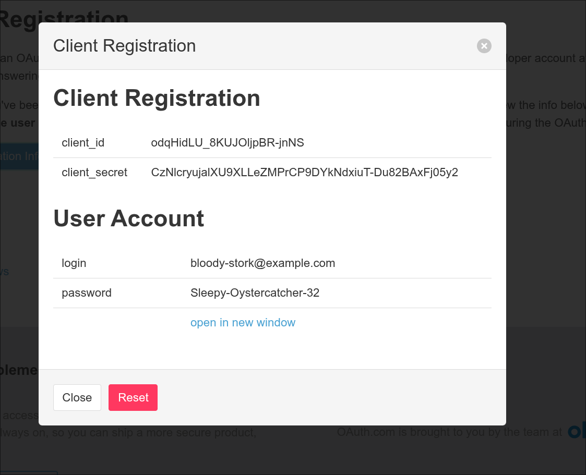

Generate a Code Verifier and Code Challenge for this authorization request.

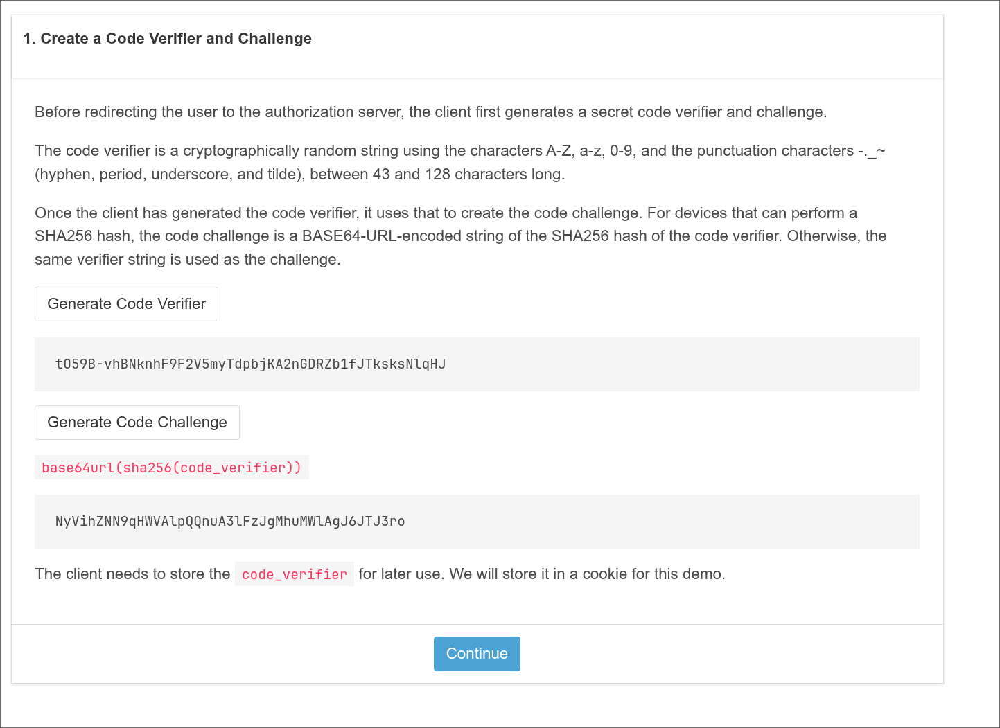

Next, build the Authorization URL. Check that it includes the generated Code Challenge, the `S256` method, the requested scopes, and `state`.

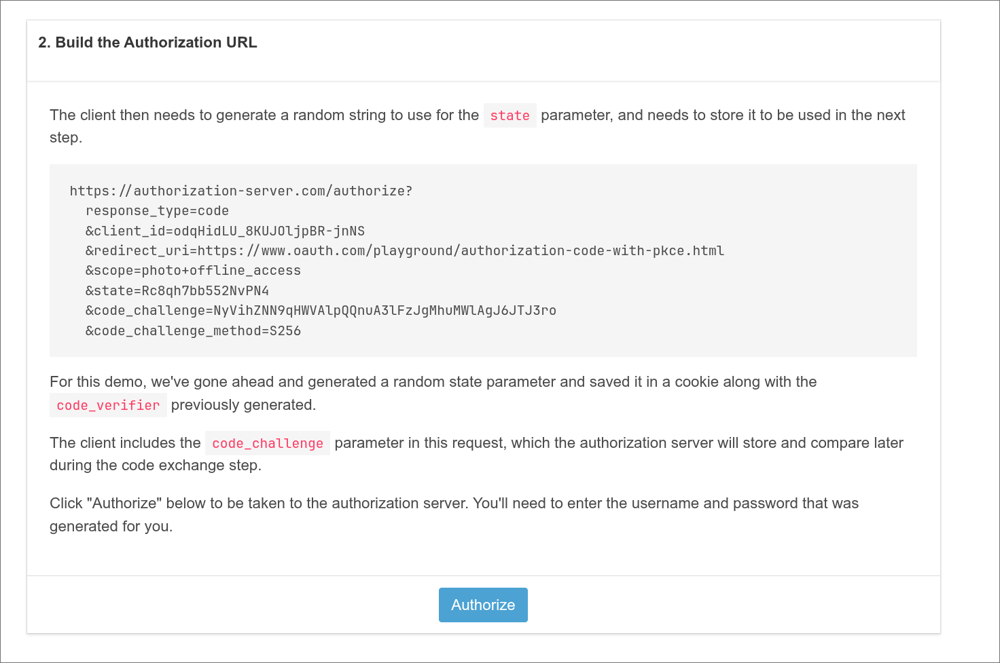

```text
https://authorization-server.com/authorize?
  response_type=code
  &client_id=odqHidLU_8KUJOljpBR-jnNS
  &redirect_uri=https://www.oauth.com/playground/authorization-code-with-pkce.html
  &scope=photo+offline_access
  &state=Rc8qh7bb552NvPN4
  &code_challenge=NyVihZNN9qHWVAlpQQnuA3lFzJgMhuMWlAgJ6JTJ3ro
  &code_challenge_method=S256
```

Open the generated URL and sign in at the Authorization Server.

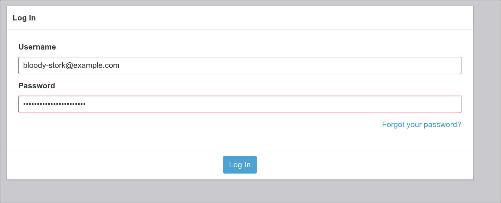

On the consent screen, review the requested permissions and approve access to photos.

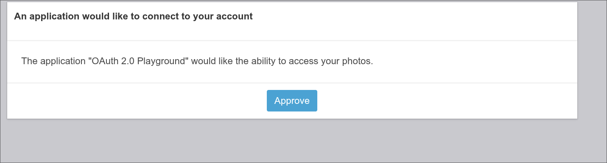

When the browser returns to the callback, compare the returned `state` with the value stored when making the request.

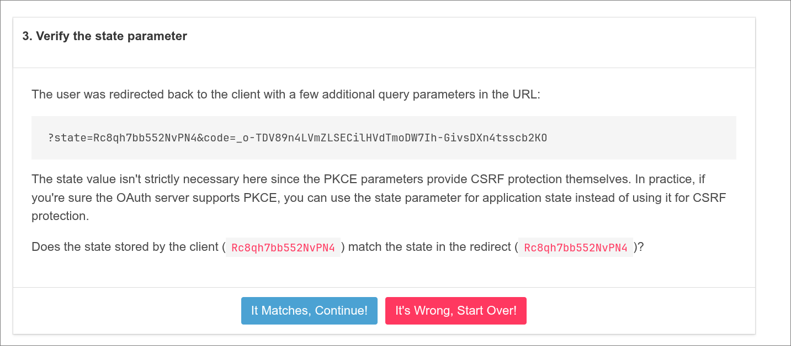

Now let's obtain an Access Token using the Authorization Code and Code Verifier.

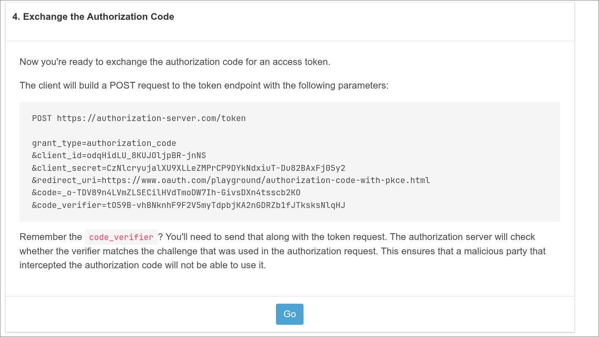

The following Playground token exchange request is split across lines for readability. The actual request body is encoded as `application/x-www-form-urlencoded`. This Playground example includes a `client_secret`, but you must not store one in a Public Client. A Public Client's PKCE request is made without a Client Secret.

```text
POST https://authorization-server.com/token
Content-Type: application/x-www-form-urlencoded

grant_type=authorization_code
&client_id=odqHidLU_8KUJOljpBR-jnNS
&client_secret=CzNlcryujalXU9XLLeZMPrCP9DYkNdxiuT-Du82BAxFj05y2
&redirect_uri=https://www.oauth.com/playground/authorization-code-with-pkce.html
&code=_o-TDV89n4LVmZLSECilHVdTmoDW7Ih-GivsDXn4tsscb2KO
&code_verifier=tO59B-vhBNknhF9F2V5myTdpbjKA2nGDRZb1fJTksksNlqHJ
```

We received the tokens! `expires_in` is the Access Token's lifetime in seconds. This example also returns a Refresh Token.

```json
{
  "token_type": "Bearer",
  "expires_in": 86400,
  "access_token": "KgDEJO3flMYLlzXYekJiBObebuIpcNhacrff-o0807yUjG3Z5T-i5NBkhef05AGIUFAAuV7Q",
  "scope": "photo offline_access",
  "refresh_token": "OkVAcOkz1Ys5cUiGq2M1o3BN"
}
```

---

## 📚 References

- [OAuth.net: OAuth 2.0](https://oauth.net/2/)
- [OAuth.com: Definitions](https://www.oauth.com/oauth2-servers/definitions/)
- [RFC 6749: The OAuth 2.0 Authorization Framework](https://datatracker.ietf.org/doc/html/rfc6749)
- [OAuth.com: Defining Scopes](https://www.oauth.com/oauth2-servers/scope/defining-scopes/)
- [OAuth 2.0 Playground](https://www.oauth.com/playground/)
- [RFC 9700: Best Current Practice for OAuth 2.0 Security](https://www.rfc-editor.org/rfc/rfc9700.html)
- [RFC 10017: OAuth 2.0 for Browser-Based Applications](https://www.rfc-editor.org/rfc/rfc10017.html)
- [RFC 7636: Proof Key for Code Exchange by OAuth Public Clients](https://www.rfc-editor.org/rfc/rfc7636.html)
