---

## 🔑 OAuth 2.0이란

OAuth 2.0은 **사용자의 자격 증명을 공유하지 않고 애플리케이션에 제한된 접근 권한을 위임하는 인가(Authorization) 프레임워크**이다.

서드파티 애플리케이션이 사용자의 ID와 비밀번호로 다른 서비스에 접근한다면 어떤 문제가 생길까?

- 서드파티 애플리케이션이 사용자의 자격 증명을 직접 받아 보관해야 한다.
- 원래 서비스가 지원하는 인증 방식에 의존하며, 비밀번호가 노출될 지점도 늘어난다.
- 필요한 일부 자원만이 아니라 사용자가 접근할 수 있는 자원 전체에 접근할 수 있다.
- 특정 애플리케이션의 접근만 취소하기 어렵다. 비밀번호를 바꾸면 같은 자격 증명을 쓰는 다른 애플리케이션도 영향을 받는다.
- 서드파티 애플리케이션이 침해되면 비밀번호와 그 비밀번호로 보호되는 데이터까지 위험해진다.


예를 들어, 사용자는 프린팅 서비스에 사진 공유 서비스의 사진을 읽을 권한만 허용할 수 있다. 프린팅 서비스는 사용자의 비밀번호를 받는 대신 Access Token으로 사진에 접근한다.

OAuth 2.0의 목적은 접근 권한 위임이다. 사용자가 누구인지 확인하는 인증(Authentication)을 다루려면 OpenID Connect(OIDC) 같은 별도의 계층이 필요하다.

---

## 🏗️ OAuth 2.0 아키텍처

### Roles

OAuth 2.0에는 네 가지 역할이 있다.

- Resource Owner: 보호된 자원에 대한 접근을 허가할 수 있는 주체이다. 일반적으로 최종 사용자이다.
- Resource Server: 보호된 자원을 제공하고, Access Token을 검증해 요청을 처리하는 서버이다.
- Client: Resource Owner의 허가를 받아 보호된 자원에 접근하는 애플리케이션이다.
- Authorization Server: Resource Owner를 인증하고 허가를 확인한 뒤 Access Token을 발급하는 서버이다.

Authorization Server와 Resource Server는 같은 시스템일 수도 있고, 별도 시스템일 수도 있다.

### 프로토콜 흐름

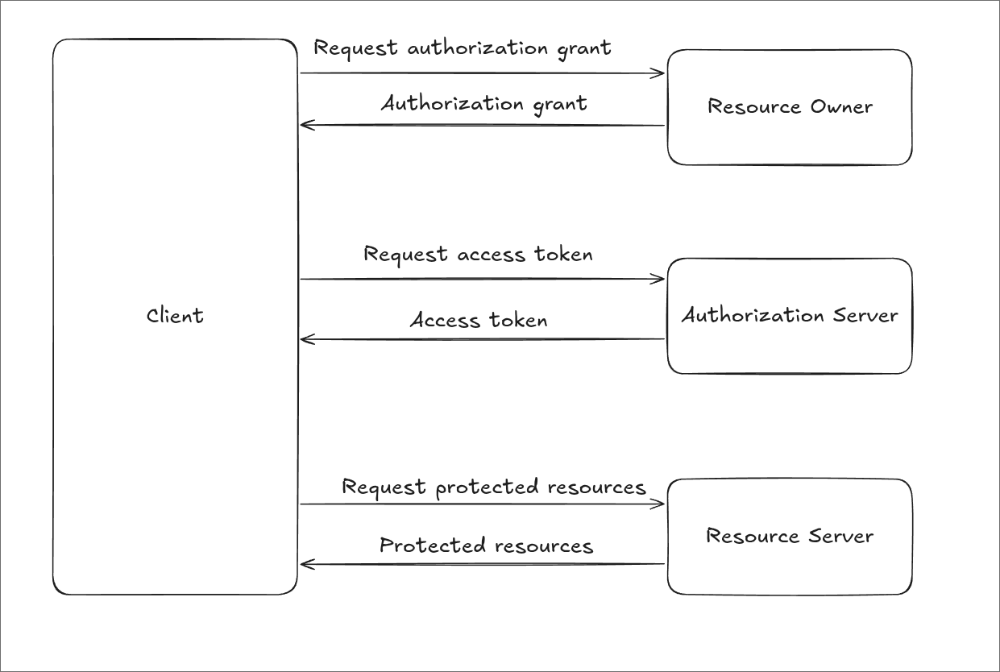

전반적인 OAuth 2.0의 흐름은 다음과 같다.

1. Client가 Resource Owner에게 인가를 요청한다. 이 요청은 직접 전달하거나 Authorization Server를 통해 중개할 수 있다.
2. Client는 인가 허가를 나타내는 Authorization Grant를 받는다.
3. Client는 Grant를 사용해 Authorization Server에 Access Token을 요청한다.
4. Authorization Server는 Grant를 검증하고 필요한 경우 Client를 인증한 뒤 Access Token을 발급한다.
5. Client는 Access Token을 사용해 Resource Server에 보호된 자원을 요청한다.
6. Resource Server는 토큰과 요청에 필요한 권한을 검증한 뒤 응답한다.

### Grant의 종류

Authorization Grant는 Client가 Access Token을 얻기 위해 사용하는 자격 증명이다. [RFC 6749](https://datatracker.ietf.org/doc/html/rfc6749)는 다음 네 가지 Grant 유형을 정의한다. 모두가 현재 권장되는 방식은 아니다.

#### Authorization Code

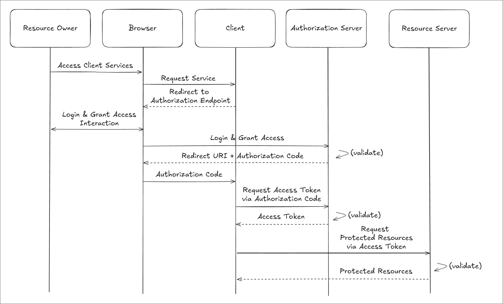

1. Client가 사용자의 브라우저를 Authorization Server의 Authorization Endpoint로 리다이렉트한다.
2. 사용자는 Authorization Server에서 로그인하고 접근을 승인한다.
3. Authorization Server는 등록된 Client의 콜백 주소로 Authorization Code를 전달한다.
4. Client는 Token Endpoint에서 Authorization Code를 Access Token으로 교환한다.

사용자의 ID와 비밀번호를 Client에 노출하지 않고 권한을 위임할 수 있다. 일반 웹 애플리케이션, 모바일 앱, SPA 등에서 널리 쓰이며, PKCE와 함께 사용하는 방식은 뒤에서 살펴본다.

#### Implicit

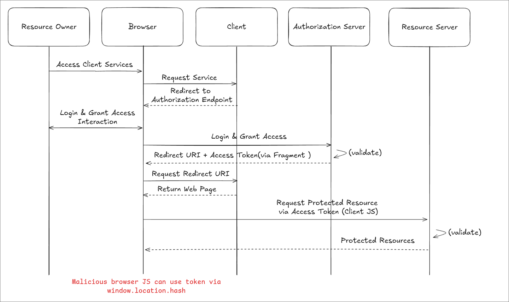

1. Resource Owner가 Authorization Server에서 로그인하고 접근을 승인한다.
2. Authorization Server는 리다이렉트 응답의 URL fragment에 Access Token을 담아 전달한다.
3. 브라우저에서 실행되는 Client가 토큰을 읽고 Resource Server에 요청한다.

토큰이 브라우저와 리다이렉트 경로에 노출될 위험이 있어, [RFC 9700](https://www.rfc-editor.org/rfc/rfc9700.html#section-2.1.2)은 이 방식의 사용을 권장하지 않는다(SHOULD NOT). 대신 Authorization Code와 PKCE를 사용한다.

#### Resource Owner Password Credentials

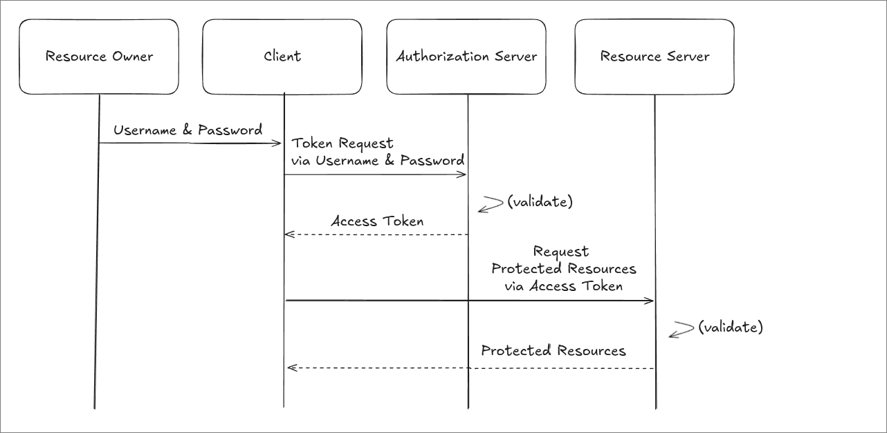

Client가 사용자의 ID와 비밀번호를 직접 받아 Access Token을 발급받는다.
[RFC 9700](https://www.rfc-editor.org/rfc/rfc9700.html#section-2.4)에서는 사용을 금지한다(MUST NOT).

#### Client Credentials

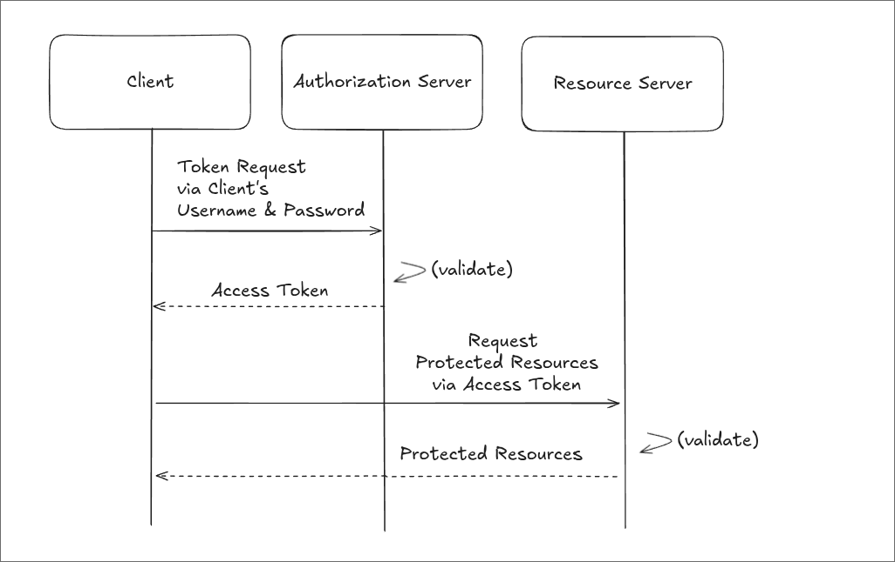

Client 자신의 자격 증명으로 Access Token을 발급받는다. 사용자의 권한 위임 없이 Client 자체의 권한으로 접근하는 서버 간 통신(Machine-to-Machine) 등에 사용한다.

### PKCE

PKCE(Proof Key for Code Exchange)는 Authorization Code Flow에서 **Authorization Code가 탈취되더라도 공격자가 이를 Access Token으로 교환하지 못하도록 보호하는 메커니즘**이다. 발음은 픽시(Pixy)이다. 별도의 Grant 유형이 아니라 Authorization Code Flow를 보완한다.

특히 모바일 앱이나 SPA 같은 Public Client는 `client_secret`을 안전하게 보관하기 어렵다. 아래 그림처럼 Authorization Code가 공격자에게 넘어가면, 코드만으로 토큰을 발급받을 수 있는 흐름은 위험하다.

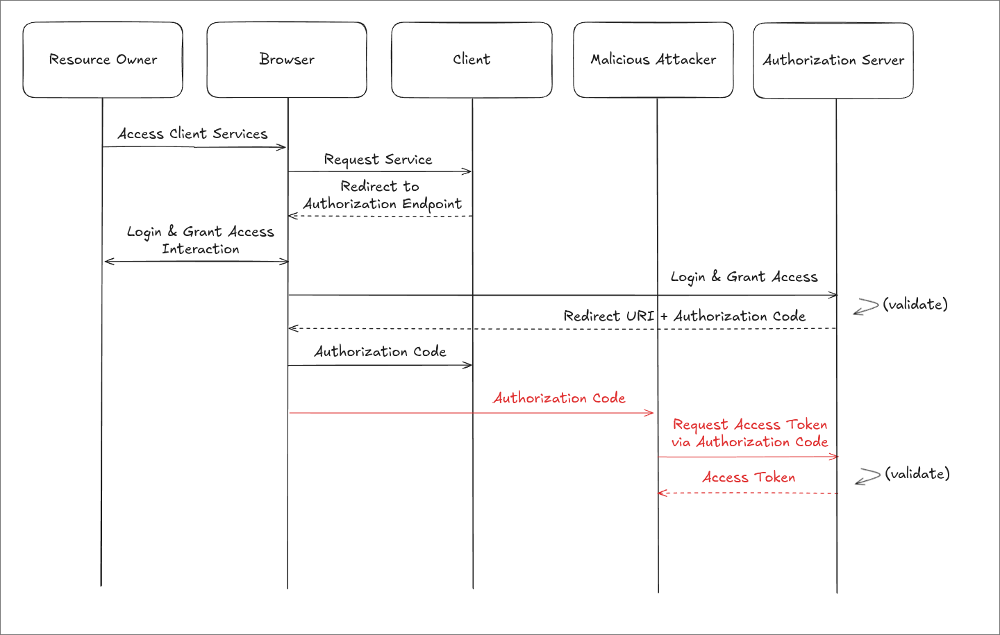

PKCE는 Authorization Request와 Token Request를 한 번의 인가 시도에 연결한다. Client는 요청마다 비밀값인 `code_verifier`를 새로 생성하고, 이를 변환한 `code_challenge`를 먼저 보낸다. 나중에 코드를 교환할 때 원래의 `code_verifier`를 제시한다.

실제 흐름은 다음과 같다.

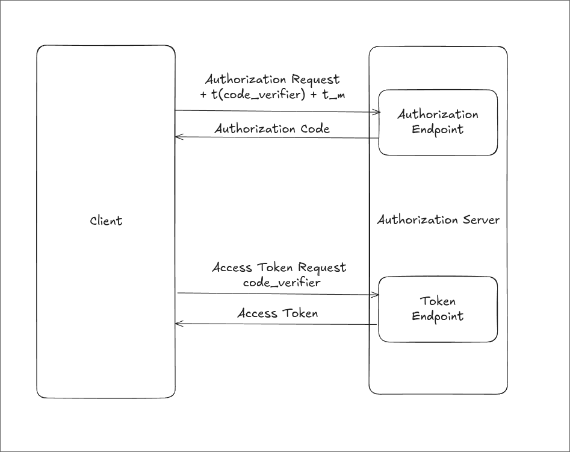

1. Client는 `code_verifier`를 생성해 해당 인가 시도와 연결하여 저장한다.
    - 길이는 43~128자이며, 암호학적으로 안전한 난수 생성기를 사용한다.
    - 허용 문자는 영문 대소문자, 숫자, `-`, `.`, `_`, `~`이다.
2. Client는 `code_challenge`를 만들어 Authorization Request에 포함한다.
    - `S256`: `code_challenge = BASE64URL(SHA256(ASCII(code_verifier)))`
    - Base64url 인코딩에서는 끝의 패딩 문자 `=`를 제거한다.
    - `code_challenge_method=S256`도 함께 보낸다.
    - 원래 규격에는 `plain` 방식과 메서드 생략 시 `plain`을 사용하는 규칙도 있지만, `S256`을 지원하는 Client는 반드시 `S256`을 사용해야 한다.
3. Authorization Server는 `code_challenge`와 변환 방식을 Authorization Code에 연결해 보관하고 코드를 반환한다.
4. Client는 Token Endpoint에 Authorization Code와 `code_verifier`를 함께 보낸다.
5. Authorization Server는 전달받은 `code_verifier`를 같은 방식으로 변환하여 저장된 `code_challenge`와 비교한다. 나머지 토큰 발급 조건도 충족하면 Access Token을 발급한다.

공격자가 Authorization Code만 얻었다면, `code_verifier`를 모르는 상태에서는 토큰으로 교환할 수 없다. 다만 Client 자체가 침해되어 `code_verifier`까지 유출된 상황을 PKCE만으로 해결할 수는 없다.

PKCE의 파라미터와 변환 규칙은 [RFC 7636](https://www.rfc-editor.org/rfc/rfc7636.html)에 정의되어 있다. Public Client는 PKCE를 사용해야 하며, Confidential Client에도 사용이 권장된다. 구체적인 보안 권고는 [RFC 9700](https://www.rfc-editor.org/rfc/rfc9700.html#section-2.1.1)을 참고하면 된다.

---

## 🎟️ Token과 Scope

### Token

- Access Token:
    - Authorization Server가 Client에 발급하며, Client가 Resource Server의 API를 호출할 때 사용한다.
    - 일반적으로 짧은 유효기간을 둔다. JWT일 수도 있고, 내부 구조를 Client가 해석할 수 없는 문자열일 수도 있다.
- Refresh Token:
    - Access Token이 만료되었을 때 새 Access Token을 발급받는 데 사용한다. Resource Server에는 보내지 않는다.
    - 일반적으로 Access Token보다 오래 유지되지만, 발급 여부와 수명은 서비스 정책에 따라 다르다. 만료되거나 철회되면 다시 인가 절차를 진행해야 할 수 있다.
- ID Token:
    - OAuth 2.0 자체가 아니라 OIDC에서 정의하며, 사용자 인증 결과를 Client에 전달한다.
    - Resource Server 호출에 사용하는 Access Token과 용도가 다르다. 자세한 내용은 [OIDC 글]()에서 다룬다.

### Scope

Scope는 Client가 요청하고 부여받는 접근 범위를 표현한다. `scope`는 공백으로 구분한 문자열 목록이며, 이름과 의미는 서비스마다 다르다.

- `scope=photos:read photos:write`처럼 자원과 작업을 조합할 수 있다.
- `scope=photo offline_access`처럼 서비스가 정의한 이름을 사용할 수도 있다.

Client가 요청한 Scope가 항상 그대로 허용되는 것은 아니다. Authorization Server는 정책과 사용자 승인에 따라 범위를 제한할 수 있고, Resource Server는 실제 요청이 허용된 범위에 속하는지 검사해야 한다.

---

## 🧩 Public Client와 Confidential Client

OAuth는 자격 증명을 안전하게 유지할 수 있는지에 따라 Client를 구분한다.

### Confidential Client

`client_secret` 같은 자격 증명을 안전하게 보관하고, Token Endpoint에서 자신을 인증할 수 있는 Client이다. 사용자가 접근할 수 없는 서버에서 실행되는 웹 애플리케이션의 백엔드가 대표적이다.

PKCE를 적용하면 Authorization Request에 `code_challenge`와 `code_challenge_method`를 보내고, Token Request에 `code_verifier`를 보낸다. 이때 PKCE는 기존 Client 인증을 대체하지 않는다.

### Public Client

자격 증명을 안전하게 유지하기 어려운 Client이다. 사용자의 기기에서 실행되는 모바일 앱이나 브라우저에서 실행되는 JavaScript 애플리케이션이 대표적이다. 코드에 `client_secret`을 넣어도 사용자가 추출할 수 있으므로 비밀로 취급할 수 없다.

Public Client도 Authorization Code와 PKCE를 사용할 수 있다. PKCE는 코드 교환 요청을 원래 인가 요청에 연결하지만, Public Client를 Confidential Client로 바꾸는 것은 아니다.

---

## 🛡️ State와 Redirect URI 검증

### State

`state`는 콜백으로 돌아온 인가 응답이 자신이 시작한 요청에 대한 것인지 확인하는 데 사용한다. 공격자가 자신의 인가 응답을 피해자의 세션에 주입하는 CSRF 공격을 방어하는 방법이다.

Client는 예측하기 어려운 일회성 값을 생성해 사용자 세션 및 인가 시도와 연결하여 저장하고, Authorization Request에 함께 보낸다.

아래는 Authorization URL을 읽기 쉽게 줄바꿈한 예시이다. 실제로는 하나의 URL로 만들고 쿼리 값을 URL 인코딩한다. `xyz123`은 설명용 값이며, 실제 `state`에는 충분한 난수성을 확보해야 한다.

```text
https://auth.example.com/authorize
    ?response_type=code
    &client_id=my-client
    &redirect_uri=https://client.com/callback
    &state=xyz123
    &code_challenge=HASH_VALUE
    &code_challenge_method=S256
```

Authorization Server는 승인 후 같은 `state`를 담아 콜백 주소로 리다이렉트한다.

```http
HTTP/1.1 302 Found
Location: https://client.com/callback?code=abc123&state=xyz123
```

Client는 저장해 둔 값과 응답의 `state`를 비교한다. 아래 코드는 비교 부분을 간략히 나타낸 예시이다.

```javascript
if (!receivedState || !session.oauthState || receivedState !== session.oauthState) {
  throw new Error("Invalid OAuth state");
}
```

값이 없거나 일치하지 않으면 응답을 거부한다. 정상 처리한 `state`도 재사용되지 않도록 폐기해야 한다.

### Redirect URI 검증

`redirect_uri`는 Authorization Server가 인가 완료 후 Authorization Code를 전달할 Client의 콜백 주소이다.
Client는 OAuth 제공자에게 다음과 같은 주소를 미리 등록한다.

```text
https://client.com/oauth/callback
```

이후, Authorization Server는 `redirect_uri`가 등록된 주소와 일치하는지 검사한다.
[RFC 9700](https://www.rfc-editor.org/rfc/rfc9700.html#section-2.1)은 정확한 문자열 일치를 요구하므로 경로와 trailing slash 등도 맞아야 한다. 네이티브 앱의 localhost 리다이렉트 URI에 대한 포트 번호 예외는 별도로 규정되어 있다.

---

## 🔒 OAuth 2.0 보안

앞에서 살펴본 내용을 실제 구현에 적용할 때는 다음을 확인한다.

- Authorization Code Flow에 PKCE의 `S256` 방식을 적용한다.
- Access Token과 Refresh Token의 수명 및 저장 정책을 구분하고, 토큰이 로그나 URL에 노출되지 않도록 한다.
- Public Client에 Refresh Token을 발급한다면 토큰 회전 또는 송신자 제한 같은 재사용 방어를 적용한다.
- Client는 필요한 최소 Scope만 요청하고, Authorization Server와 Resource Server는 허용 범위를 강제한다.
- 등록된 Redirect URI를 엄격하게 검증한다.
- `state`를 세션 및 인가 시도에 연결해 검증하고, 처리 후 폐기한다.
- 인가 응답과 토큰이 오가는 통신에 HTTPS를 사용한다. 네이티브 앱의 loopback 리다이렉트 등 규격에서 허용한 예외는 해당 지침을 따른다.

---

## 🧪 실습: OAuth 2.0 PKCE Flow

[OAuth 2.0 Playground](https://www.oauth.com/playground/)는 모의 Authorization Server로 각 단계를 확인할 수 있는 실습 환경이다. 아래 예시에서 나오는 `client_id`, `client_secret` 등의 값들은 실제로는 안전하게 관리되어야 한다.

먼저 Client와 사용자를 등록하고, PKCE 흐름을 선택한다.

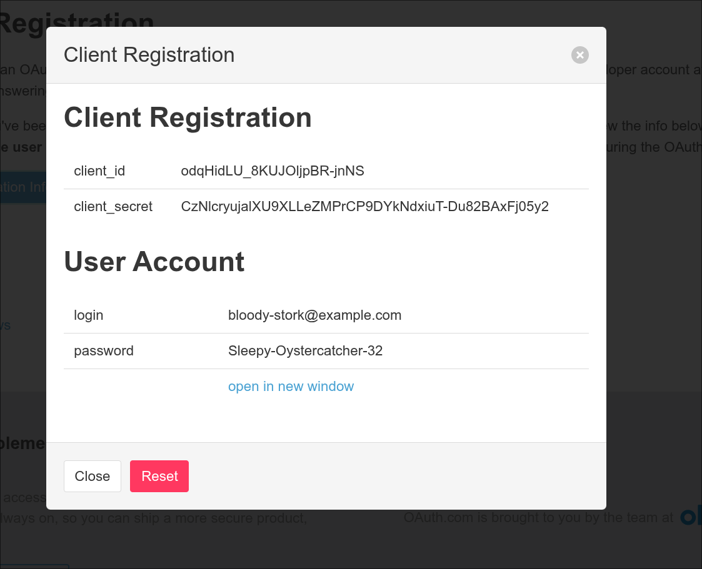

이번 인가 요청에 사용할 Code Verifier와 Code Challenge를 생성한다.

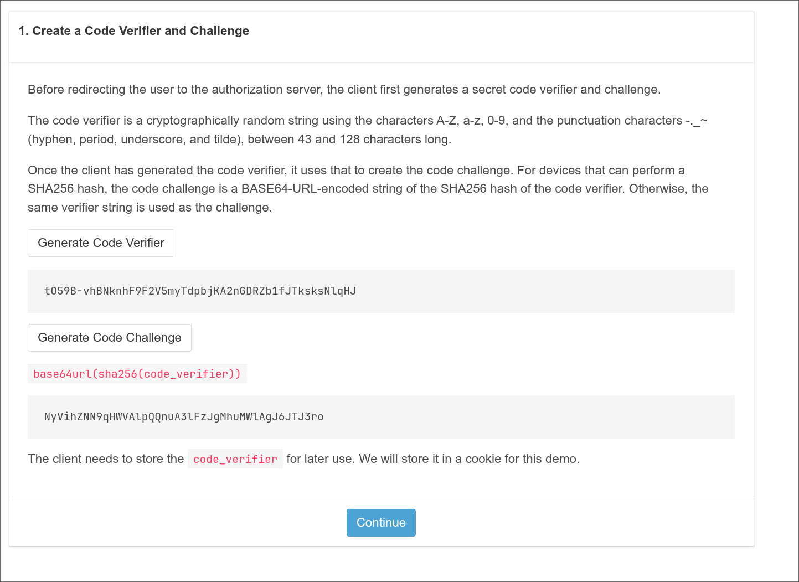

이제 Authorization URL을 만든다. 앞서 생성한 Code Challenge와 `S256` 방식, 요청한 Scope, `state`가 포함되어 있는지 확인한다.

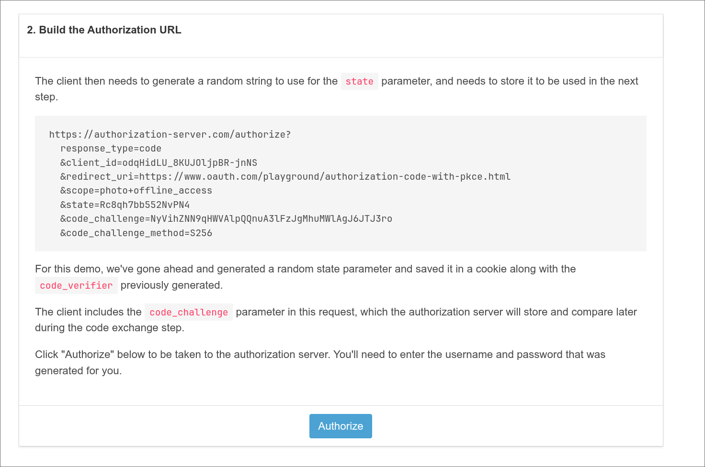

```text
https://authorization-server.com/authorize?
  response_type=code
  &client_id=odqHidLU_8KUJOljpBR-jnNS
  &redirect_uri=https://www.oauth.com/playground/authorization-code-with-pkce.html
  &scope=photo+offline_access
  &state=Rc8qh7bb552NvPN4
  &code_challenge=NyVihZNN9qHWVAlpQQnuA3lFzJgMhuMWlAgJ6JTJ3ro
  &code_challenge_method=S256
```

생성된 URL로 이동해 Authorization Server에서 로그인한다.

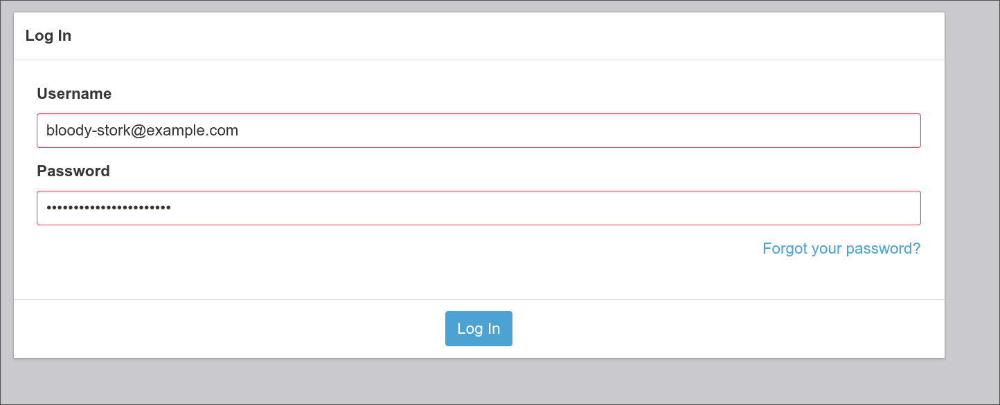

사진 접근을 허용할지 묻는 화면에서 요청한 권한을 확인하고 승인한다.

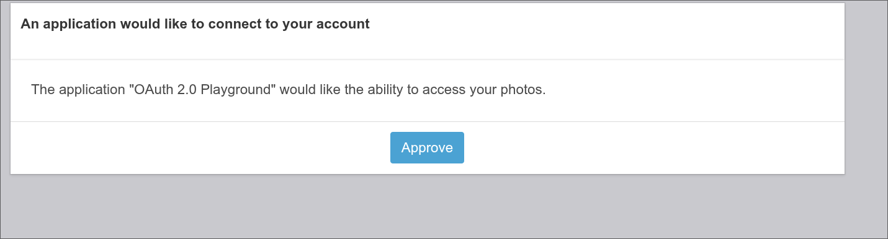

콜백으로 돌아오면 요청 시 저장한 값과 응답의 `state`를 비교한다.

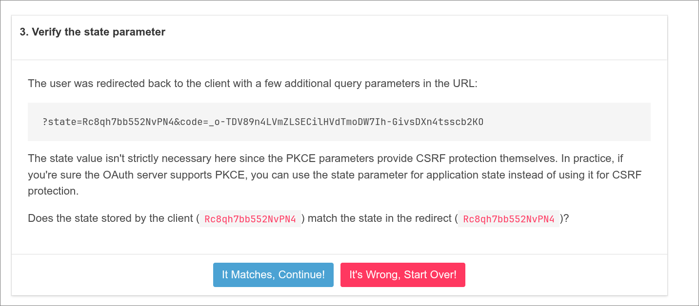

이제 Authorization Code와 Code Verifier를 사용해 Access Token을 받아보자.

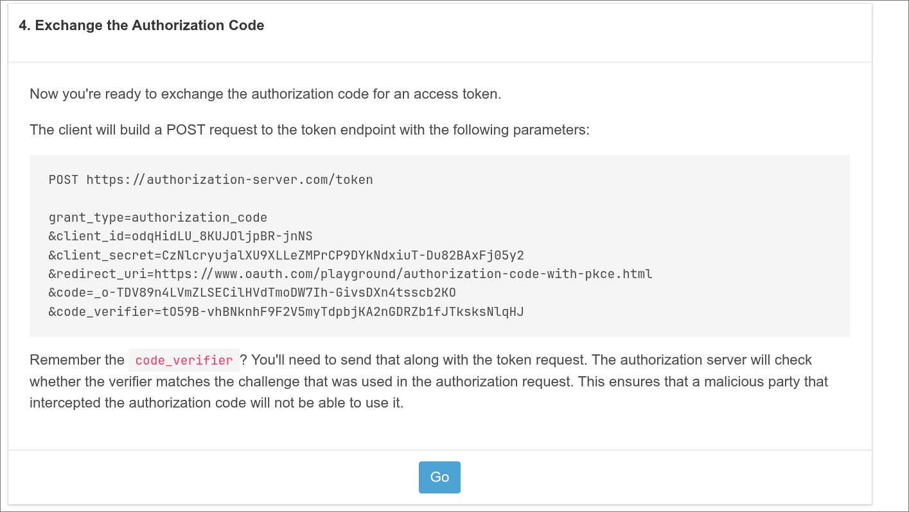

아래는 Playground의 토큰 교환 요청을 읽기 쉽게 나눈 예시이다. 실제 요청 본문은 `application/x-www-form-urlencoded` 형식으로 인코딩한다. 여기에는 Playground 예시의 `client_secret`도 포함되어 있지만, 이를 Public Client에 저장해서는 안 된다. Public Client의 PKCE 요청은 Client Secret 없이 구성한다.

```text
POST https://authorization-server.com/token
Content-Type: application/x-www-form-urlencoded

grant_type=authorization_code
&client_id=odqHidLU_8KUJOljpBR-jnNS
&client_secret=CzNlcryujalXU9XLLeZMPrCP9DYkNdxiuT-Du82BAxFj05y2
&redirect_uri=https://www.oauth.com/playground/authorization-code-with-pkce.html
&code=_o-TDV89n4LVmZLSECilHVdTmoDW7Ih-GivsDXn4tsscb2KO
&code_verifier=tO59B-vhBNknhF9F2V5myTdpbjKA2nGDRZb1fJTksksNlqHJ
```

응답으로 토큰을 받았다! `expires_in`은 Access Token의 유효기간을 초 단위로 나타낸다. 이 예시에서는 Refresh Token도 함께 발급되었다.

```json
{
  "token_type": "Bearer",
  "expires_in": 86400,
  "access_token": "KgDEJO3flMYLlzXYekJiBObebuIpcNhacrff-o0807yUjG3Z5T-i5NBkhef05AGIUFAAuV7Q",
  "scope": "photo offline_access",
  "refresh_token": "OkVAcOkz1Ys5cUiGq2M1o3BN"
}
```

---

## 📚 References

- [OAuth.net: OAuth 2.0](https://oauth.net/2/)
- [OAuth.com: Definitions](https://www.oauth.com/oauth2-servers/definitions/)
- [RFC 6749: The OAuth 2.0 Authorization Framework](https://datatracker.ietf.org/doc/html/rfc6749)
- [OAuth.com: Defining Scopes](https://www.oauth.com/oauth2-servers/scope/defining-scopes/)
- [OAuth 2.0 Playground](https://www.oauth.com/playground/)
- [RFC 9700: Best Current Practice for OAuth 2.0 Security](https://www.rfc-editor.org/rfc/rfc9700.html)
- [RFC 10017: OAuth 2.0 for Browser-Based Applications](https://www.rfc-editor.org/rfc/rfc10017.html)
- [RFC 7636: Proof Key for Code Exchange by OAuth Public Clients](https://www.rfc-editor.org/rfc/rfc7636.html)
